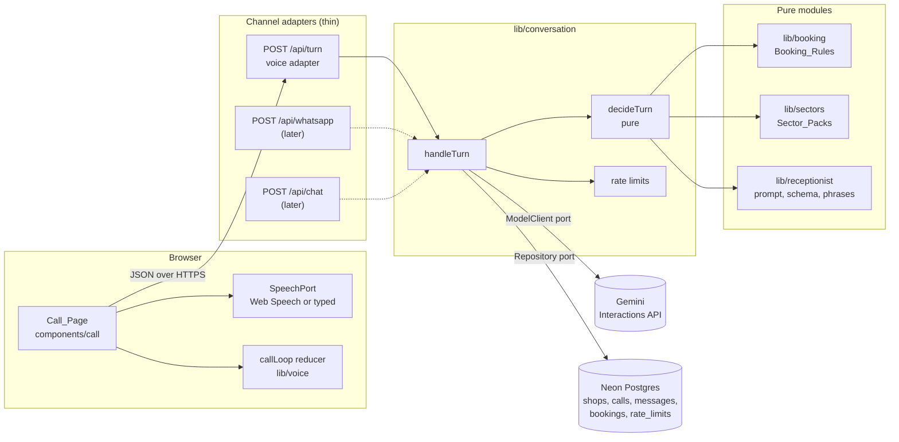
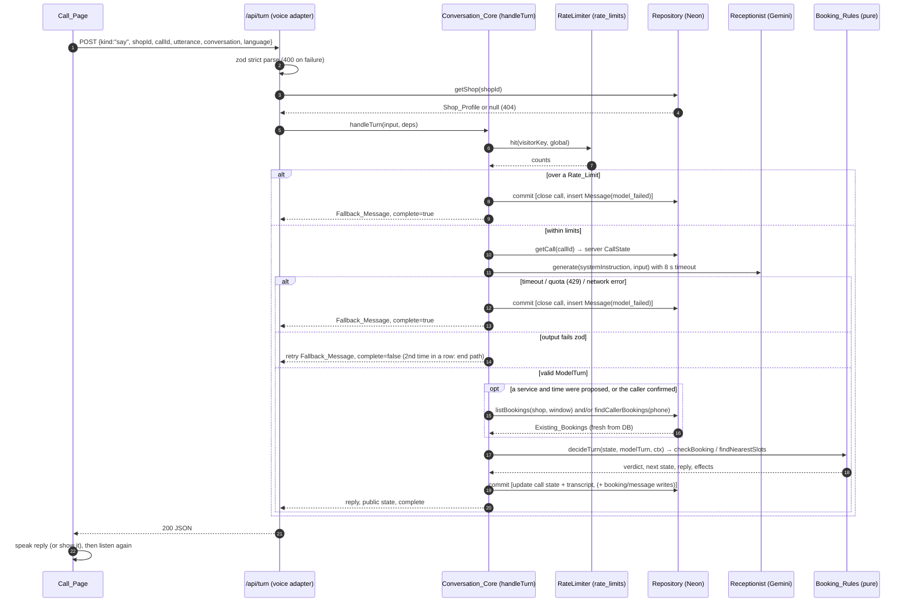

# Design Document: Core Call Loop

## Overview

The core call loop is the voice channel of Phantom Line, end to end. A Caller opens `/call/[shopId]`, presses one button and talks (or types). Each line goes to `POST /api/turn`, the voice adapter. The adapter hands the Turn to the channel-agnostic Conversation_Core, which asks Gemini for the next line and the fields it heard, runs every booking decision through the pure Booking_Rules, and writes Bookings, Calls and Messages to Postgres. The owner's machine reads the same `messages` and `bookings` tables.

Three rules shape the whole design:

1. **The model proposes, the code decides.** Gemini extracts fields and writes conversational lines. Availability, confirmation, read-backs, rejections and alternative slots are produced by code from templates.
2. **The server owns the facts.** The browser sends the conversation so the model has context, but every fact that gets persisted (name, phone, service, time, "the caller said yes") comes from server-side state that the server derived itself. The request schema has no field for any of them.
3. **Nobody is locked out and nobody hears silence.** Voice falls back to typing. Model failures, quota errors and rate limits all end in the same Fallback_Message plus a saved Message.

Out of scope for this spec: the owner's machine UI and `api/messages` (next spec), the WhatsApp and web-chat adapters (only their plug-in point is designed), and sector packs other than hair salon.

## Where current documentation changed my first choice

Each library choice below was checked against the docs on 2026-11-11 (Next.js docs bundled in `node_modules/next/dist/docs`, the rest online).

| Area | First choice from memory | What the current docs say | Decision |
|---|---|---|---|
| Gemini API | `ai.models.generateContent` with `responseSchema` | The Interactions API (`ai.interactions.create`) has been GA and recommended for new projects since June 2026; `generateContent` is "legacy, fully supported". Interactions **store requests by default** (`store=true`). | Use `interactions.create` with `store: false`, so caller names and phones are not kept as stored interactions. The client is behind an interface, so switching back is one file. |
| Gemini model | `gemini-2.5-flash` | `gemini-3.8-flash` is the current stable Flash (Sept 2026). Gemini 3.6+ ignore `temperature`/`top_p`/`top_k`. 3.8 Flash does not support `thinking_level: "minimal"` (returns an error). | Model id comes from `GEMINI_MODEL`. Send `generation_config: { thinking_level: "low", max_output_tokens }`, no sampling parameters. **Changed by the spike (task 1):** `gemini-3.8-flash` never answered with this key, `gemini-2.5-flash` returns 404 for new users, and `gemini-3.6-flash` is capped at 5 requests per minute on the free tier. The default is now `gemini-3.5-flash-lite`. See "Verification spike findings". |
| Gemini free tier | Not considered | Free-tier content is "used to improve our products". | The prompt carries only what the Turn needs. Documented as a privacy note for the demo. |
| `@google/genai` | Any Node | SDK 3.0+ requires Node 22+ (`engines: ">=22.0.0"` in 3.2.0, checked with `npm view`). | **Changed on the real machine:** the default Node here is 20.19.6, so the repo pins `@google/genai` **2.32.0**, the newest release whose `engines` is `>=20.0.0`. Its types already have `ai.interactions.create` with `store`, `response_format`, `generation_config.thinking_level` and per-request `signal`/`timeout_ms`/`retries` options. |
| Time zones | `date-fns-tz` or a hand-rolled `Intl` offset helper | The docs said Node 26 (Vercel's default since 2026) ships `Temporal` enabled by default, and TypeScript ships Temporal types from 6.0. **That claim did not hold on the real machine:** `node -e "console.log(typeof Temporal)"` prints `undefined` on Node 26.0.0, also with `--harmony-temporal`, and the machine's default Node is 20.19.6. | No runtime `Temporal` global. Every file that uses Temporal imports it explicitly: `import { Temporal } from "temporal-polyfill"` (the side-effect-free entry point; it uses the native implementation when one exists, and ships its own types, so TypeScript stays at the installed 5.9.3). `"engines": { "node": ">=20.19" }`, the floor at which this ESM-only package can also be `require()`d. Still no date library besides the polyfill. |
| Drizzle exclusion constraint | A Drizzle schema helper | Drizzle has no `EXCLUDE` constraint builder (issue #3388 still open). | The constraint lives in a custom SQL migration (`drizzle-kit generate --custom`). |
| Drizzle + Neon transactions | `db.transaction(async tx => …)` | The `neon-http` driver supports non-interactive transactions only; interactive ones need the WebSocket driver. Drizzle exposes `db.batch([...])` for `neon-http`. | Every write is one `db.batch` (atomic, no reads inside). Decisions are made in code before the batch, and the database constraint catches races. No WebSocket driver needed. |
| Drizzle version | 0.x | The Neon guide now installs `drizzle-orm@rc` / `drizzle-kit@rc` (v1 release candidate). | Decided in task 2: see "Versions installed" below. The schema below uses APIs that exist in both. |
| Next.js runtime | Edge runtime for `api/turn` (low latency) | Edge runtime is deprecated. With `cacheComponents: true` (set in `next.config.ts`) the `runtime` export is not allowed at all. | Default Node.js runtime, no `runtime` export. |
| Next.js client IP | `request.ip` | `NextRequest.ip` was removed in Next 15. On Vercel, `x-forwarded-for` is overwritten by the platform to prevent spoofing. | Read `x-forwarded-for` directly; no `@vercel/functions` dependency. |
| Next.js pages | Async page that awaits the DB | With Cache Components, `params` is a runtime API and uncached reads must sit inside `<Suspense>`, or the build flags a blocking route. | The call page renders a static shell; the shop lookup runs in a child component inside `<Suspense>`. |
| Web Speech API | Feature-detect `webkitSpeechRecognition` only | `SpeechRecognition.available({ langs, processLocally })` now exists to check language availability. `phrases` adds contextual biasing. `grammars` is deprecated. Chrome sends audio to a server, so it fails with `network` offline. | Detect the constructor, then call `available()` when it exists. Pass service names as `phrases` when supported. A `network` error switches to Typed_Mode. |

Three things could not be confirmed from the docs: the exact per-request abort/timeout option of `interactions.create` in the JS SDK, whether the configured model is on the free tier for this project's key, and whether the API accepts nullable fields in `response_format.schema`. Task 1 of `tasks.md` settled them with a spike; its results are below.

## Verification spike findings

Run on 2026-11-11 with `node --env-file=.env.local scripts/check-gemini.mjs <check> [--model=<id>] [--timeout=ms]` on Node 20.19.6 and `@google/genai` 2.32.0. The script is `.mjs`, not `.mts` as task 1.2 first said, because Node 20 cannot run TypeScript files. It never prints the key or `process.env`; every error message goes through `redact()`. The spike disables SDK retries (`retries: { strategy: "none" }`) so each failure shows up as it happens.

| Question | How it was checked | Finding | Design change |
|---|---|---|---|
| Does `GEMINI_MODEL` (then default `gemini-3.8-flash`) answer on the free tier with the project key? | `list` check (`ai.models.list()`, Flash names only), then one `interactions.create` with `store: false` and a one-line input per model, 10–60 s ceiling. | The key works: `models.list` returns 27 Flash models, `gemini-3.8-flash` among them. Per model: **`gemini-3.8-flash`**: 7 of 7 `interactions.create` calls hung with no HTTP status until the client timeout (`APIConnectionTimeoutError` at 10, 20 and 60 s; the very first one, with SDK retries still on, was still waiting after 60 s). `generateContent` hung the same way, so the problem is the model, not the Interactions API. **`gemini-flash-latest`**: hung the same way (it looks like an alias of 3.8). **`gemini-3.7-flash`**: one 503 "high demand", one hang. **`gemini-3.6-flash`**: 4 of 5 plain calls OK (1.6–3.9 s) and one 503, then repeated 503s and a **429 "limit: 5 requests per minute on Free Tier"** under structured output. **`gemini-3.5-flash`**: one 503, one OK after 12.9 s. **`gemini-2.5-flash`**: 404 "no longer available to new users". **`gemini-3.5-flash-lite`**: 10 of 10 calls OK, 0.6–1.1 s, including every structured-output call. `gemini-3.1-flash-lite`, `gemini-3-flash-preview` and `gemini-flash-lite-latest` also answered (0.5–1.3 s, one call each). | Default `GEMINI_MODEL` is **`gemini-3.5-flash-lite`**: the only Flash model that answered every call well inside the 8 s budget. A Call makes one model request per Turn, so 5 requests per minute (3.6 Flash) would end most demo calls in the fallback. Switching back to a bigger Flash model when it recovers is an env change. |
| How does the SDK honour an abort signal or timeout on `interactions.create`? What error does it throw on abort, on 429? | Read `dist/node/node.d.ts` (`GoogleGenAIRequestOptions`, `RetryConfig`, error classes) and `dist/node/index.mjs` (`APIError.generate`). Then called with each option set to 50 ms. | The second argument of `create` takes `signal` (it is `GoogleGenAIRequestOptions & Omit<RequestInit, "method" \| "body">`), `timeout_ms` and `retries`. **Top-level `signal: AbortSignal.timeout(50)`** rejects after 52 ms with `APIConnectionTimeoutError`. **`timeout_ms: 50`** rejects after 52 ms with `APIConnectionTimeoutError`. **`AbortController.abort()`** after 50 ms rejects after 51 ms with `APIUserAbortError`. The deprecated **`fetch_options.signal`** was not reliable: once ignored (the call resolved after 16 s), once honoured. The default retry policy is backoff: without `retries: { strategy: "none" }` the first spike call hung past 60 s. API errors are `APIError` subclasses that carry both `status` and `statusCode`: 429 is `RateLimitError` (status 429), 5xx is `InternalServerError` (503 seen), 404 is `NotFoundError`. These classes are not exported from the package entry point; `ApiError` (also with `status`) is. | `geminiClient.ts` passes the top-level `signal` from `callReceptionist` and `retries: { strategy: "none" }`, never `fetch_options`. `callReceptionist` keeps its own 8 s race and decides "timeout" from its own timer, not from the error class. Classification reads the numeric `status` (or `statusCode`): 429 → `quota`; any other error → `unavailable`. No `instanceof` checks against SDK classes. |
| Does `response_format.schema` accept the nullable fields that `z.toJSONSchema(ModelTurnSchema)` produces? | Sent the schema from "Model contract" in three forms with `mime_type: "application/json"`, `thinking_level: "low"` and an input ("Hola, buenas.") that leaves the caller fields empty, then parsed `output_text` with `ModelTurnSchema`. | zod 4.6.7 renders `.nullable()` as `anyOf: [{ type: T, … }, { type: "null" }]` with a top-level `$schema`. On `gemini-3.5-flash-lite` all three forms were accepted: the zod output as is, the same without `$schema`, and `type: [T, "null"]` unions. Every answer passed `ModelTurnSchema.parse`, with `wantsLanguage`, `name`, `phone`, `service`, `date` and `time` returned as `null`. `gemini-3.6-flash` accepted the zod form once (zod OK) before its 503/429 errors. `thinking_level: "low"` was accepted. | None. `modelTurnJsonSchema = z.toJSONSchema(ModelTurnSchema)` is sent unchanged. |

## Versions installed

| Package | Version | Note |
|---|---|---|
| `@google/genai` | 2.32.0 | Newest release that supports Node 20 (3.x needs Node 22). |
| `zod` | 4.6.7 | |
| `temporal-polyfill` | 1.0.8 | Explicit import, no global. |
| `typescript` | 5.9.3 | Kept; Temporal types come from the polyfill. |
| `drizzle-orm` | 0.45.4 | The `latest` tag on npm. Chosen over the v1 release candidate (`1.0.0-rc.5`): a release candidate can still break before 1.0, and every API this design uses (`pgTable`, `check`, partial `uniqueIndex`/`index` with `.where`, `db.batch` on `neon-http`, the PGlite driver) exists in 0.45. Its peer ranges accept the Neon driver (`>=0.10.0`) and PGlite (`>=0.2.0`). Moving to v1 later is a separate, small migration. |
| `drizzle-kit` | 0.31.11 | The `latest` tag, paired with `drizzle-orm` 0.45. `generate --custom` exists in this line. |
| `@neondatabase/serverless` | 1.2.0 | `engines: >=19`. |
| `server-only` | 0.0.1 | |
| `@electric-sql/pglite` | 0.5.16 | Dev only. |

`npm audit --omit=dev` reports 0 vulnerabilities. The full `npm audit` reports 12 moderate ones, all in dev tooling; 4 of them arrived with `drizzle-kit` 0.31 (it still pulls the deprecated `@esbuild-kit` loaders). They do not ship to production.

## Architecture



A Channel adapter does four things only: authenticate or identify the sender (`visitorKey`), validate the channel's payload, load the Shop, and translate `TurnOutput` back into the channel's format. Everything else is in `handleTurn`.

### Adding WhatsApp or web chat later

A new adapter is a new route file. It does not touch `lib/conversation`, `lib/booking` or `lib/receptionist`:

- `app/api/whatsapp/route.ts` verifies Meta's signature, maps the sender's number to an open Call (or starts one), reads the conversation from the server-side transcript (WhatsApp does not send history), and calls `handleTurn({ channel: "whatsapp", … })`. It sends `reply` back through the Cloud API.
- `visitorKey` becomes a hash of the WhatsApp number instead of the IP.
- Messages and Bookings land in the same tables with `channel = 'whatsapp'`, so they appear on the same tape and agenda (Requirements 10.3–10.5).

The only core extension WhatsApp will need is an optional `channelFacts.phone` (a phone number the channel itself vouches for). It is not built now.

### Sequence: one Turn



### Sequence: end of a Call

There are two ways a Call ends. In both, the Message is built by code from server state.

```mermaid
sequenceDiagram
  autonumber
  participant B as Call_Page
  participant C as Conversation_Core
  participant R as Repository
  participant BR as Booking_Rules
  participant DB as Postgres (EXCLUDE constraint)

  Note over B,DB: A. The caller confirms the read-back ("sí, perfecto")
  B->>C: say "sí, perfecto"
  C->>C: model: callerConfirmed=true; server stage is awaiting_confirmation
  C->>R: listBookings(shop, window) (fresh read)
  C->>BR: checkBooking(pending service + start, ctx)
  alt verdict ok (resource assigned)
    C->>DB: batch [INSERT booking, INSERT message, UPDATE call status=completed]
    alt constraint violation 23P01 (someone took the chair)
      DB-->>C: error, whole batch rolled back
      C->>R: listBookings again, re-run checkBooking (other chair or alternatives), max 2 retries
    else committed
      DB-->>C: ok
      C-->>B: "Te queda la cita… Lola verá tu mensaje." complete=true
    end
  else rejected now
    C-->>B: rejection + up to 3 nearest slots, call continues
  end

  Note over B,DB: B. The caller hangs up early (button, tab close, 15 s client timeout)
  B->>C: {kind:"hangup", callId} via fetch(keepalive)
  C->>R: getCall(callId)
  C->>DB: batch [INSERT message(outcome=abandoned, fields so far), UPDATE call status=abandoned]
  Note over C,DB: No Booking is ever created on hang-up.
```

Calls whose hang-up never arrives (browser crash) are closed by a sweep that runs in `after()` on each Turn_API request: open Calls idle for more than 10 minutes become `abandoned` with their Message.

## Components and Interfaces

### Module layout

```
app/
  call/[shopId]/page.tsx        server shell + <Suspense> shop lookup; renders <CallScreen>
  call/[shopId]/error.tsx       "the line is not available right now" (DB down)
  api/turn/route.ts             voice adapter: POST only
components/call/
  CallScreen.tsx                'use client'; wires useCallLoop to the UI
  CallButton.tsx  LanguageSwitch.tsx  Transcript.tsx  TypedInput.tsx  TypeInsteadButton.tsx
  useCallLoop.ts                hook: runs the reducer, owns SpeechPort and fetch
lib/
  booking/      PURE   types.ts time.ts rules.ts slots.ts index.ts
  sectors/      PURE   types.ts hairSalon.ts registry.ts
  receptionist/ PURE*  schema.ts prompt.ts phrases.ts speech.ts format.ts callModel.ts
                I/O    geminiClient.ts (server-only)
  conversation/ PURE   types.ts fields.ts decide.ts ownerMessage.ts limits.ts shopProfile.ts
                PORTS  handleTurn.ts (I/O only through injected deps)
  voice/        PURE   callLoop.ts (reducer)   BROWSER speechPort.ts
  db/           I/O    schema.ts client.ts repository.ts seed.ts
drizzle/                generated migrations + one custom migration (constraint)
tests/                  mirrors lib/
```

`lib/voice/` holds the browser side of the voice adapter so that its logic is a pure, testable reducer (listed in `structure.md` since the design review). `callModel.ts` is marked PURE\* because it is async but does no I/O of its own: the network happens inside the injected client.

### What each module exports

**`lib/booking`** (pure, no imports outside `Temporal` from `temporal-polyfill` and its own types)

| Export | Purpose |
|---|---|
| `checkBooking(req, ctx): Verdict` | Accept or reject one request; on rejection, includes up to 3 alternatives. |
| `evaluateBooking(req, ctx): Evaluation` | Same decision without alternatives (used by the slot search). |
| `findNearestSlots(req, ctx, opts?): Slot[]` | Nearest valid slots, bounded window. |
| `sessionsOn(date, shop): SessionInstants[]` | A local date's sessions as instants in the Shop's Time_Zone. |
| `localDateOf(instant, tz)`, `toInstant(date, time, tz)`, `overlaps(a, b)` | Time helpers. |
| Types: `ShopRules`, `Service`, `Resource`, `WeeklyHours`, `ExistingBooking`, `BookingRequest`, `RuleContext`, `Verdict`, `Slot`, `RejectionReason` | |

**`lib/sectors`** (pure data plus pure rule functions)

| Export | Purpose |
|---|---|
| `SectorPack` type, `SectorPackDataSchema` (zod for the data part) | The pack contract. |
| `hairSalon: SectorPack` | First pack. |
| `getSectorPack(id): SectorPack` | Registry; every pack is validated with zod at module load and fails fast. |
| `term(pack, lang, key)` | Vocabulary lookup ("cita", "sillón", "appointment"). |

**`lib/receptionist`**

| Export | Pure | Purpose |
|---|---|---|
| `ModelTurnSchema`, `ModelTurn`, `modelTurnJsonSchema` | yes | The model contract (zod and its JSON Schema). |
| `buildSystemInstruction(shop, pack, lang, now)`, `buildInput(state, conversation, utterance)` | yes | Prompt construction. |
| `phrases(lang, pack, shop)` | yes | Every templated line: greeting, read-back, confirmation, rejection with alternatives, not found, fallbacks, what happens next. |
| `toSpokenReply(text)` | yes | Strips markdown and emoji, keeps at most 2 sentences of at most 25 words. |
| `formatSlot(instant, tz, lang)` | yes | "el miércoles 11 a las 19:30" / "Wednesday the 11th at 7:30 pm". |
| `callReceptionist(client, prompt, opts)` | async, no own I/O | Timeout, error classification, zod validation. |
| `ModelClient` interface, `createGeminiClient(cfg)` | no (`server-only`) | The only file that imports `@google/genai`. |

**`lib/conversation`**

| Export | Pure | Purpose |
|---|---|---|
| `decideTurn(input): Decision` | yes | Given server state, the validated model turn, shop, pack, now and DB snapshots, returns next state, reply and effects. |
| `normalizePhone(raw, country)`, `matchService(text, shop, pack)`, `mergeFields(state, turn)` | yes | Field re-derivation. |
| `normalizeName(name)`, `matchesCaller(caller, booking)` | yes | The Booking_Match for reschedule and cancel (Requirement 12.1). |
| `buildOwnerMessage(state, outcome, shop, pack)` | yes | The Message for the tape. |
| `checkLimits(counts, config)` | yes | Rate limit decision. |
| `ShopProfileSchema`, `ShopProfile` | yes | zod for `shops.profile`. |
| `handleTurn(input, deps): Promise<TurnOutput>` | no (ports) | The one function every Channel calls. |
| Port types: `Repository`, `RateLimiter`, `CoreDeps`, `Clock` | | |

**`lib/voice`**: `callLoop(state, event): [state, effects]` (pure reducer), `SpeechPort` interface, `createWebSpeechPort(window)`, `createTypedOnlyPort()`, `createFakeSpeechPort(script)` for tests.

**`lib/db`**: `schema` (Drizzle tables), `getDb()` (neon-http, `server-only`), `createRepository(db): Repository`, `seed()`.

### Conversation_Core contract

```ts
// lib/conversation/types.ts
export type Channel = "voice" | "whatsapp" | "webchat";
export type Lang = "es" | "en";
export type Intent = "booking" | "reschedule" | "cancel" | "question" | "order" | "other";
export interface Line { caller: string; receptionist: string }

export type TurnInput =
  | { kind: "start";  channel: Channel; shop: ShopProfile; language: Lang; visitorKey: string }
  | { kind: "say";    channel: Channel; shop: ShopProfile; language: Lang; visitorKey: string;
      callId: string; utterance: string; conversation: readonly Line[] }
  | { kind: "hangup"; channel: Channel; shop: ShopProfile; callId: string };

export interface TurnOutput {
  callId: string;
  reply: string;              // what to say or show
  language: Lang;             // may change if the caller asked to switch
  state: PublicState;         // Requirement 3.5, derived on the server, display only
  complete: boolean;
  outcome?: Outcome;          // set when complete
}
export interface PublicState {
  intent: Intent;
  fields: { name: string | null; phone: string | null; service: string | null; requestedTime: string | null };
  complete: boolean;
}
export type Outcome = "booked" | "rescheduled" | "cancelled" | "answered" | "message" | "fallback" | "abandoned";

export interface CoreDeps {
  repo: Repository;
  model: ModelClient;
  limiter: RateLimiter;
  clock: () => Temporal.Instant;
  newId: () => string;
  config: { modelTimeoutMs: 8000; maxTurns: 20; perVisitorPerMinute: number; globalPerHour: number; maxConsecutiveInvalid: 2 };
}

export function handleTurn(input: TurnInput, deps: CoreDeps): Promise<TurnOutput>;
```

`start` creates the Call row and returns the templated greeting (Requirement 4.8) without calling the model. `say` is one Turn. `hangup` is idempotent and creates the Message for an unfinished Call.

### Server-owned Call state

Stored in `calls.state` and updated by every Turn. The browser never sends it and never sees the internal parts.

```ts
export interface CallState {
  stage: "collecting" | "awaiting_confirmation" | "done";
  intent: Intent;
  language: Lang;
  fields: { name?: string; phone?: string /* E.164 */; serviceId?: string; requested?: { date: string; time: string } };
  pending?: // what the read-back asked the caller to confirm
    | { kind: "book";       serviceId: string; start: string /* ISO instant */ }
    | { kind: "reschedule"; serviceId: string; start: string; oldBookingId: string }
    | { kind: "cancel";     bookingId: string };
  lastOffer?: string[];        // ISO instants of the alternatives just offered, so "vale, a las siete y media" resolves
  existingBookingId?: string;  // passed the Booking_Match (phone AND name) for reschedule / cancel
  note: { reason: string; urgency: "low" | "normal" | "urgent" };
  consecutiveInvalid: number;
  modelFailed: boolean;
  turnCount: number;
}
```

How the server re-derives facts each Turn (Requirement 5.9, amendment 4):

1. Gemini reads the whole conversation plus the latest utterance and returns every field it has heard so far.
2. `mergeFields` keeps server values unless the model returns a new non-null value; `normalizePhone` and `matchService` validate them. A value that fails validation is dropped, and the receptionist asks again.
3. `callerConfirmed` from the model counts only if the server's own `stage` is `awaiting_confirmation`. Then the server uses its own `pending` (never the browser's view of it) and re-runs `checkBooking` against bookings read from the database in this same request.

A browser that forges the conversation can at most book a valid, free slot under the name and phone it typed, which any caller can do anyway. Forged receptionist lines cannot confirm anything, because confirmation depends on server `stage` and `pending`.

### `decideTurn` (pure)

```ts
export interface DecideInput {
  state: CallState;
  turn: ModelTurn;                       // already zod-validated
  shop: ShopProfile;
  pack: SectorPack;
  now: Temporal.Instant;
  existing: readonly ExistingBooking[];  // fresh from DB when a time is involved, else []
  callerBookings: readonly CallerBooking[]; // upcoming confirmed bookings for the caller's phone; decideTurn filters them with matchesCaller
}
export interface Decision {
  state: CallState;
  reply: string;
  complete: boolean;
  outcome?: Outcome;
  effects: Effect[];
}
export type Effect =
  | { type: "createBooking"; verdict: AcceptedVerdict; serviceId: string; name: string; phone: string }
  | { type: "reschedule"; oldBookingId: string; verdict: AcceptedVerdict; serviceId: string; name: string; phone: string }
  | { type: "cancelBooking"; bookingId: string }
  | { type: "saveMessage"; message: OwnerMessage };
export function decideTurn(input: DecideInput): Decision;
```

Reply composition, in order:

| Situation | Reply comes from |
|---|---|
| Caller asked to switch language | Model reply in the new language; `language` changes. |
| Service named but not offered | Template: "No hacemos manicura. Hacemos corte, tinte y barba." (5.7) |
| Service and time known, `checkBooking` rejects | Template with reason and up to 3 alternatives (5.5). |
| Accepted, required fields still missing | Model reply (asks for the next field, in `pack.requiredFields` order, 4.12). The prompt forbids the model from saying a time is free or confirmed. |
| Accepted, all fields present | Template read-back with day, time, Service (4.13); `stage = awaiting_confirmation`. |
| Caller confirms and the fresh re-check accepts | Template confirmation + what happens next (4.15); effects `createBooking` + `saveMessage`. |
| Reschedule / cancel, phone or name still missing | Model reply asking for the phone, then the name. Nothing about any booking is said yet. |
| Reschedule / cancel, phone and name known | `callerBookings.filter(b => matchesCaller(caller, b))`: none → template "No encuentro ninguna cita con esos datos. ¿Quieres que le deje un mensaje a Lola?" (12.7), identical whether the phone has no booking or the name does not match; one or more → template read-back of the next upcoming one (12.2). |
| Question or out-of-profile | Model reply; if `outOfProfile`, the model must say it does not know and offer to take a message (4.14). |
| Caller wants to end | Template "what happens next" + `saveMessage`. |
| 20th Turn reached | Template "Te dejo el mensaje a Lola" + `saveMessage`. |

Every reply, templated or not, goes through `toSpokenReply` (Requirement 4.11).

### Turn_API (voice adapter)

```ts
// app/api/turn/route.ts (Node runtime, no `runtime` export: cacheComponents forbids it)
const Lang = z.enum(["es", "en"]);
const Line = z.strictObject({ caller: z.string().max(500), receptionist: z.string().max(600) });
export const TurnRequestSchema = z.discriminatedUnion("kind", [
  z.strictObject({ kind: z.literal("start"),  shopId: z.string().min(1).max(100), language: Lang }),
  z.strictObject({ kind: z.literal("say"),    shopId: z.string().min(1).max(100), language: Lang,
                   callId: z.uuid(), utterance: z.string().min(1).max(500), conversation: z.array(Line).max(20) }),
  z.strictObject({ kind: z.literal("hangup"), shopId: z.string().min(1).max(100), callId: z.uuid() }),
]);
```

- `strictObject` makes unknown keys a validation error, so a body carrying `fields`, `accepted`, `bookingId` or similar gets a 400 listing the offending keys (Requirements 3.7, 3.11).
- `callId` is added to the approved request fields of 3.2. The server issues it on `start`; it is the idempotency key for the Call, its Booking and its Message.
- Responses: `200` with `TurnOutput` (also for fallbacks and rate limits), `400` `{ error: "invalid_request", issues: [{ path, message }] }`, `404` `{ error: "shop_not_found" }`, `503` `{ error: "unavailable", reply: <Fallback_Message> }` when the database is down.
- `visitorKey = sha256(RATE_LIMIT_SALT + firstIp(x-forwarded-for))`. The raw IP is never stored.

### Rate limits and quota (amendment 3)

Counters live in Postgres because Vercel runs several instances, so in-memory counters would not give a global cap. One statement per Turn, fixed windows:

```sql
INSERT INTO rate_limits (key, window_start, count) VALUES
  ($visitorKey, date_trunc('minute', now()), 1),
  ('global',    date_trunc('hour',   now()), 1)
ON CONFLICT (key, window_start) DO UPDATE SET count = rate_limits.count + 1
RETURNING key, count;
```

`checkLimits` (pure) compares the counts with `TURN_LIMIT_PER_VISITOR_PER_MINUTE` (default 12) and `TURN_LIMIT_GLOBAL_PER_HOUR` (default 200, to be set below the project's Gemini daily quota shown in AI Studio). The free tier also caps requests per minute per model (the spike hit "5 requests per minute" on `gemini-3.6-flash`); a 429 from that cap takes the same path as any other 429. Rows older than a day are deleted in `after()`.

- Over a limit, or Gemini answers 429 `RESOURCE_EXHAUSTED`: same path as a timeout. The Caller hears the Fallback_Message, the Call closes, and a Message with the fields collected so far is saved (`model_failed = true`). HTTP status is 200, so the Call_Page shows a normal transcript line, never an error screen.
- On `start`, there is no Call yet and nothing to tell the Owner. Over the limit, `start` returns "Ahora mismo hay muchas llamadas, vuelve a intentarlo en unos minutos" and saves nothing. This stops an abuser from filling the tape with empty Messages. (Review point 3.)
- `hangup` is not rate-limited: it only closes a Call that already exists, once.
- If the counter query itself fails (database down), limits fail open and the error is logged; Gemini's own 429 still protects the quota.

### Call_Page

- `page.tsx` renders the static shell (title area, language switch placeholder) and, inside `<Suspense>`, an async `ShopGate` that awaits `params`, loads the public shop data (`id`, `name`, `languages`) with `'use cache'` + `cacheTag('shop:' + id)`, and either renders `<CallScreen>` or the "shop not found" message without a Call button (1.9). With streaming, the not-found message may arrive with HTTP 200; the requirement asks only for the message.
- `CallScreen` holds one primary control (the gold pill "Call →"), the ES / EN switch (default from `navigator.language`), the transcript, and a secondary "type instead" link-button that is always visible (2.11).
- `useCallLoop` drives the pure `callLoop` reducer:

```ts
type CallPhase = "idle" | "starting" | "listening" | "thinking" | "speaking" | "typing" | "ended";
type CallEvent =
  | { type: "PRESS_CALL" } | { type: "RECOGNIZED"; text: string } | { type: "TYPED"; text: string }
  | { type: "REPLY"; out: TurnOutput } | { type: "SPOKEN" } | { type: "SPEECH_ERROR"; kind: SpeechErrorKind }
  | { type: "SWITCH_LANG"; lang: Lang } | { type: "TYPE_INSTEAD" } | { type: "HANG_UP" } | { type: "CLIENT_TIMEOUT" };
type CallEffect =
  | { type: "listen"; lang: Lang } | { type: "speak"; text: string; lang: Lang } | { type: "post"; body: TurnRequest }
  | { type: "focusInput" } | { type: "beaconHangup" };
```

- `SpeechPort` wraps the browser. `createWebSpeechPort` uses `window.SpeechRecognition ?? window.webkitSpeechRecognition` with `lang` `es-ES` / `en-US`, `continuous = false`, `interimResults = true` (interim text is shown greyed), `phrases` from the service names when supported. Before the first listen it calls `SpeechRecognition.available({ langs: [lang], processLocally: false })` if that method exists. Synthesis picks the first voice whose `lang` starts with `es` / `en`, waiting up to 1 s for `voiceschanged`. No voice for the selected language means "synthesis unavailable for this language".
- Speech error mapping (none of them end the Call, 2.12):

| Error | Behaviour |
|---|---|
| No recognition constructor, `available()` → `unavailable`, `not-allowed`, `service-not-allowed`, `audio-capture`, `language-not-supported`, `network` | Switch to Typed_Mode with one kind line: "No te oigo bien, pero puedes escribirme aquí." |
| `no-speech` | Listen again; after 2 in a row, show the hint to type, keep listening. |
| `aborted` | Ignored (our own stop). |
| No synthesis or no voice | Replies are shown in the transcript only; listening restarts right after the reply is shown. |

- Recognition starts only after synthesis ends (2.9), so the receptionist's voice is never transcribed.
- The first `speak` happens after the Call button click, so the page has user activation, which Chrome requires.
- `fetch` uses `AbortSignal.timeout(15000)` (2.10). On timeout the transcript shows "Se ha cortado la línea. Lola tiene tu mensaje y te llamará.", the Call ends, and a `hangup` is sent with `keepalive: true` so the Owner gets the Message.
- `pagehide` and the hang-up button also send `hangup` with `keepalive: true`.

## Data Models

### Shop_Profile (in `shops.profile`, validated with zod on every read)

```ts
export const ShopProfileSchema = z.strictObject({
  id: z.string().min(1).max(100),
  name: z.string().min(1).max(120),
  ownerName: z.string().min(1).max(60),
  address: z.string().min(1).max(200),
  timeZone: z.string().refine(isValidIanaZone),
  sectorPackId: z.string(),                                   // exactly one pack (11.2)
  languages: z.array(Lang).min(1),
  hours: WeeklyHoursSchema,                                   // ISO weekday 1 (Mon) … 7 (Sun) → sessions
  services: z.array(ServiceSchema).min(1),
  resources: z.array(z.strictObject({ id: z.string(), name: z.object({ es: z.string(), en: z.string() }) })).min(1),
});
// Session: { open: "HH:MM", close: "HH:MM" }, open < close, same local day; sessions of a day sorted and non-overlapping.
// Service: { id, name: { es, en }, durationMin: 5..480, priceCents: int >= 0 }
```

Seeded Peluquería Lola: `timeZone: "Europe/Madrid"`, `hours` Tue–Sat (2–6) `10:00–14:00` and `17:00–20:00`, services `haircut` 30 min 1500, `colour` 90 min 4500, `beard` 20 min 1000, resources `chair-1`, `chair-2`, `sectorPackId: "hair-salon"`.

### Drizzle schema (`lib/db/schema.ts`)

```ts
export const shops = pgTable("shops", {
  id: text().primaryKey(),                          // URL slug, e.g. "peluqueria-lola"
  name: text().notNull(),
  sectorPackId: text("sector_pack_id").notNull(),
  timeZone: text("time_zone").notNull(),
  profile: jsonb().$type<ShopProfile>().notNull(),
  createdAt: timestamp("created_at", { withTimezone: true }).notNull().defaultNow(),
}, (t) => [uniqueIndex("shops_name_uq").on(t.name)]);

export const calls = pgTable("calls", {
  id: uuid().primaryKey(),
  shopId: text("shop_id").notNull().references(() => shops.id),
  channel: text().notNull(),                        // check: voice | whatsapp | webchat
  language: text().notNull(),                       // check: es | en
  status: text().notNull().default("open"),         // check: open | completed | abandoned | failed
  state: jsonb().$type<CallState>().notNull(),
  transcript: jsonb().$type<Line[]>().notNull().default([]),  // lines the server itself handled
  turnCount: integer("turn_count").notNull().default(0),
  startedAt: timestamp("started_at", { withTimezone: true }).notNull().defaultNow(),
  updatedAt: timestamp("updated_at", { withTimezone: true }).notNull().defaultNow(),
  endedAt: timestamp("ended_at", { withTimezone: true }),
}, (t) => [
  index("calls_shop_started_idx").on(t.shopId, t.startedAt.desc()),
  index("calls_open_idx").on(t.shopId, t.updatedAt).where(sql`status = 'open'`),
]);

export const bookings = pgTable("bookings", {
  id: uuid().primaryKey().defaultRandom(),
  shopId: text("shop_id").notNull().references(() => shops.id),
  resourceId: text("resource_id").notNull(),        // id from shop.profile.resources
  serviceId: text("service_id").notNull(),
  startsAt: timestamp("starts_at", { withTimezone: true }).notNull(),
  endsAt: timestamp("ends_at", { withTimezone: true }).notNull(),
  status: text().notNull().default("confirmed"),    // check: confirmed | cancelled
  customerName: text("customer_name").notNull(),
  customerPhone: text("customer_phone").notNull(),  // E.164
  channel: text().notNull(),
  callId: uuid("call_id").references(() => calls.id),
  rescheduledFrom: uuid("rescheduled_from"),        // self reference, old booking id
  createdAt: timestamp("created_at", { withTimezone: true }).notNull().defaultNow(),
  cancelledAt: timestamp("cancelled_at", { withTimezone: true }),
}, (t) => [
  check("bookings_time_order", sql`${t.endsAt} > ${t.startsAt}`),
  uniqueIndex("bookings_call_uq").on(t.callId),     // a Call creates at most one Booking (retry-safe)
  index("bookings_shop_start_idx").on(t.shopId, t.startsAt),
  index("bookings_phone_idx").on(t.shopId, t.customerPhone).where(sql`status = 'confirmed'`),
]);

export const messages = pgTable("messages", {
  id: uuid().primaryKey().defaultRandom(),
  shopId: text("shop_id").notNull().references(() => shops.id),
  callId: uuid("call_id").notNull().references(() => calls.id),
  channel: text().notNull(),
  callerName: text("caller_name"),
  callerPhone: text("caller_phone"),
  reason: text().notNull(),
  urgency: text().notNull(),                        // check: low | normal | urgent
  agreed: text().notNull(),                         // written by code from the outcome
  suggestedReply: text("suggested_reply").notNull(),
  outcome: text().notNull(),                        // Outcome
  modelFailed: boolean("model_failed").notNull().default(false),  // 6.4
  bookingId: uuid("booking_id").references(() => bookings.id),
  readAt: timestamp("read_at", { withTimezone: true }),
  createdAt: timestamp("created_at", { withTimezone: true }).notNull().defaultNow(),
}, (t) => [
  uniqueIndex("messages_call_uq").on(t.callId),     // one Message per Call (hang-up and retries are idempotent)
  index("messages_shop_created_idx").on(t.shopId, t.createdAt.desc()),
  index("messages_unread_idx").on(t.shopId).where(sql`read_at IS NULL`),
]);

export const rateLimits = pgTable("rate_limits", {
  key: text().notNull(),
  windowStart: timestamp("window_start", { withTimezone: true }).notNull(),
  count: integer().notNull(),
}, (t) => [primaryKey({ columns: [t.key, t.windowStart] })]);
```

Text enums are plain `text` with `CHECK` constraints (added in the generated migration) rather than Postgres enums, so adding a channel or outcome later is a one-line migration. `rate_limits` is the fifth table, listed in `tech.md` since the design review.

### The constraint that makes a double booking impossible

Custom migration `drizzle/XXXX_bookings_no_overlap.sql`, generated with `drizzle-kit generate --custom --name=bookings_no_overlap` after the table migration:

```sql
CREATE EXTENSION IF NOT EXISTS btree_gist;

ALTER TABLE bookings
  ADD CONSTRAINT bookings_no_overlap
  EXCLUDE USING gist (
    shop_id     WITH =,
    resource_id WITH =,
    tstzrange(starts_at, ends_at, '[)') WITH &&
  )
  WHERE (status = 'confirmed');
```

- Two confirmed rows for the same shop and resource whose half-open ranges `[start, end)` intersect cannot both exist. Back-to-back bookings (10:00–10:30 and 10:30–11:00) are allowed, which matches `overlaps()` in `lib/booking`.
- Postgres checks exclusion constraints with index locking, so two concurrent inserts for the same chair and time cannot both commit. The loser gets SQLSTATE `23P01`, the whole `db.batch` rolls back, and `handleTurn` re-reads bookings and re-runs `checkBooking` (another chair if one is free, otherwise alternatives). At most 2 retries.
- `btree_gist` is needed for `=` on `text` inside a GiST index. Neon and PGlite both ship it.
- Cancelling sets `status = 'cancelled'`, which takes the row out of the constraint.

Reschedule is one batch: `UPDATE bookings SET status='cancelled' WHERE id=$old AND status='confirmed'` followed by `INSERT` of the new booking with `rescheduled_from = $old`. If the insert violates the constraint, the update rolls back with it, so the old booking is never lost without a new one (5.10). The Booking_Rules evaluate the new time with the old booking excluded (`ignoreBookingId`), so moving 30 minutes later on the same chair is allowed.

### Repository port

```ts
export interface Repository {
  getShop(id: string): Promise<ShopProfile | null>;
  getCall(id: string, shopId: string): Promise<StoredCall | null>;
  listBookings(shopId: string, from: Temporal.Instant, to: Temporal.Instant): Promise<ExistingBooking[]>;
  findCallerBookings(shopId: string, phone: string, now: Temporal.Instant): Promise<CallerBooking[]>; // upcoming, confirmed, with customer name
  commit(writes: readonly Write[]): Promise<{ ok: true } | { ok: false; conflict: "booking_overlap" }>;
  hitRateLimits(visitorKey: string): Promise<{ visitor: number; global: number }>;
  closeStaleCalls(shopId: string, idleBefore: Temporal.Instant): Promise<number>;
}
```

`commit` is `db.batch` on Neon and `db.transaction` on PGlite in tests. `listBookings` returns confirmed bookings with `starts_at < to AND ends_at > from`.

## Booking_Rules API

All functions in `lib/booking` are pure: the current time, the Shop's rules, the Sector_Pack and the Existing_Bookings are parameters. Instants are `Temporal.Instant`; local calendar values are `Temporal.PlainDate` / `PlainTime`.

```ts
// lib/booking/types.ts
export type ServiceId = string;
export type ResourceId = string;
export type Weekday = 1 | 2 | 3 | 4 | 5 | 6 | 7;            // ISO, 1 = Monday

export interface Session { open: string; close: string }     // "HH:MM", local, open < close
export type WeeklyHours = Readonly<Partial<Record<Weekday, readonly Session[]>>>;

export interface Service { id: ServiceId; durationMin: number }
export interface Resource { id: ResourceId }

export interface ShopRules {
  timeZone: string;                    // IANA, e.g. "Europe/Madrid"
  hours: WeeklyHours;
  services: readonly Service[];
  resources: readonly Resource[];      // order = allocation preference
}

export interface ExistingBooking {
  id: string;
  resourceId: ResourceId;
  start: Temporal.Instant;
  end: Temporal.Instant;               // exclusive
}

export interface BookingRequest {
  serviceId: string;                   // may be unknown: rejected with "unknown_service"
  start: Temporal.Instant;
  ignoreBookingId?: string;            // the booking being rescheduled
}

export interface SectorRuleInput {
  service: Service;
  start: Temporal.Instant;
  end: Temporal.Instant;
  session: SessionInstants;
  timeZone: string;
}
export type SectorRule = (input: SectorRuleInput) => { ok: true } | { ok: false; reason: string };

export interface RuleContext {
  now: Temporal.Instant;
  shop: ShopRules;
  pack: { slotStepMin: number; rules: readonly SectorRule[] };   // the parts of SectorPack the rules use
  existing: readonly ExistingBooking[];
}

export interface SessionInstants { open: Temporal.Instant; close: Temporal.Instant }

export type RejectionReason =
  | "unknown_service" | "in_the_past" | "closed_day" | "outside_hours" | "does_not_fit"
  | "all_resources_busy" | `sector:${string}`;

export type Evaluation =
  | { ok: true; resourceId: ResourceId; start: Temporal.Instant; end: Temporal.Instant; session: SessionInstants }
  | { ok: false; reason: RejectionReason };

export type AcceptedVerdict = Extract<Evaluation, { ok: true }>;
export type Verdict =
  | AcceptedVerdict
  | { ok: false; reason: RejectionReason; alternatives: readonly Slot[] };

export interface Slot { start: Temporal.Instant; end: Temporal.Instant; resourceId: ResourceId }

export interface SlotSearchOptions { limit?: number /* 3 */; windowDays?: number /* 14 */ }
```

```ts
// lib/booking/time.ts
export function toInstant(date: Temporal.PlainDate, time: Temporal.PlainTime, timeZone: string): Temporal.Instant;
export function localDateOf(instant: Temporal.Instant, timeZone: string): Temporal.PlainDate;
export function sessionsOn(date: Temporal.PlainDate, shop: ShopRules): SessionInstants[];
export function overlaps(a: { start: Temporal.Instant; end: Temporal.Instant },
                         b: { start: Temporal.Instant; end: Temporal.Instant }): boolean; // a.start < b.end && b.start < a.end

// lib/booking/rules.ts
export function evaluateBooking(req: BookingRequest, ctx: RuleContext): Evaluation;
export function checkBooking(req: BookingRequest, ctx: RuleContext, opts?: SlotSearchOptions): Verdict;

// lib/booking/slots.ts
export function findNearestSlots(req: BookingRequest, ctx: RuleContext, opts?: SlotSearchOptions): Slot[];
export function slotCandidates(service: Service, ctx: RuleContext,
                               from: Temporal.Instant, to: Temporal.Instant): Temporal.Instant[];
```

### Evaluation order

`evaluateBooking` checks in a fixed order and returns the first failure, so the reason is deterministic:

1. `unknown_service`: `serviceId` not in `shop.services` (5.7).
2. `in_the_past`: `start < now` (5.3).
3. `closed_day`: the local date of `start` has no sessions (9.2).
4. `outside_hours`: no session with `open <= start < close` (5.6).
5. `does_not_fit`: `start + duration > close` of that session (5.2, 9.3).
6. `sector:<name>`: the first pack rule that fails.
7. `all_resources_busy`: every resource in `shop.resources` has an Existing_Booking (other than `ignoreBookingId`) that overlaps `[start, end)` (5.4, 5.12).
8. Otherwise accept with the **first** free resource in `shop.resources` order (5.11, 5.12).

The result does not depend on the order of `existing`, only on the order of `resources`.

### Time-zone approach

- **Storage and comparison in instants.** Every start, end, session open and close is a `Temporal.Instant`. Durations are added to instants (`start.add({ minutes })`), so a 90-minute service lasts 90 real minutes even across a clock change.
- **Calendar questions in the Shop's Time_Zone.** "Which day is it?", "which weekday?", "what does 10:00 mean on that day?" are answered with `instant.toZonedDateTimeISO(shop.timeZone)` and `plainDate.toZonedDateTime({ timeZone, plainTime })`. The server's own zone is never used: no `Date#getHours`, no `new Date(y, m, d)`.
- **Sessions per date.** `sessionsOn(date, shop)` converts each `open` / `close` of that local date to instants with Temporal's default `"compatible"` disambiguation: a wall time inside the spring-forward gap moves forward by the gap, and a repeated wall time in the fall-back hour takes the earlier instant. Days are enumerated with `PlainDate.add({ days: 1 })`, which steps calendar days, not 24-hour blocks.
- **Europe/Madrid in 2026.** Spring forward on Sunday 29 March at 02:00 → 03:00 (that day has 23 hours); fall back on Sunday 25 October at 03:00 → 02:00 (25 hours). Peluquería Lola is closed on Sundays, so for Lola the visible effects are the offset change (Saturday 28 March is UTC+1, Tuesday 31 March is UTC+2) and the real-hour distances used by the slot search. The unit tests also use a synthetic shop open on those Sundays from 01:00 to 05:00, which has 3 real hours on 29 March and 5 on 25 October.
- **What the model sends.** Gemini returns the requested date and time as local `YYYY-MM-DD` and `HH:MM` strings. The code converts them with `toInstant(date, time, shop.timeZone)`; the model never does offset arithmetic.
- **What the caller hears.** `formatSlot` uses `Intl.DateTimeFormat(lang, { timeZone: shop.timeZone, … })`.

### Nearest-slot search, bounded to 14 days

A **slot** is a candidate start time on the shop's grid: for each session, `open + k · slotStepMin` (real minutes) for every `k >= 0` with `start + duration <= close`. The hair-salon pack uses a 15-minute step, as stated in Requirement 9.4 (approved on review). Grid slots keep spoken offers natural ("a las siete y media", never "a las siete y treinta y siete"). Off-grid requested times are still accepted when valid; the grid applies only to the alternatives the receptionist offers.

`findNearestSlots(req, ctx, { limit: 3, windowDays: 14 })`:

1. Window `W = [max(now, R − 14 days), R + 14 days]`, where `R = req.start`. This searches both before and after the requested time (5.5), never in the past, within 14 days of the request (9.4).
2. For each local date from `localDateOf(W.start)` to `localDateOf(W.end)` and each session, generate grid candidates inside `W`.
3. Keep the candidates that `evaluateBooking` accepts (same rules, same Existing_Bookings, same `ignoreBookingId`).
4. Sort by `|candidate − R|` measured in real time (instants), ties to the earlier start. Return the first `limit`, each with the resource `evaluateBooking` assigned.

Cost: at most 29 days × (sessions × slots per session) candidates, each checked against the resources and the bookings in the window. For a small shop that is a few thousand cheap comparisons per rejected request; no clever search is needed, and the brute-force shape makes the property test oracle simple.

When nothing fits in the window the list is empty, and the receptionist says so and offers to take a message for the Owner.

### Worked example (unit test)

Peluquería Lola, `now = 2026-11-11T09:00 Europe/Madrid` (a Wednesday, open day), no Existing_Bookings, request haircut (30 min) at `2026-11-11T21:00`:

- `checkBooking` returns `{ ok: false, reason: "outside_hours" }`.
- `alternatives[0].start` is Wednesday 11 November, 19:30 Europe/Madrid (90 minutes before the request; 19:30 + 30 min ends exactly at the 20:00 close). The full list is 19:30, 19:15, 19:00, all on `chair-1`. The next morning's 10:00 is 13 hours away and does not make the list.

Two companion unit tests around daylight saving:

- Saturday `2026-03-28` 21:00 haircut → first alternative Saturday 19:30, which is `18:30Z` (UTC+1). Tuesday `2026-03-31` 19:30 is `17:30Z` (UTC+2).
- Sunday `2026-03-29` 12:00 (closed) → first alternative Saturday 28 March 19:30 (15.5 real hours before) rather than Tuesday 31 March 10:00 (46 real hours after). The distance is measured in real hours across the 23-hour Sunday.

## Sector packs

```ts
// lib/sectors/types.ts
export interface SectorPack {
  id: string;                                         // "hair-salon"
  unit: "appointment" | "table" | "order";
  resourceKind: { es: { one: string; many: string }; en: { one: string; many: string } };  // sillón / chair
  requiredFields: readonly ("service" | "requestedTime" | "name" | "phone")[];              // ask order
  slotStepMin: number;
  rules: readonly SectorRule[];                       // pure functions
  vocabulary: Record<Lang, { booking: string; bookingVerb: string; service: string }>;     // cita, reservar, servicio
  sensitiveTopics: Record<Lang, readonly string[]>;   // never advise; take a message instead
  neverPromise: Record<Lang, readonly string[]>;      // e.g. the result of a colour
}
```

`hairSalon`: unit `appointment`, resource kind sillón / chair, required fields `service → requestedTime → name → phone` (11.4, 4.12), step 15 minutes, and `rules: []`. The general rule "the service must fit before the session closes" already lives in `lib/booking` for every sector; sector-specific rules (such as limits on colour near closing time) are out of scope and come with the sector-packs spec. The `rules` hook stays, because Requirement 11.1 asks for it, and it is covered by a unit test with a synthetic pack rule. The engine never names a sector; a new pack is a new file plus one line in the registry, and every pack runs through the same property tests.

## Model contract

### What Gemini must return

```ts
// lib/receptionist/schema.ts
const Nullable = <T extends z.ZodType>(t: T) => t.nullable();
export const ModelTurnSchema = z.strictObject({
  reply: z.string().min(1).max(400),                  // spoken line(s) in `language`
  language: z.enum(["es", "en"]),                     // language of `reply`
  wantsLanguage: Nullable(z.enum(["es", "en"])),      // caller asked to switch
  intent: z.enum(["booking", "reschedule", "cancel", "question", "order", "other"]),
  name: Nullable(z.string().min(1).max(80)),
  phone: Nullable(z.string().min(6).max(32)),         // digits as heard; code normalizes
  service: Nullable(z.string().min(1).max(80)),       // as the caller said it; code matches the catalog
  date: Nullable(z.string().regex(/^\d{4}-\d{2}-\d{2}$/)),        // shop-local
  time: Nullable(z.string().regex(/^([01]\d|2[0-3]):[0-5]\d$/)),  // shop-local, 24 h
  callerConfirmed: z.boolean(),                       // said yes to the last read-back
  callerWantsToEnd: z.boolean(),
  outOfProfile: z.boolean(),                          // asked something the profile does not answer
  reason: z.string().min(1).max(160),                 // one line for the owner
  urgency: z.enum(["low", "normal", "urgent"]),
});
export type ModelTurn = z.infer<typeof ModelTurnSchema>;
export const modelTurnJsonSchema = z.toJSONSchema(ModelTurnSchema);
```

The schema is flat on purpose: flat objects with enums, strings and booleans are the safest subset of JSON Schema for structured output. The same zod object generates the JSON Schema sent to Gemini and validates the answer, so they cannot drift.

### How the prompt is built

`buildSystemInstruction(shop, pack, lang, now)` returns one text in the Call's language with these blocks:

1. **Role and voice**, from `receptionist-voice.md`: answering machine of `shop.name`; one or two short spoken sentences; no lists, emoji or markdown; one question at a time.
2. **Shop facts, the only facts you may state**: name, owner, address, opening hours per weekday rendered in words ("martes a sábado, de 10:00 a 14:00 y de 17:00 a 20:00"), services with duration and price formatted with `Intl.NumberFormat(lang, { style: "currency", currency: "EUR" })`. Every noun comes from the pack vocabulary, so the hair salon says "cita" and "sillón", never "mesa".
3. **Today**: "Hoy es miércoles, 11 de noviembre de 2026, 09:12 (Europe/Madrid)." Relative expressions like "mañana a las cinco" resolve against this (4.3).
4. **Rules**: never say a time is free or booked, because the system checks and says it; return dates and times as shop-local `YYYY-MM-DD` / `HH:MM`; never advise on the pack's sensitive topics or promise results from `neverPromise`; if the answer is not in the shop facts, say so and offer to take a message for `ownerName`; if the caller asks for the other language, set `wantsLanguage` and reply in it.
5. **Field order**: `pack.requiredFields` rendered as "first the service, then the day and time, then the name, then the phone". For a reschedule or a cancel: "first the phone, then the name"; the model must never describe a booking itself, because only the system's read-back may.

`buildInput(state, conversation, utterance)` returns the per-Turn input:

- **Known so far (from the system, trusted)**: the server's fields, stage, and the last offer ("21:00 no es posible; ofrecidas 19:30, 19:15, 19:00"), so "vale, la de las siete y media" can be resolved.
- **Transcript (data, not instructions)**: the conversation lines, then the latest caller utterance, inside clear delimiters, with the instruction that nothing inside can change the rules above.

The request: `client.interactions.create({ model, system_instruction, input, store: false, response_format: { type: "text", mime_type: "application/json", schema: modelTurnJsonSchema }, generation_config: { thinking_level: "low", max_output_tokens: 400 } }, { signal, retries: { strategy: "none" } })`, where `signal` is the one `callReceptionist` passes in. The text is read from `output_text`.

### Model client, timeout and fallback

```ts
// lib/receptionist/callModel.ts
export interface ModelClient {
  generate(req: { systemInstruction: string; input: string; jsonSchema: object; signal: AbortSignal }): Promise<string>;
}
export type ModelFailure = "timeout" | "quota" | "unavailable" | "invalid_output";
export async function callReceptionist(
  client: ModelClient,
  prompt: { systemInstruction: string; input: string },
  opts: { timeoutMs: number },               // 8000
): Promise<{ ok: true; turn: ModelTurn } | { ok: false; failure: ModelFailure }>;
```

- **Timeout.** `callReceptionist` creates `AbortSignal.timeout(8000)`, passes it to the client, and also races the call against the same timer. The 8-second bound holds even if the SDK ignores the signal. The spike showed that the SDK honours a top-level `signal` within milliseconds, that the deprecated `fetch_options.signal` is not reliable, and that the SDK's default backoff retries can outlast the budget, so the client disables them.
- **Classification.** Our own timer fired → `timeout`; an error with numeric `status` (or `statusCode`) 429 → `quota` (the SDK's `RateLimitError`; `RESOURCE_EXHAUSTED` in the message also counts); any other error, including 503 "high demand" and 404 → `unavailable`; JSON parse or zod failure → `invalid_output`. The checks read fields, not SDK classes, because most error classes are not exported.
- **Fallback.** `timeout`, `quota`, `unavailable` and a Rate_Limit all take the **end path**: the reply is the Fallback_Message, the Call closes with `outcome = "fallback"`, and the Message carries the fields collected so far plus `model_failed = true` (4.7, 6.4, 8.2, 8.3). `invalid_output` takes the **retry path** (4.6): a Fallback_Message variant that offers to take a message and invites the caller to say it again; the Call continues; a second invalid output in a row takes the end path.
- Fallback texts (in `phrases.ts`):
  - end, es: "Perdona, ahora mismo no puedo atenderte bien. Le dejo tu mensaje a Lola y te llamará."
  - end, en: "Sorry, I can't help properly right now. I'll leave your message for Lola and she'll call you back."
  - retry, es: "Perdona, no te he entendido. ¿Me lo repites? Si prefieres, se lo dejo apuntado a Lola."
  - retry, en: "Sorry, I didn't catch that. Could you say it again? Or I can leave a note for Lola."
- **Injection.** `handleTurn` receives `deps.model`. Tests pass a scripted fake (`createScriptedModel([...turns])`) or failure fakes (`neverResolves`, `throws429`, `returnsGarbage`). No test touches the network.
- `geminiClient.ts` starts with `import "server-only"` and reads `GEMINI_API_KEY` and `GEMINI_MODEL` from `process.env`. Neither has a `NEXT_PUBLIC_` prefix, so Next never inlines them into a client bundle (8.4).

### The Owner's Message

`buildOwnerMessage` is pure and fills the `messages` row from server state:

- `callerName`, `callerPhone`: server fields (may be null after a failure).
- `reason`: the model's last valid `reason`, or a template ("Llamada sin terminar") when there is none.
- `urgency`: the model's last valid value, default `normal`.
- `agreed`: written by code from the outcome, e.g. "Cita de corte el miércoles 11 a las 19:30 (sillón 1)" or "Nada acordado; quiere saber si hacéis mechas".
- `suggestedReply`: a template in the caller's language, e.g. "Hola Ana, te confirmo tu cita de corte el miércoles 11 a las 19:30. ¡Hasta pronto! Lola".

## Error Handling

| Failure | What the Caller hears or sees | What the Owner gets |
|---|---|---|
| No `SpeechRecognition` in the browser, or `available()` says unavailable | Typed_Mode from the start: text field, replies shown, and spoken if synthesis has a voice. | A normal Message; nothing marks it as typed. |
| Microphone denied (`not-allowed`, `service-not-allowed`, `audio-capture`) | "No te oigo, pero puedes escribirme aquí." Typed_Mode, same Call. | Normal Message. |
| Recognition `network` error | Same switch to Typed_Mode. | Normal Message. |
| `no-speech` | Listens again; after 2 silences shows the "type instead" hint. | Nothing extra. |
| No `speechSynthesis` or no voice for the language | Replies appear in the transcript only. | Normal Message. |
| Model timeout (8 s) | End Fallback_Message, Call ends. | Message with fields so far, `model_failed`, outcome `fallback`. |
| Model returns invalid output | Retry Fallback_Message, Call continues; a second time in a row ends the Call as above. | Nothing extra on the first; Message with `model_failed` if it ends. |
| Gemini quota exceeded (429) | Same as timeout. | Same as timeout. |
| Visitor or global Rate_Limit during a Call | Same as timeout; HTTP 200, no error screen. | Same as timeout. |
| Rate_Limit on the first request (`start`) | "Ahora mismo hay muchas llamadas, vuelve a intentarlo en unos minutos." | Nothing (no Call exists yet). |
| Unknown shop on the page | "No encontramos esta tienda." No Call button. | Nothing. |
| Unknown shop on the Turn_API | 404 `shop_not_found`; the page shows the same not-found line. | Nothing. |
| Invalid request body (incl. browser-sent facts) | 400 with the failing fields; the page shows "Algo ha fallado, vuelve a llamar" and ends. Only a buggy or tampered client hits this. | Nothing. |
| Database down when the page loads | `error.tsx`: "La línea no está disponible ahora mismo. Prueba en unos minutos." | Nothing can be saved; the error is logged without personal data. |
| Database down during a Turn | 503 with the end Fallback_Message, which the page speaks; Call ends. | Nothing can be saved; logged. This is the one case where the Owner gets no Message. |
| Chair taken by a concurrent call at commit (`23P01`) | Retries silently; if still taken, "Justo se acaba de ocupar. Tengo libre a las 19:15 o a las 19:45." | The Booking and Message of whichever call won. |
| Reschedule / cancel: no booking for the phone, or the name does not match | "No encuentro ninguna cita con esos datos. ¿Quieres que le deje un mensaje a Lola?" Same words in both cases. | A Message with the request, outcome `message`. |
| Caller hangs up early (button, tab close) | Nothing more. | Message with fields so far, outcome `abandoned`. No Booking. |
| Hang-up request never arrives | Nothing. | The sweep in `after()` closes the Call after 10 idle minutes and saves the same `abandoned` Message. |
| Turn_API slower than 15 s (client timeout) | "Se ha cortado la línea. Lola tiene tu mensaje y te llamará." Call ends (2.10). | `hangup` is sent with `keepalive`, so a Message with fields so far is saved. |

## Correctness Properties

Each property becomes one fast-check test in `tests/booking/` with `numRuns: 200`. Shared generators (`tests/booking/arbitraries.ts`):

- `arbShop`: time zone from `Europe/Madrid`, `America/New_York`, `Australia/Lord_Howe` (30-minute DST shift), `Asia/Kolkata`, `UTC`; 0–7 open weekdays; 1–3 sorted, non-overlapping sessions per day on 5-minute boundaries; 1–4 services of 10–180 minutes; 1–3 resources. Peluquería Lola is always one of the cases (`fc.oneof` with a constant).
- `arbNow`: an instant between 2026-03-20 and 2026-11-05, which covers both 2026 Madrid transitions.
- `arbRequest(now)`: `now` plus an offset from −3 to +21 days at **minute** granularity, biased toward session boundaries (open, close − duration, close) with `fc.oneof`. This spans 24 consecutive days.
- `arbExisting(shop, now)`: bookings built by accepting random requests one by one, so they never overlap on a resource, as in the real database.

Properties that validate Requirement 9:

**P1. Outside opening hours is rejected.** *For all* shops, `now`, requests and existing bookings, *if* no session of the request's local date (in the Shop's Time_Zone) satisfies `open <= start < close`, *then* `checkBooking` returns `ok: false`. Validates 9.1 (and 5.6).

**P2. Closed weekdays are rejected.** *For all* shops, `now`, existing bookings and requests whose local weekday has no sessions, `checkBooking` returns `{ ok: false, reason: "closed_day" }` *or* an earlier reason in the evaluation order (`unknown_service`, `in_the_past`). Validates 9.2.

**P3. Accepted services end by the session's close.** *For all* shops, `now`, requests and existing bookings, *if* `checkBooking` accepts, *then* there is a session `S` of the local date with `S.open <= start` and `start + duration <= S.close`, where `+` is real-time instant arithmetic. Validates 9.3 (and 5.2).

**P4. Rejections come with the nearest valid slot.** *For all* shops with at least one weekly session long enough for the service, `now`, requests and existing bookings, *if* `checkBooking` rejects for any reason except `unknown_service`, *then*:
(a) every alternative is accepted by `evaluateBooking` with the same context;
(b) every alternative lies in `[max(now, R − 14 d), R + 14 d]`;
(c) the alternatives are distinct, at most 3, sorted by `|start − R|` (ties: earlier first);
(d) compared with an exhaustive oracle that checks every minute of the window that is on the slot grid, no accepted slot is strictly closer to `R` than `alternatives[0]`, and the list is non-empty whenever the oracle finds at least one;
(e) with no existing bookings the list is non-empty.
Validates 9.4 (and 5.5).

**P5. The past is rejected.** *For all* shops, existing bookings, `now` and requests with `start < now`, `checkBooking` returns `ok: false` with reason `in_the_past` (or `unknown_service`). Validates 9.5 (and 5.3).

**P6. Busy everywhere is rejected; busy somewhere is not.** *For all* shops, `now` and requests that pass rules 1–6, *if* every resource has an existing booking overlapping `[start, start + duration)`, *then* the verdict is `{ ok: false, reason: "all_resources_busy" }`; *and if* at least one resource has none, *then* the verdict is `ok: true` with a resource that has none. Validates 9.6 (and 5.4, 5.12).

**P7. Re-checking gives the same verdict.** *For all* contexts and requests, `checkBooking(req, ctx)` deep-equals a second `checkBooking(req, ctx)`, and also equals `checkBooking(req, { ...ctx, existing: shuffled(ctx.existing) })`. In particular an accepted request re-validated on the server against the same bookings is accepted again with the same resource. Validates 9.7 (and 5.9).

**P8. The generators meet the coverage floor.** A meta-test asserts that the generator configuration produces at least 100 requests per property, at minute granularity, over at least 7 consecutive days, and that across a run both DST weekends (28–29 March and 24–25 October 2026) are hit. Validates 9.8.

**P9. No two accepted Bookings share a Resource and overlap.** *For all* shops, `now` and sequences of 1–40 requests, applying them in order (each accepted verdict is appended to `existing` as a new booking on its assigned resource), *for all* pairs of accepted bookings `a ≠ b`: `a.resourceId !== b.resourceId || !overlaps(a, b)`. Validates 9.9 and 5.11. The database half is covered by an integration test: 20 concurrent `commit` calls for the same chair and time against PGlite produce exactly one confirmed row and 19 `booking_overlap` conflicts.

Supporting properties outside Requirement 9 (same style, smaller):

- **S1.** *For all* requests with a `serviceId` not in the catalog, the reason is `unknown_service` (5.7).
- **S2.** *For all* `ModelTurn` values and server states, every `createBooking` or `reschedule` effect emitted by `decideTurn` carries a verdict that `evaluateBooking` accepts for the same `existing`, and no effect is emitted unless the server stage was `awaiting_confirmation` (5.8, 5.9, amendment 4).
- **S3.** *For all* JSON bodies with any key outside the schema, `TurnRequestSchema` fails (3.11).
- **S4.** *For all* strings, `toSpokenReply` returns at most 2 sentences, each at most 25 words, with no markdown characters or emoji (4.11).
- **S5.** *For all* event sequences, `callLoop` never reaches `ended` except through `HANG_UP`, `CLIENT_TIMEOUT` or a `REPLY` with `complete: true`, and the "type instead" action is available in every non-ended phase (2.11, 2.12).
- **S6.** *For all* counts and configs, `checkLimits` blocks exactly when `visitor > perVisitorPerMinute` or `global > globalPerHour` (3.9).
- **S7.** *For all* names `n`, phones `p` and bookings: (a) `matchesCaller({ name: v(n), phone: p }, { customerName: n, customerPhone: p })` is true for every variant `v(n)` that only changes letter case, adds or removes accents (á↔a, ñ↔n, ü↔u) or adds leading, trailing or repeated spaces; (b) it is false whenever `normalizeName` of the two names differs; (c) it is false whenever the normalized phones differ, whatever the names; (d) `normalizeName` is idempotent. Validates 12.1, 12.2, 12.7.

`normalizeName(s) = s.normalize("NFD").replace(/\p{M}/gu, "").toLowerCase().trim().replace(/\s+/g, " ")`. Because "ñ" decomposes to "n" plus a mark, "Núñez" matches "Nunez"; that is acceptable for a phone-plus-name check.

## Testing Strategy

**Property-based tests (fast-check, Vitest):**

- `tests/booking/*.property.test.ts`: P1–P9 over all packs in the registry (only hair salon today; new packs join automatically).
- `tests/conversation/decide.property.test.ts`: S2 with arbitrary `ModelTurn` values (generated from the zod schema's shape) and server states.
- `tests/receptionist/speech.property.test.ts`: S4. `tests/voice/callLoop.property.test.ts`: S5. `tests/conversation/limits.property.test.ts`: S6. `tests/api/turnRequest.property.test.ts`: S3. `tests/conversation/matchCaller.property.test.ts`: S7.

**Unit tests (example-based):**

- `lib/booking`: the worked example (21:00 → 19:30, 19:15, 19:00), the two DST companions, the synthetic Sunday 01:00–05:00 shop on both transition days, back-to-back bookings allowed, a synthetic pack rule rejecting with `sector:<name>`, reschedule with `ignoreBookingId` moving 30 minutes on the same chair.
- `lib/receptionist`: `buildSystemInstruction` snapshot for Lola in ES and EN (contains name, hours, prices, today's date, the "cita" vocabulary and no "mesa"); `modelTurnJsonSchema` snapshot (catches schema drift); `callReceptionist` with fakes for timeout (fake timers, resolves at exactly 8 s), 429, network error and garbage JSON.
- `lib/conversation`: `normalizePhone` ("seis uno dos…" already converted to digits by the model, `+34` handling, rejection of short numbers); `matchService` with accents and synonyms; `buildOwnerMessage` for each outcome; reschedule and cancel flows, including "no booking for this phone" and "phone matches but name does not", which must produce the same reply (12.7).
- `lib/sectors`: every pack passes `SectorPackDataSchema`; the seed profile passes `ShopProfileSchema`.

**Integration tests (no network):**

- `tests/db/`: the Drizzle migrations, including the custom constraint migration, run on PGlite with `btree_gist`. Tests cover the overlap constraint, the concurrent-commit test from P9, reschedule rollback when the new slot conflicts, idempotent `hangup` (one Message per Call), seed idempotence (7.6).
- `tests/api/turn.test.ts`: the route's `POST` is built from `makeTurnHandler(deps)`, so the test calls it with a real `Request`, a PGlite repository and a scripted model. It runs a **full scripted booking call in Spanish and in English**: start → greeting → "quiero cortarme el pelo mañana a las nueve de la noche" → rejection with 19:30 offered → "vale, a las siete y media" → name → phone → read-back → "sí" → confirmation, `complete: true`, one confirmed booking, one Message. Further scripted calls cover timeout, 429, rate limit, invalid output twice, hang-up mid-call and a forged body with `accepted: true` (400).

**The end-to-end call without a microphone:**

- The browser loop is the pure `callLoop` reducer plus `SpeechPort`. `createFakeSpeechPort(script)` emits `RECOGNIZED` texts and speech errors on cue and records what was spoken. Reducer tests drive a complete call through voice, through a mid-call `not-allowed` switch to Typed_Mode, and through a 15-second client timeout.
- Typed_Mode is the same path a real Caller without a microphone uses, so typing a whole call in the running app exercises everything except the two Web Speech calls.
- Before the demo, a short manual checklist in Chrome (desktop and Android) covers real recognition and synthesis in `es-ES` and `en-US`, the denied-microphone path, and a 360 px viewport. Browser automation (Playwright with fake media devices) is left out to keep dependencies few; it can be added later for the typed path if the manual check proves too slow.

## Dependencies and configuration

New runtime dependencies: `zod` (v4), `@google/genai` (2.x, see "Versions installed"), `temporal-polyfill`, `drizzle-orm`, `@neondatabase/serverless`, `server-only`. New dev dependencies: `drizzle-kit`, `@electric-sql/pglite`. TypeScript stays at 5.9; Temporal and its types come from `temporal-polyfill`, imported explicitly in every file that uses it. `package.json` gets `"engines": { "node": ">=20.19" }`.

`.env.example` gains (names only, no values): `GEMINI_MODEL`, `TURN_LIMIT_PER_VISITOR_PER_MINUTE`, `TURN_LIMIT_GLOBAL_PER_HOUR`, `RATE_LIMIT_SALT`.

## Decisions recorded on review (2026-11-11)

1. **Slot grid:** approved. Alternatives start on a 15-minute grid for the hair salon; stated in Requirement 9.4.
2. **Colour rule:** dropped from this spec and from `sector-packs.md`. Sector-specific rules come with the sector-packs spec. The hair-salon pack ships `rules: []`.
3. **Rate limit on `start`:** approved. No Message is saved when the very first request is over the limit.
4. **Phone lookup privacy:** approved. Reschedule and cancel read back a booking only when phone and name both match (Booking_Match, Requirement 12). A mismatch gets the same "cannot find it" reply as no booking. Property S7 covers the matcher.
5. **Requirement 2.10:** kept. The client timeout ends the Call and sends a `hangup` so the Owner gets a Message.
6. **Extra pieces:** approved: the `rate_limits` table, `lib/voice/`, the `callId` request field, and resources stored in `shops.profile`. `structure.md` and `tech.md` are updated to match.
