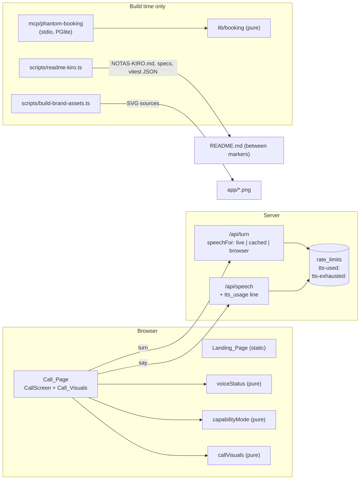
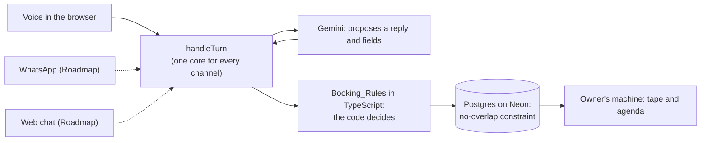

# Design Document: Jury Polish

## Overview

This spec turns the defects of `.kiro/specs/JURY-REVIEW.md` (items 3, 4, 5, 6, 7, 8, 9, 12, 13) into working, tested changes, plus one regression test for the Safari audio fix of 2026-11-16 (commit 1839ce4). It adds no new channel, no new sector pack and no new table. It does six kinds of work:

1. **Kiro evidence** (item 3): prove the existing hooks fire, and build `mcp/phantom-booking`, a small MCP server over the pure booking core, that later tasks actually call.
2. **Honest voice** (items 4, 5): a visible "resting" state when the neural voice is out of quota, a `tts_usage` log line, the English half of the voice cache plan, and a clear typed start in browsers that cannot recognise speech.
3. **English parity** (item 6): the five real-call cases in English, in unit tests, a route replay and a scripted HTTP check.
4. **First impression** (items 7, 8): a real landing page, the reels and the light on the call page, an optional tape hiss, and our own icons and social image.
5. **Presentation** (items 9, 12): a README for judges with a generated Kiro table and generated numbers, and every unbuilt feature labelled Roadmap.
6. **Accessibility** (item 13): axe in the DOM tests, names, focus order, contrast and 375 px checks.

The model still proposes and the code still decides. Nothing in this spec changes a Booking_Rule; the MCP server only calls them.

### Working beside the other specs

- **owner-machine**: its spec files are read, never edited (Requirement 15.6). Its code is reused by import: `TapeReels`, `useReducedMotion`, `DemoNotice`, `controlButton`, `DEMO_SHOP_ID`, `isDemoShop`. Two places are shared ground: `app/page.tsx` (owner-machine 3.1–3.4 built the demo links there; this spec rewrites the page and keeps those four criteria) and `components/machine/*` (the accessibility pass may find a violation there; Requirement 13.6 says the task records it and asks before changing the component). See open question 1.
- **natural-voice**: still open (tasks 2, 9, 10, 11, 12 are owner steps or measurements). This spec edits files it wrote: `lib/voice/neuralVoice.ts`, `lib/voice/speechRequest.ts`, `components/call/callSession.ts`, `app/api/turn/handler.ts`, `app/api/speech/handler.ts`, `lib/receptionist/cachePlan.ts`, `lib/conversation/fallbackLog.ts`. Before each task that edits them, re-read them as they are; if a natural-voice session is changing them at the same time, stop and ask. The English cache (task 8) waits for natural-voice task 2.4.
- **core-call-loop**: Requirement 6.5 here hides "Prefiero escribir" when there is no voice to switch from. core-call-loop 2.11 says that control is shown in every phase except `ended`. This is a deliberate amendment; it needs the owner's approval (open question 4).

## Where current documentation changed my first choice

**No documentation could be read in this session.** The Context7 MCP call and every shell command failed at the permission step, so `@modelcontextprotocol/sdk`, `axe-core`, MDN's compatibility data, the Next.js metadata file conventions and the Kiro hook docs were not checked. Nothing below depends on memory without saying so: each open point is a sub-task of task 1, and design decisions that a finding could change are marked *(check in 1.x)*.

| Area | First choice from memory | To check in task 1 | What would change |
|---|---|---|---|
| MCP SDK | `@modelcontextprotocol/sdk` 1.x, `McpServer.registerTool` with a zod shape, `StdioServerTransport`, `InMemoryTransport` for tests | Newest version whose `engines` accepts Node 20.19; which zod major its `peerDependencies` accept (the app uses zod 4.6); the current tool-registration API and the in-memory transport | If it needs zod 3, the tool schemas use JSON Schema built with `z.toJSONSchema` instead of zod shapes; if it needs Node 22, pin the newest Node 20 release (as was done for `@google/genai` and jsdom) |
| Kiro hooks | IDE hooks as JSON in `.kiro/hooks/`, CLI hooks in the agent file | The current file format and trigger names for the IDE (`.kiro.hook` files?) and the CLI (`preToolUse` / `postToolUse` / `agentSpawn` / `stop`?) | If `.kiro/hooks/booking-properties.json` is not a format the IDE reads, that is reported to the owner, not silently "fixed" (Requirement 1.1) |
| Safari, Firefox | Safari 14.1+ exposes `webkitSpeechRecognition`; Firefox has none; `available()` is Chrome-only | `@mdn/browser-compat-data` (as natural-voice did, with `npm pack` into `.measurements/`) | If Safari has a working constructor, the Capability_Mode is `voice` there and the notice shows only on Firefox and when `available()` says no (open question 3) |
| axe | `axe-core` as a dev dependency, `axe.run(container)` in jsdom, `color-contrast` off | Newest `axe-core` and its jsdom support; which rules need layout | The list of rules turned off in Requirement 13.1 |
| Icons and OG image | `app/icon.svg`, `app/apple-icon.png`, `app/opengraph-image.png` + `opengraph-image.alt.txt` | `node_modules/next/dist/docs` (metadata file conventions); whether `ImageResponse` from `next/og` runs in a plain Node script | If `next/og` cannot run outside Next, the PNGs are drawn from the SVG sources with a script that uses a tool already installed, or the owner exports them by hand (open question 7) |
| Mermaid | GitHub renders ```` ```mermaid ```` blocks | GitHub docs | None expected |

## Architecture



Nothing under "Build time only" is imported by the app. `scripts/check-client-bundle.mjs` gains `phantom-booking` and `@modelcontextprotocol` to its refused strings.

## Module layout

```
mcp/phantom-booking/
  server.ts            stdio entry: builds the demo DB, registers the tools, connects the transport
  tools.ts             pure tool layer: input schemas, toBookingRequest, answer shaping, explain
  demoDb.ts            in-memory PGlite: migrations, Demo_Shop seed (no PIN), busy rollback
  README.md            how to run it, the three tools, "never the real database"
.kiro/hooks/scripts/
  guardSecretsCore.mjs isBlocked(input) — the matcher, exported for tests
  guard-secrets.mjs    reads stdin, calls isBlocked, same exit codes as now
lib/voice/
  capability.ts        capabilityMode (pure)
  voiceStatus.ts       voiceStatus reducer (pure)
  callVisuals.ts       callVisuals and hissShouldPlay (pure)
  tapeHiss.ts          the Web Audio noise player, structurally typed like neuralVoice
lib/conversation/
  ttsUsage.ts          ttsUsageLine (pure) and the TtsUsageStore port
lib/landing/
  copy.ts              Landing_Page text in ES and EN, Roadmap items, the three steps
  repo.ts              REPO_URL and specLinks()
components/call/
  LineLight.tsx  CallVisuals.tsx  HissToggle.tsx  VoiceNotice.tsx
components/landing/
  LandingContent.tsx (client island: language switch)  HowItWorks.tsx  BuiltWithKiro.tsx  RoadmapList.tsx
scripts/
  check-call.ts        Call_Check_Script
  readme-kiro.ts       Kiro_Table and Project_Numbers between README markers
  lib/kiroTable.ts     pure: parse NOTAS-KIRO.md, render the table, splice between markers
  lib/projectNumbers.ts pure: count properties, catch-log bugs, mutation rows from text
  build-brand-assets.ts
assets/brand/          icon.svg, og.svg sources; fonts/ with licence (if needed, 1.6)
tests/
  hooks/guardSecrets.test.ts, guardSecrets.property.test.ts
  mcp/tools.test.ts, tools.property.test.ts, server.test.ts, isolation.test.ts
  voice/capability.*.test.ts, voiceStatus.*.test.ts, callVisuals.*.test.ts, neuralVoice.unlock.test.ts
  conversation/ttsUsage.*.test.ts
  conversation/languageParity.property.test.ts
  receptionist/realCall.en.test.ts
  api/turn.realCall.en.test.ts, speech.usage.test.ts, turn.resting.test.ts
  scripts/kiroTable.*.test.ts, projectNumbers.test.ts, checkCall.test.ts
  design/claims.test.ts (and contrast.test.ts extended)
  components/call/*.test.tsx, components/landing/*.test.tsx, components/a11y/axe.test.tsx
```

## Part 1: Kiro evidence

### Hooks (Requirement 1)

The three hooks already exist; what is missing is proof. `guard-secrets.mjs` keeps its stdin contract and exit codes; its regex moves to `guardSecretsCore.mjs` as `isBlocked(toolInputJson: string): boolean`, so property J1 can run thousands of cases in-process. The script imports it. Nothing else about the hook changes.

Evidence is gathered in real Kiro sessions and written to `NOTAS-KIRO.md` (task 2):

| Hook | How it is made to fire | What is quoted |
|---|---|---|
| `session-brief` | Any CLI session start with the builder agent | The brief the hook printed (this session's brief is the first sample: "core-call-loop: 12/13 tasks…") |
| `guard-secrets` | First search earlier session records for a real block. If none, a builder session asks to read `.env.hooktest`, a file that does not exist. No call names `.env.local` | The hook's stderr line and that the tool call did not run |
| `booking-properties` | In a builder session, a deliberate mutation written to `lib/booking/rules.ts` (drop the fit check, step 5, as in the 2026-11-12 mutation proof), then the restore | The hook's failing output (which property, shrunk counterexample), then its green output after the restore |

If the IDE hook file turns out not to be in a format the IDE reads (task 1.2), its evidence row says "CLI only" and the owner decides what to do with the IDE file.

### The booking MCP server (Requirement 2)

**Shape.** `server.ts` is about 40 lines: build the demo DB, register three tools from `tools.ts`, connect `StdioServerTransport` *(check in 1.1)*. `tools.ts` is pure apart from one injected port:

```ts
interface BookingAgenda {
  /** Runs fn with the Demo_Shop's rules and existing bookings, with `busy` inserted first; always rolled back. */
  withBusy<T>(busy: readonly BusyInput[], fn: (ctx: { shop: ShopRules; existing: ExistingBooking[] }) => T): Promise<T | { inputError: string }>;
}
```

**Input (shared by the three tools)**, zod `strictObject`:

| Field | Type | Notes |
|---|---|---|
| `service` | string | A service id (`haircut`) or a name or alias from Lola's profile, matched with the same `matchService` the conversation core uses |
| `date` | `YYYY-MM-DD` | Local date in the Demo_Shop's Time_Zone |
| `time` | `HH:MM` | Local time |
| `now` | ISO instant, optional | Default: the real clock. Lets a test ask "as of Friday 13 November, 11:00 Madrid" |
| `busy` | array, optional, max 20 | `{ service, date, time, resource? }`; inserted through the real insert path so the no-overlap constraint checks them |

**Output**, as JSON text content:

- `check_slot` → `{ ok: true, resource, start: "2026-11-14 17:00", end: "17:30", startIso }` or `{ ok: false, reason, alternatives: [{ start, resource }] }`, from `checkBooking`.
- `nearest_slots` → `{ slots: [...] }`, from `findNearestSlots` with the same options the core uses.
- `explain_rejection` → `{ verdict: "accepted" | "rejected", step: 1..8, reason, facts }`, where `step` is the first check in `evaluateWith`'s order that decided (1 catalog, 2 past, 3 closed day, 4 outside hours, 5 does not fit, 6 sector rule, 7–8 resources), and `facts` holds what that step looked at: the day's sessions in local time, the service duration and computed end, and for 7–8 which resources were busy and by which booking times (never names or phones).

`explain` does not re-implement the rules. It calls `evaluateBooking` for the verdict and reads the facts from the same helpers (`sessionsOn`, `localDateOf`, `overlaps`). Property J2 checks that its `reason` always equals `evaluateBooking`'s, and that `step` is the step whose check maps to that reason.

**Demo DB.** `demoDb.ts` creates `new PGlite()` in memory, applies `drizzle/` migrations the way `tests/db/pglite.ts` does, and seeds the Demo_Shop with the seed's own profile and no PIN. `withBusy` runs in a transaction and always ends with `ROLLBACK`, so each tool call sees the seeded agenda only (J3). A constraint error on the `busy` rows becomes `{ inputError: "busy bookings overlap on <resource>" }`.

**Isolation (Requirement 2.3).** The server imports only `@electric-sql/pglite`, the Drizzle PGlite driver, `lib/booking`, `lib/sectors`, the seed profile and the matcher. `tests/mcp/isolation.test.ts` mocks `@neondatabase/serverless` and `lib/db/client` to throw on import and then imports `server.ts`; it also scans the server's source files for `process.env` and `.env`. Both must find nothing.

**Registration.** `.kiro/settings/mcp.json` gains:

```json
"phantom-booking": {
  "command": "node",
  "args": ["--import", "tsx", "mcp/phantom-booking/server.ts"],
  "disabled": false,
  "autoApprove": ["check_slot", "nearest_slots", "explain_rejection"]
}
```

`builder.json` adds `"@phantom-booking"` to `tools` (it already has `includeMcpJson: true`). The SDK is a dev dependency: the app never imports it.

**Use while building.** From task 5 on, every sub-task that writes an expected booking outcome asks the server first and adds a line to the MCP_Log in `tasks.md`: task, question, answer, and whether it matched what the test expected. The obvious first users are the English replay (task 6: "tomorrow at four" rejected, alternatives five, quarter past, half past; a colour at seven does not fit) and the landing page's three-step example (task 11).

## Part 2: Honest voice

### Voice_Status (Requirement 3)

A pure reducer beside `callLoop`, so S5 and `callLoop.ts` do not change:

```ts
type VoiceStatus = "neural" | "resting";
type VoiceStatusEvent = { type: "CALL_STARTED" } | { type: "QUOTA_OUT" } | { type: "OTHER_FALLBACK" };
function voiceStatus(s: VoiceStatus, e: VoiceStatusEvent): VoiceStatus;
// CALL_STARTED → "neural"; QUOTA_OUT → "resting"; OTHER_FALLBACK → s
```

Two sources of `QUOTA_OUT`:

1. **Browser**: `NeuralVoicePort` gains `onQuotaOut(listener)`; its existing `quotaOut` effect calls the listeners once.
2. **Server**: `speechFor` in `app/api/turn/handler.ts`, on a cache miss only, reads the `tts-exhausted:*` marks (one indexed query on `rate_limits`, the same store `/api/speech` uses). When every model in `GEMINI_TTS_MODEL` is marked, it returns `speech: { kind: "browser", reason: "quota" }` instead of a live token. `SpeechHintSchema` gains that variant. The neural port treats it like a 429: `quotaOut`, listeners, Browser_Voice. This saves one doomed `/api/speech` request per line and lets the notice appear on the first live line.

`callSession` keeps `voice: VoiceStatus` in its snapshot; `CallScreen` renders `VoiceNotice` when it is `resting`: one line under the status, `--text` on `--section` with a gold-dot border like the transcript notices, inside its own `role="status"` that is rendered empty from the start, so the text is announced once when it appears. Wording:

| | Resting_Notice |
|---|---|
| es | La voz natural descansa; te atiende la voz del navegador. |
| en | The natural voice is resting; your browser's voice is answering. |

The English wording is mine; the owner approves it (open question 5).

### `tts_usage` (Requirement 5)

`/api/speech` already counts per visitor, per hour and per day, and marks exhausted models. It gains one counter per model, `tts-used:<model>`, in `rate_limits` with `window_start = quotaDayStart(now)` (midnight Pacific), incremented when a model answers its first chunk. After every `say` request, in `after()` so it never delays the audio, it writes:

```json
{"event":"tts_usage","day":"2026-11-16","models":[
  {"model":"gemini-3.8-flash-tts","used":7,"limit":10,"exhausted":false,"resetsAt":null},
  {"model":"gemini-3.8-flash-lite-tts","used":10,"limit":10,"exhausted":true,"resetsAt":"2026-11-17T08:00:00Z"}],
 "globalDay":{"used":17,"limit":40}}
```

`ttsUsageLine(models, counts, marks, global, now)` is pure (J5). The per-model limit is `TTS_MODEL_REQUESTS_PER_DAY` (default 10, the spike's measurement); it is for the log only and does not gate requests, because the real gate is the 429 the model sends. The line is built from model ids and numbers only, so no field can carry text, a token or a visitor key; J5 still checks the serialized line against generated secrets, as N14 does.

### English voice cache (Requirement 4)

`cachePlan.ts` already orders "tiers 1–2 in both languages, then tiers 3–5 in Spanish, then English", with English left out until natural-voice task 2.4. The change is the switch that leaves English out: once `hairSalon.voice.en` holds the chosen voice, the plan includes it. J6 pins that the Spanish lines are unchanged as a sequence (the plan with English is the old Spanish plan with English lines inserted only where the tier order says), every English line is cacheable and is said by `phrases("en", …)`, and keys stay unique. `--plan` reports English counts per tier. The real run is an owner step (Requirement 4.5).

### Browsers without speech recognition (Requirement 6)

```ts
type CapabilityInput = { hasRecognition: boolean; availability: "available" | "downloadable" | "downloading" | "unavailable" | "unknown" };
function capabilityMode(i: CapabilityInput): "voice" | "typed";
// typed iff !hasRecognition || availability === "unavailable"
```

`SpeechPort` gains an optional `capability(lang): Promise<CapabilityInput>`; the Web Speech port implements it with the constructor check and its existing cached `available()` call. `callSession.attach` asks it for the selected language (and again on a language switch while idle) and, while the Call is still `idle`, re-creates the initial state with `recognition: mode === "voice"`. `initialCallLoop` already sets `typed: !recognition`, so the reducer itself does not change.

On screen, when the mode is `typed`:

- the No_Recognition_Notice sits right under the heading, above the language switch, so it is visible at 375 px before the Call ("La voz funciona en Chrome; aquí puedes escribir." / "Voice works in Chrome; here you can type.");
- the Call button keeps its label and starts the Call in Typed_Mode; `focusInput` already runs on the first `typing` phase;
- `TypeInsteadButton` is not rendered (`state.typed && !state.recognition`), because there is nothing to switch from (the core-call-loop 2.11 amendment, open question 4);
- replies are still spoken when the browser can speak (Safari and Firefox have `speechSynthesis`; the Neural_Voice works with `<audio>`).

Copy lives in `callCopy.ts` (`noRecognition`, `voiceResting`).

## Part 3: English parity (Requirement 7)

**Unit level** (`tests/receptionist/realCall.en.test.ts`): each of the five cases as one `decideTurn` call with the fields the scripted model returns in English, asserting the exact line from `phrases("en", …)` and `toSpokenReply(…, "en", …)`:

| Case | Caller (English) | Expected |
|---|---|---|
| 1 | (start) | The English greeting, matching `/virtual assistant/`, not `/answering machine/` |
| 2 | "Tomorrow at 4:00 pm" (Saturday, closed at four) | "Tomorrow at four we're closed, we open at five. Does five work for you? I also have quarter past five or half past five." (already pinned by the current English test; kept) |
| 3 | "Five, not 17, you idiot" | `timeAcceptedAskName` for five o'clock; no "put you down", no "idiot", `requestedTime` 17:00 |
| 4 | "Can I dye my hair pink first" | "Sure, a colour takes an hour and a half and costs forty-five euros." followed by the name ask; service `colour`; nothing defers to Lola |
| 5 | "darling", then "Yes, it's Darling" | `askNameAgain`, then accepted and `askPhone` |

The alternatives and the "does not fit" times are asked from `phantom-booking` first (MCP_Log). The English insult word and the endearment list are checked against `lib/conversation/names.ts`; if "idiot" or "darling" is not caught there, that is a finding for the catch log, and the fix goes into `names.ts` with its own unit test.

**Route level** (`tests/api/turn.realCall.en.test.ts`): the same full replay as the Spanish test, every line through the real route on PGlite with a scripted model, ending with one colour booking at five, no digit in anything spoken, and the model's own words never spoken.

**Language independence** (J8): for random shops, agendas, `now`, fields and caller confirmations, `decideTurn` in `es` and in `en` returns the same `outcome`, the same derived fields and the same booking writes; only the reply text differs.

**Call_Check_Script** (`scripts/check-call.ts`, run with `node --import tsx`): plays each case as a sequence of `POST /api/turn` bodies against `--base` (default `http://localhost:3000`), in `--lang=es|en|both`, with `--gap` between turns (default 4 000 ms, to stay under the text model's per-minute limit). Each reply goes through the structural checks shared with the unit tests (`scripts/lib/replyChecks.ts`: no digits, sentence and word limits, outcome, fields), not exact text, because the real model's own lines may differ. It prints one line per case (`PASS en case 3 — 2 turns, 2 model requests`) and a total. It refuses a non-localhost base without `--allow-remote` and reads no env file; because the dev server writes to whatever database it is configured with, running it is an owner step (open question 6). Its checks are unit-tested with a fake `fetch`.

**Switch visible before the Call**: a DOM test renders `CallScreen` idle at the 375 px media stub and finds the ES / EN radio group by name before any press.

## Part 4: First impression

### Landing page (Requirement 8)

`app/page.tsx` stays a server component with no request data, so it prerenders. It reads the PIN the same way as now (exactly 6 digits from `DEMO_OWNER_PIN` at build time, else no PIN line) and passes it, with `allSectorPacks()` names, to `LandingContent`, a client island that holds the language. The first render is English, as now; after mount, a browser whose `navigator.language` starts with `es` switches to Spanish, and the ES / EN switch is always there (open question 2). `lang` is set on `<main>`.

Sections, top to bottom, all from `lib/landing/copy.ts`:

1. Eyebrow "KIROWEEN 2026", heading "Phantom Line" with the one gold phrase in the tagline, and the problem in one line: "Small shops miss calls while they serve the customer in front of them. *Phantom Line answers.*" / "Las tiendas pequeñas pierden llamadas mientras atienden al cliente que tienen delante. *Phantom Line contesta.*"
2. The demo card (what is there now, reworded): primary "Call Peluquería Lola →" (gold gradient, ink text, the 19 px bold label that passes contrast), secondary "Open the owner's machine" (ink outline), the PIN line, the Demo_Notice, and a Caveat note with a hand-drawn arrow: "they called while you were busy…".
3. How it works, 3 steps with Lucide icons (`Phone`, `ShieldCheck`, `Lightbulb`): "1. A customer calls; the virtual assistant answers in Spanish or English." "2. The code checks the booking against the shop's hours, services and free chairs. The model only proposes." "3. The owner's machine blinks with the message, the booking and a suggested reply."
4. Built with Kiro: links to `.kiro/specs/`, `.kiro/steering/` and `NOTAS-KIRO.md` through `specLinks(REPO_URL)`, plus the hook and MCP lines once their evidence exists.
5. Roadmap: WhatsApp, web chat, and every pack of the steering's list that is not in the registry, labelled "Roadmap" / "Próximamente". The available packs list comes from `allSectorPacks()`.

`REPO_URL` is one constant in `lib/landing/repo.ts`, set to `https://github.com/REPO_OWNER/phantom-line` until the repository exists (open question 8). The page keeps working without it: the links point at the placeholder, and `tests/design/claims.test.ts` warns, not fails, while it is a placeholder.

### Call_Visuals (Requirement 9)

```ts
function callVisuals(phase: CallPhase, reducedMotion: boolean): { reels: "spinning" | "still"; light: "blinking" | "steady" | "off" };
// reels: spinning iff phase === "speaking" && !reducedMotion
// light: off for idle and ended; blinking for listening (steady if reducedMotion); steady otherwise
function hissShouldPlay(i: { enabled: boolean; phase: CallPhase }): boolean;
// true iff enabled && phase not in {idle, ended}
```

- `CallVisuals.tsx` draws a small ivory panel with gold trim above the transcript: `TapeReels` (imported from `components/machine`, unchanged) and `LineLight`, which reuses the `light-blink` class and the same `data-light` attribute as `MessageLight`. Both are `aria-hidden`; the existing `role="status"` line already says "Te escucho…" / "Hablando…".
- The ghost fade already exists (`ghost-in` on each Transcript `<li>`, stopped by the global reduced-motion rule). The DOM test pins it so it is not lost.
- `HissToggle.tsx`: a switch button (`aria-pressed`) labelled "Ruido de cinta" / "Tape hiss", off by default, stored in `localStorage` under `pl_hiss`. `tapeHiss.ts` builds 2 seconds of noise once, low-passed at about 4 kHz, looped through a `GainNode` at about −36 dBFS, on the AudioContext the neural port already unlocks in the Call press. It starts and stops only when `hissShouldPlay` changes. No file, no dependency.

Under reduced motion the reels and light are still (the classes are not added, as on the machine) and the global rule stops `ghost-in`. The hiss is sound, not motion, and stays the Caller's choice.

### Brand_Assets (Requirement 10)

Sources in `assets/brand/`: `icon.svg` (an espresso reel with a gold hub and a terracotta dot on `--bg`) and `og.svg` (1200 × 630: the machine's ivory body, two reels, the light, "Phantom Line" in Newsreader with "nobody answered" in gold, and one line of Inter). `scripts/build-brand-assets.ts` writes `app/icon.svg` (copied), `app/apple-icon.png` (180 × 180) and `app/opengraph-image.png` with `app/opengraph-image.alt.txt`, using `ImageResponse` from `next/og` *(check in 1.5)*. Text in the image needs the font file itself: Newsreader and Inter come from the Google Fonts repository under the SIL Open Font License and are committed in `assets/brand/fonts/` with `OFL.txt` (Requirement 10.6, open question 7). The PNGs are committed; the build reads them as static files. `app/favicon.ico` and the unused SVGs in `public/` are deleted after a search shows nothing references them. `metadata.description` becomes "An AI answering machine for small shops: it answers, books by the shop's rules, and leaves the owner a message."

## Part 5: Presentation

### README (Requirement 11)

New order: title and one-line pitch; **Try it in 30 seconds** (DEMO_URL placeholder, `/call/peluqueria-lola`, `/machine/peluqueria-lola`, the PIN on the landing page, "voice in Chrome; Safari and Firefox type"); GIF placeholders; **How it works** with the Mermaid diagram; **How we used Kiro** (generated); **The numbers** (generated); **Roadmap**; then the existing "Run it locally" and "Deploy" sections, unchanged.

Diagram:



**Generator** (`scripts/readme-kiro.ts`, pure parts in `scripts/lib/`):

- `parseNotas(md)`: the rows of the first table in `NOTAS-KIRO.md` (escaped pipes kept), skipping rows whose date or "What I did" is empty (the placeholder rows "Hooks", "MCP"…).
- `renderKiroTable(rows)`: one row per Kiro feature, in first-appearance order: the feature, how many times it was used, and the 1–3 shortest "What it changed / caught" cells as examples, each linking to the full log. Text is copied, never rewritten.
- `projectNumbers(sources)`: tests total and passed from the Vitest JSON report (`npx vitest run --reporter=json --outputFile=.measurements/vitest.json`); correctness properties as the list of distinct ids defined in each spec's `## Correctness Properties` section (`**P1.**`, `**N4.**`, `**M17.**`, `**J3.**`…); bugs caught as catch-log rows in every `tasks.md` whose cause is not a generator or oracle fault; mutation proofs as NOTAS rows whose feature names a mutation proof, and filled rows of the `tasks.md` mutation tables. Each number is printed with its source and the date (open question 9 on how mutation proofs are counted).
- `splice(readme, startMarker, endMarker, block)`: replaces only between `<!-- kiro:table:start -->` / `end` and `<!-- kiro:numbers:start -->` / `end`; fails loudly when a marker is missing or duplicated.

### Claims (Requirement 12)

`lib/landing/copy.ts` exports `ROADMAP_TERMS` (WhatsApp, web chat / chat web, and the names of the steering's packs not in the registry: physio, clinic, clínica, fisio, restaurant, restaurante, bakery, panadería, obrador). `tests/design/claims.test.ts` renders the landing copy in both languages and reads `README.md`; a term may appear only inside a section whose heading is "Roadmap" / "Próximamente" or inside the Mermaid diagram with "(Roadmap)" next to it. A pure `findUnlabelledClaims(doc)` does the scan (J12).

Outside this spec's own surfaces, task 12 lists the other places (steering `product.md` and `sector-packs.md` describe four packs and three channels; NOTAS rows; spec introductions) and proposes wording to the owner. Steering is edited only after approval; owner-machine spec files are not edited.

## Part 6: Accessibility (Requirement 13)

- `axe-core` (dev) in `tests/components/a11y/axe.test.tsx`: Landing_Page content in both languages, CallScreen in each phase with a fake port (idle voice, idle typed with the No_Recognition_Notice, typing, speaking with the Resting_Notice, ended), and PinGate. `color-contrast` and any rule task 1.4 finds layout-dependent are off, and listed in the test. Machine screens are scanned too; a violation there is recorded and asked about (13.6).
- Names: CallButton ("Llamar" / "Call", "Colgar" / "Hang up", "Volver a llamar"), TypeInsteadButton, HissToggle, both language switches, the landing links, by role and name.
- Order and ring: the same `tabbables` helper as the machine tests, for the Landing_Page and the Call_Page, against the visual order listed in the test; no `tabindex` above 0; every tabbable has `focus-ring`.
- Contrast: `contrast.test.ts` gains the new pairs: the problem line (`--text` on `--bg`), the gold tagline phrase (large, `--gold` on `--bg`), the step text, the notices (`--text` on `--section`), the hiss toggle label, the OG image's text on its ivory (from the SVG's own fills).
- 375 px: jsdom has no layout, so it is manual: Chrome device mode and a real phone, screenshots saved to `docs/screenshots/` for the README.

## Part 7: The Safari unlock test (Requirement 14)

`tests/voice/neuralVoice.unlock.test.ts`, with the same fake window as `neuralVoice.test.ts`: a counting `Audio` constructor; `unlock()`; two `speak` calls with cached hints, each driven to `ended`. Asserts: the constructor ran once; both lines set `src` on that instance; `play()` was called three times on it (unlock plus two lines). Mutation: `const el = new Ctor()` in `startElement` must fail it.

## Error Handling

| Failure | What the user sees | Server or dev side |
|---|---|---|
| Every TTS model exhausted | Resting_Notice; Browser_Voice | `tts_usage` shows all `exhausted: true`; `/api/turn` returns `kind: "browser"` |
| Exhausted-marks read fails in `/api/turn` | Nothing: a live token is issued as now | The error is caught, no log line is added, and `/api/speech` decides as before |
| `tts-used` counter write fails | Nothing | The `tts_usage` line is still written with `used: null` for that model |
| `available()` throws | Voice mode, as now (a failing check must not lock out voice) | none |
| Browser cannot speak at all | Typed replies shown only, as now | none |
| `localStorage` blocked | Hiss toggle works for the page, not remembered | none |
| MCP `busy` overlaps | Tool answers `isError` with the resource | Transaction rolled back |
| MCP input invalid | Tool answers `isError` with zod's issues (path, code, message) | none |
| README marker missing | Generator exits 1 and changes nothing | none |
| Call_Check_Script reaches a non-localhost base without the flag | Exits 1 before any request | none |

## Correctness Properties

Each property is one fast-check test with `numRuns: 200` unless noted. Shared generators come from `tests/booking/arbitraries.ts` (`arbShop`, `arbNow` covering both 2026 Madrid DST weekends, `arbExisting`) and run over `allSectorPacks()`.

**J1. The secrets guard blocks exactly the real env files.** *For all* tool-input JSON objects built from random paths, shell commands and nesting: `isBlocked` is true iff some token is `.env` or `.env.<suffix>` with a suffix other than `example`, at a path or word boundary; `.env.example`, `my.env.ts`, `environment` and a `--env-file=.env.local` flag alone are never blocked; any input that contains `cat .env.local` or a path ending in `/.env.production` is blocked. Validates 1.2.

**J2. The booking tools say what the Booking_Rules say.** *For all* shops, `now`, existing bookings and requests: `check_slot`'s `ok` equals `evaluateBooking(...).ok`, its resource, start and end equal the evaluation's, and its rejection reason and alternatives equal `checkBooking`'s; `nearest_slots` equals `findNearestSlots`; `explain_rejection`'s `reason` equals the evaluation's reason, its `step` is the step of that reason in `evaluateWith`'s order, and its `facts` contain no customer name or phone. Validates 2.4, 2.5.

**J3. Tool calls never affect each other.** *For all* sequences of 1–10 tool calls on the PGlite demo DB, each with its own `busy` list (some overlapping, so the constraint rejects them): each answer equals the answer of the same call made alone on a fresh DB, and after the sequence the `bookings` table equals the seed's. `numRuns: 50`. Validates 2.6.

**J4. The voice is "resting" exactly after quota, until the next Call.** *For all* event sequences of `CALL_STARTED`, `QUOTA_OUT` and `OTHER_FALLBACK`: the status is `resting` iff a `QUOTA_OUT` happened after the last `CALL_STARTED`; `OTHER_FALLBACK` never changes it. And through the neural port with a fake window: for all sequences of hints (`cached`, `live` answering 200, 429 quota, 429 rate limit, 503, a deadline, `browser`), `onQuotaOut` fires at most once per port and exactly when a quota 429 or a `browser` hint arrived. Validates 3.1, 3.2, 3.4, 3.5.

**J5. The usage line is complete and carries nothing personal.** *For all* model lists (1–5 ids), counts, exhausted marks (expired or not) and `now` around both US DST days: `ttsUsageLine` has one entry per configured model in configured order, `used` equals the count of that model's Pacific-day window, `exhausted` is true iff a mark exists whose expiry is after `now`, `day` is the Pacific date of `now`; and the serialized line contains none of the generated texts, tokens, names, phones, visitor keys or API keys passed to the handler alongside it. Validates 5.1, 5.2, 5.4.

**J6. English joins the cache plan without moving Spanish.** *For all* shops and "today" dates: the plan's Spanish lines, in order, equal the plan built with English left out; every English line is cacheable and equals a line `phrases("en", …)` really says for that tier; keys are unique; tier order holds. `numRuns: 30`, with the 120 s timeout N17 uses. Validates 4.2, 4.3.

**J7. The call starts typed exactly when it must, and no control is dead.** *For all* `CapabilityInput` values and languages: `capabilityMode` is `typed` iff there is no constructor or availability is `unavailable`; with the initial state built from it, `PRESS_CALL` always emits a `post` effect; in `typed` mode the "type instead" control is not offered; in `voice` mode it is offered in every phase but `ended`. Validates 6.2, 6.4, 6.5.

**J8. The code decides the same in both languages.** *For all* shops, agendas, `now`, Structured_State fields and caller confirmations: `decideTurn` with `lang: "es"` and with `lang: "en"` returns the same outcome, the same derived fields and the same write effects (booking created, rescheduled, cancelled, or none, with the same start, end and resource). Validates 7.3.

**J9. Reels and light follow the Call.** *For all* phases and reduced-motion flags: reels spin iff `speaking` and motion is allowed; the light is off iff `idle` or `ended`, blinking iff `listening` and motion is allowed, steady otherwise. Validates 9.1, 9.2, 9.7.

**J10. The hiss never plays by itself.** *For all* sequences of toggles, Call phases, reloads (stored value read back) and storage failures: the hiss plays iff the Caller turned it on in this browser and the Call is live; a fresh browser never plays it; after hang-up it is silent. Validates 9.5, 9.6.

**J11. The Kiro table copies the log faithfully.** *For all* generated NOTAS tables (random features, cells with escaped pipes, backticks and links, empty placeholder rows) and README texts with markers: every non-empty row's feature appears in the table with its exact use count; every example cell is a verbatim cell of that feature; placeholder rows never appear; `splice` changes nothing outside the markers; and running the generator on its own output gives the same README. Validates 11.3, 11.6.

**J12. Unlabelled claims are always found.** *For all* Markdown documents built from random sections (some headed "Roadmap" / "Próximamente"), random Roadmap terms placed inside and outside them, and term variants in case and accent: `findUnlabelledClaims` reports exactly the occurrences outside Roadmap sections and outside "(Roadmap)" diagram labels. Validates 12.3.

## Testing Strategy

**Property-based tests:** J1 `tests/hooks/guardSecrets.property.test.ts`; J2 `tests/mcp/tools.property.test.ts`; J3 `tests/mcp/demoDb.property.test.ts` (PGlite, 50 runs); J4 `tests/voice/voiceStatus.property.test.ts`; J5 `tests/conversation/ttsUsage.property.test.ts`; J6 extends `tests/receptionist/voiceCache.property.test.ts`; J7 `tests/voice/capability.property.test.ts`; J8 `tests/conversation/languageParity.property.test.ts`; J9–J10 `tests/voice/callVisuals.property.test.ts`; J11 `tests/scripts/kiroTable.property.test.ts`; J12 `tests/design/claims.property.test.ts`. Each property also asserts that its rare branches were reached (as M7 and M14 do), so none passes without testing anything.

**Mutation checks** (break on purpose, record what failed, restore):

| Mutation | Expected to fail |
|---|---|
| `guardSecretsCore` lets `.env.production` through | J1 |
| `explain_rejection` checks resources before the fit (wrong step order) | J2 |
| `withBusy` commits instead of rolling back | J3 |
| `OTHER_FALLBACK` sets `resting` | J4 |
| `ttsUsageLine` treats an expired mark as exhausted | J5 |
| English lines inserted before Spanish tier 3 | J6 |
| `capabilityMode` ignores `unavailable` | J7 and the Safari DOM test |
| `decideTurn` reads the opening-time offer from the English template in Spanish | J8 |
| Reels spin while `listening` | J9 |
| Hiss default read as on when storage throws | J10 |
| `parseNotas` drops rows whose cell contains an escaped pipe | J11 |
| `findUnlabelledClaims` matches only lowercase | J12 |
| `startElement` builds a new `Audio` per line | the unlock test (Requirement 14) |

**Unit tests:** the English real-call lines; `names.ts` for "idiot" and "darling" if they are added; `speechFor` returning `browser` only on a miss with all models marked; the `/api/speech` usage counter on PGlite (a model answering increments only its own window; a 429 does not increment); `projectNumbers` on fixture specs (a generator-fault catch-log row is not a bug); `splice` with a missing or duplicated marker; `replyChecks` for each check; Call_Check_Script refusing a remote base; the MCP server in-process through the SDK's in-memory transport *(check in 1.1)*, listing exactly three tools and answering one `check_slot`; the isolation test.

**DOM tests** (`// @vitest-environment jsdom`, `cleanup` called in each file, as the machine tests do): the whole typed Call with no `SpeechRecognition` (notice before the Call, no "type instead", the Call button starts typing and focuses the field, a typed line, the reply, hang-up); the Resting_Notice after a scripted 429; the language switch visible before the Call; Call_Visuals' `data-reels` and `data-light` per phase, with and without reduced motion; the hiss toggle's name and `aria-pressed`; the landing page in both languages with the PIN shown only for 6 digits; axe; names; order and focus ring.

**Manual checklist** (`.kiro/specs/jury-polish/manual-checklist.md`, written in task 15): Safari on macOS and iOS and Firefox, a whole typed Call; the Resting_Notice with `GEMINI_TTS_MODEL` set to a model with no quota; the `tts_usage` line in the Vercel logs; the English call by voice in Chrome; the Call_Check_Script against `next dev` (owner step); the hiss on, off, remembered; the landing page, call page and machine at 375 px with screenshots; VoiceOver on a typed Call; the OG image in a link preview checker; Lighthouse accessibility on `/` and `/call/peluqueria-lola`.

## Dependencies and configuration

- New dev dependencies: `@modelcontextprotocol/sdk` (the MCP server; the app never imports it) and `axe-core` (DOM tests). Versions chosen in task 1 for Node 20.19 and zod 4. Nothing else: noise, icons and the README generator use what is installed.
- `.env.example` gains, names only: `TTS_MODEL_REQUESTS_PER_DAY`.
- `.kiro/settings/mcp.json` gains `phantom-booking`; `builder.json` gains `@phantom-booking` in `tools`.
- `scripts/check-client-bundle.mjs` refuses `@modelcontextprotocol` and `phantom-booking`.
- Steering proposals, edited only after the owner approves: `structure.md` adds `mcp/`, `lib/landing/`, `components/landing/`, `assets/brand/` and `docs/screenshots/`; `tech.md` adds the MCP SDK and axe-core to the test and tooling lines; `product.md` and `sector-packs.md` mark WhatsApp, web chat and the three unbuilt packs as Roadmap (Requirement 12.4).

## Open questions

1. **"Owner-machine files".** I read it as the spec files in `.kiro/specs/owner-machine/`. If it also means the code owner-machine wrote, then `app/page.tsx` (Requirement 8) cannot be rewritten, and the machine half of the accessibility pass can only report.
2. **Landing language.** The static page renders English first and switches to Spanish after mount for Spanish browsers, so a Spanish visitor may see English for a moment. The alternative is two routes (`/` and `/es`), which avoids the flash but adds a route.
3. **Safari's recognition.** If MDN's data shows Safari has a working `webkitSpeechRecognition`, should Safari use it (voice mode, notice only on Firefox), or should we force typed mode on Safari because its recognition was not tested?
4. **Hiding "Prefiero escribir".** When the call starts typed, that button has nothing to do. Hiding it changes core-call-loop 2.11. Approve the amendment, or keep the button (it would focus the field)?
5. **English Resting_Notice wording.** "The natural voice is resting; your browser's voice is answering." OK?
6. **Call_Check_Script and the database.** `next dev` uses `DATABASE_URL`, so the check writes Calls and Bookings to the Neon demo shop. Run it only as an owner step, against a Neon branch, or not at all?
7. **Fonts for the images.** Committing Newsreader and Inter TTF files (OFL) is what lets the OG image draw text with no network. OK, or draw the heading as outlined SVG paths instead?
8. **Repo_URL.** The GitHub repository does not exist yet (review item 1). Which owner and name should the constant use?
9. **Counting mutation proofs.** Owner-machine recorded mutation results in NOTAS rows, not in its `tasks.md` tables, and a row can hold several mutations. Count NOTAS rows (sessions), or have each future mutation logged as its own row in one ledger so the number is exact?
10. **Kiro hook file format.** If task 1.2 finds that `.kiro/hooks/booking-properties.json` is not a format the IDE reads, should it be converted, or should the evidence stay CLI-only?
