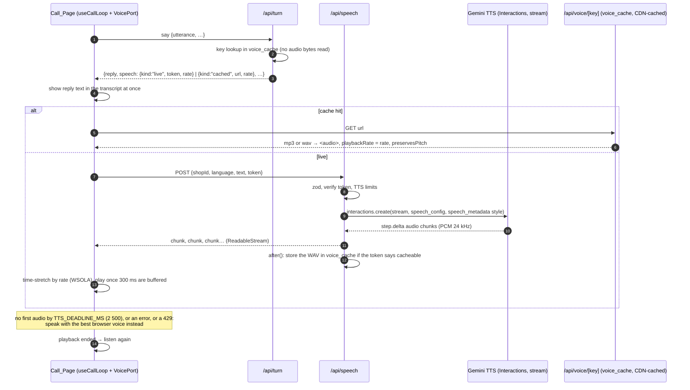

# Design Document: Natural Voice

## Overview

Two changes, one goal: the caller should feel they are talking to the salon.

- **Part A, a natural voice.** Each reply is spoken by a Gemini text-to-speech model, generated on the server and streamed to the browser, which starts playing at the first chunk. Every line that carries no caller data is synthesized at most once: it is stored in the voice cache (Postgres, served through the CDN) by a hash of model, voice, style, language and exact text, and a cache hit never calls the model. A script pre-generates the fixed lines and the most common dynamic lines of the demo shop over several days of quota. If the neural voice fails, is late or is out of quota, the best browser voice speaks instead. The caller never hears silence, and the Call never ends because of the voice.
- **Part B, talk like the salon.** Times, days, prices and phone numbers become words in pure, property-tested functions (`speakTime`, `speakDay`, `speakNumber`, `speakPrice`, `speakPhone`). Every code-owned line is rewritten in colloquial Spanish from Spain with tú, and in natural English, with a few deterministic variants. The greeting says plainly that the caller is talking to the salon's virtual assistant.

The rules from core-call-loop still hold. The model proposes and the code decides. The server owns the facts. The model's text and every template pass through `toSpokenReply`, which now also turns any leftover digits into words. The transcript shows exactly the words that are spoken.

**Spike verdict (task 1, measured 2026-11-12):** Gemini TTS on the free tier is fast enough: streamed first audio arrives in 0.96 s at the median and 1.9 s at p90. The limiting factor is quota. Each TTS model allows **10 requests per day**, with no per-minute cap seen, so the three streaming models give **about 30 live requests per day in total**. One demo booking call needs **4 to 6** live requests once the fixed lines are cached. The free tier can therefore carry the demo call and a few rehearsals a day, but not a jury or the public calling freely. Beyond that, the browser voice takes over automatically. Details are in "Spike findings" below.

## Where the docs changed my first choice

Checked on 2026-11-12 in the installed `@google/genai` 2.32.0 (`dist/node/node.d.ts`) and the Next.js docs bundled in `node_modules/next/dist/docs`. Web fetch was not available.

| Area | First choice from memory | What the installed types and the API say | Decision |
|---|---|---|---|
| TTS call | `models.generateContent` with `responseModalities: ["AUDIO"]` and `speechConfig.voiceConfig.prebuiltVoiceConfig.voiceName` | The Interactions API handles audio output too: `response_format: { type: "audio", mime_type? }` and `generation_config.speech_config: [{ voice, language }]` (`SpeechConfig_2`). It streams with `stream: true` as `step.delta` events whose `delta` is `{ type: "audio", data, mime_type, sample_rate }` (`AudioDelta`). | Same API and client as the text model: `ai.interactions.create(..., { signal, retries: { strategy: "none" } })` with `store: false`. |
| TTS models | `gemini-2.5-flash-preview-tts` | The SDK's model list names `gemini-3.8-flash-tts`, `gemini-3.8-flash-lite-tts` and `gemini-3.1-flash-tts-preview`. `models.list` for this key also returns `gemini-2.5-flash-preview-tts` and `gemini-2.5-pro-preview-tts`. | `GEMINI_TTS_MODEL` is an ordered list. The default is the three streaming models (see findings). |
| Voices | The classic names (Kore, Puck, …) | `ai.voices.list({ language_code, type: ["prebuilt"] })` returns a catalog with descriptions. For `es-ES` it lists 22 **Castilian Spanish** voices (`es-es-commercial-3`, `es-es-techagent-5`, …). For `en-US` it lists at least 200, the classic names among them. | The voice is chosen from the catalog by its description and by ear. The Castilian voices work only on the 3.8 models, so a Voice_Profile carries a catalog voice plus a classic voice for the other models. |
| Speaking rate | A `speaking_rate` field, as in other TTS APIs | `SpeechConfig_2` in the installed types has only `language`, `speaker` and `voice`. There is no rate or pitch field. | Pace can come only from the style annotation or from the player (see "Pace"). |
| Style prompt | A line before the text ("Say cheerfully: …") | Measured: a style line before the text, or "Dilo así, …:", **is read aloud** (6.1 s of audio became 11.4 s). `system_instruction` is rejected with a 400. The types define a `speech_metadata` annotation on a text block (`{ type: "speech_metadata", style, start_index, end_index }`, with byte offsets). With it the audio lasted 6.9 s, so the style was applied and not read. | The style goes in a `speech_metadata` annotation over the whole text. The words are never mixed with the style. |
| Audio format | MP3 or Opus | When streaming, the API returns `audio/l16` (16-bit PCM, mono, 24 kHz) in many small chunks. A non-streamed call returns `audio/wav` by default, and also accepts `audio/l16`, `audio/wav` and `audio/mp3` (44.1 kHz). `audio/ogg_opus` is rejected ("not supported for gemini-3.8-flash-tts"). | Live replies: raw PCM, forwarded chunk by chunk and played with the Web Audio API. Cached Fixed_Phrases: MP3 files (45 kB for 2.4 s, against 117 kB as PCM). |
| Live API as TTS | Not considered | `ai.live.connect` with `gemini-3.1-flash-live-preview` streams audio in 0.5 s, but it is a conversational model. Told to read a text exactly, it did not do so: a 6-word line ("Vale, perfecto. ¿Me dices tu nombre?") produced 6.7 s of audio and a 20-word transcript, because it answered the question. `gemini-2.5-flash-native-audio-latest` rejects `es-ES`. | Rejected, because the voice must never change the words (Requirement 3.5). |
| Next.js streaming | A library for streaming | `route.md` documents returning `new Response(ReadableStream)` from a route handler. | `app/api/speech/route.ts` returns the PCM chunks as a `ReadableStream`, on the default Node.js runtime with no `runtime` export (forbidden with `cacheComponents`). |

## Spike findings

Run on 2026-11-12 between 22:28 and 22:42 UTC (23:28 to 23:42 in Madrid), on Node 20.19.6 with `@google/genai` 2.32.0, using `node --env-file=.env.local scripts/check-tts.mjs <check>`. The script never prints the key or `process.env`. Every error message goes through `redact()`. Audio samples go only to `.measurements/tts/`, which is git-ignored. Every call used Spanish demo lines only; the English voice is still to be chosen (task 2). SDK retries were off and each call had a 30 s cap.

### Quota (free tier, this project's key)

| Model | Streams? | Successful calls before the first 429 | What the 429 said |
|---|---|---|---|
| `gemini-3.8-flash-tts` | yes | 13 | "limit: 10 requests per day on Free Tier. Please retry in 9h20m25s" |
| `gemini-3.8-flash-lite-tts` | yes | 9, then a 429, then 1 more success, then a 429 | "limit: 10 requests per day on Free Tier" |
| `gemini-3.1-flash-tts-preview` | yes | 12, including 10 back to back in 16 s | "limit: 10 requests per day on Free Tier" |
| `gemini-2.5-flash-preview-tts` | **no**: one chunk at the end | 11, including 9 back to back in 23 s | a streamed 429 with no quota text |
| `gemini-2.5-pro-preview-tts` | not reached | 0 | "limit: 0 requests per day on Free Tier" |

- **Per day:** 10 requests per model. The counter is a little loose, since 10 to 13 calls went through, but the design assumes 10.
- **Per minute:** no cap was hit. 10 back-to-back calls in 16 s on `gemini-3.1-flash-tts-preview` all succeeded.
- **Reset:** "retry in 9h20m25s" at 22:39:35 UTC points to 08:00 UTC, which is midnight Pacific time and **09:00 in Madrid** (CET).
- **Separate buckets:** the TTS quotas are per model, so they do not touch the text model's quota (`gemini-3.5-flash-lite`).

### Latency (streamed calls, 26 with audio)

Time to first audio is measured from the SDK call on the server to the first audio chunk. The browser adds one network hop on top.

| Model | Calls | First audio p50 / max (ms) | Underruns while playing | Total / audio length |
|---|---|---|---|---|
| `gemini-3.8-flash-lite-tts` | 7 | 895 / 2 270 | 2 (one of −412 ms; one call delivered 6.9 s of audio over 21.4 s) | 0.33–1.16 |
| `gemini-3.8-flash-tts` | 8 | 1 241 / 3 347 | 1 (−2 849 ms, with a 3.2 s gap between chunks) | 0.31–1.65 |
| `gemini-3.1-flash-tts-preview` | 11 | 883 / 1 136 | 0 | 0.40–0.63 |
| **All three** | **26** | **p50 958, p90 1 902, max 3 347** | **3 of 26** | |

- An **underrun** is computed for playback that starts at the first chunk: at some chunk, the audio received so far is shorter than the time elapsed, so the caller would hear a gap of that length.
- **Non-streamed calls** took 2.6 to 21.6 s for the same 2–8 s lines (`gemini-3.8-flash-tts`: 21.6 s for WAV and 18.4 s for MP3; `gemini-3.1-flash-tts-preview`: 14.3 s). Non-streamed calls are never used during a Call, only to build the cache offline.
- `gemini-2.5-flash-preview-tts` does not stream: its single chunk arrived after 2.4–8.0 s. It is used only to build the cache, which also adds 10 more requests a day for that job.
- The Castilian catalog voice `es-es-commercial-3` worked on both 3.8 models. `gemini-3.1-flash-tts-preview` rejected it ("No matching speaker voice found for name: es-es-commercial-3 and language: es-ES") and accepted `Kore`.

### What one demo booking call needs

The scripted booking conversation from core-call-loop (`check-turn --conversation`) has 6 replies: the greeting, the 21:00 rejection with alternatives, "vale, a las siete y media" answered with an ask for the name, an ask for the phone, the read-back, and the confirmation.

| Reply | Needs a live TTS request? |
|---|---|
| Greeting | No: Fixed_Phrase, cached |
| Rejection with alternatives (times in it) | Yes |
| Time accepted + ask for the name (time in it) | Yes |
| Ask for the phone (no caller data, no time) | No: caller-independent line, cached |
| Read-back (name, phone, time) | Yes |
| Confirmation (day, time) | Yes |

That is **4 live requests per booking call**, or 5–6 with a question answered by the model. 30 live requests a day give **5 to 7 demo calls a day**.

### Verdict

- **The free tier can carry the demo call.** It can carry about 5 to 7 calls a day, reset at 09:00 in Madrid. It cannot carry a jury or the public calling freely. When the daily quota is used up, the browser voice takes over automatically, the Call goes on, and the log says why.
- **On demo day:** keep rehearsals to two calls after 09:00, and build the cache on an earlier day.
- **Addendum (after the owner's review):** caching every line without caller data, and pre-generating the demo shop's most common lines, brings one demo booking call down to 1 live request (the read-back). See "The voice cache".
- **The best alternative that needs no new account and no card** is the one already built in as the fallback: the best browser voice (Chrome's network voice "Google español" on desktop, the Google speech engine on Android) together with all of Part B. Part B removes most of what made the call sound robotic (digits, "¿Te lo confirmo?", "a las 17:15"), and it costs no quota. The Live API was measured and rejected because it does not read the text verbatim. Paid tiers and other providers need a card or an account, so they are out.

## Architecture



### Module layout (new and changed)

```
app/api/speech/route.ts          NEW  voice adapter for audio: thin, POST only; stores cacheable live audio
app/api/voice/[key]/route.ts     NEW  GET one cached line from voice_cache, immutable Cache-Control
lib/receptionist/
  spoken/numbers.ts              NEW  PURE speakNumber, speakPrice, speakDigits / speakPhone
  spoken/time.ts                 NEW  PURE speakTime, clockWords, periodOf
  spoken/day.ts                  NEW  PURE speakDay
  spoken/parse.ts                NEW  PURE parse back (used by property tests, and by toSpokenReply tests)
  spoken/index.ts                NEW
  variants.ts                    NEW  PURE pickVariant(seed, key, variants)
  phrases.ts                     CHANGED  every template rewritten, variants, spoken forms
  speech.ts                      CHANGED  toSpokenReply(text, lang?) converts leftover digits; template limit
  prompt.ts                      CHANGED  style rules + examples, hours and prices in words, honesty rule
  voiceProfile.ts                NEW  PURE resolveVoiceProfile(pack, shop, lang), VoiceProfileSchema
  speechToken.ts                 NEW  PURE-ish sign/verify (node:crypto HMAC), server only
  ttsClient.ts                   NEW  server-only, the only file that calls a TTS model
  fixedPhrases.ts                NEW  PURE the list of cacheable lines per shop and language
  voiceCacheKey.ts               NEW  PURE cacheKey(model, voice, style, languageCode, text)
  cachePlan.ts                   NEW  PURE the ordered pre-generation plan for a shop (tiers below)
lib/db/schema.ts                 CHANGED  new table voice_cache (key, bytes, mime, duration, size, last used)
lib/db/voiceCacheRepository.ts   NEW  lookup keys, read one line, insert on conflict do nothing, evict
lib/conversation/
  handleTurn.ts                  CHANGED  passes the Variant_Seed; returns `speech` (cached url or token)
  ttsLimits.ts                   NEW  PURE checkTtsLimits(counts, config)
  fallbackLog.ts                 CHANGED  adds the `tts_fallback` event type
lib/sectors/types.ts, hairSalon.ts      CHANGED  `voice` (Voice_Profile per language), `vocabulary.place`
lib/conversation/shopProfile.ts         CHANGED  optional `voice` override, optional `spokenName` per service
lib/voice/
  callLoop.ts                    CHANGED  `speak` effect carries the `speech` hint; no new phases
  speechPort.ts                  CHANGED  pickVoice prefers natural / Google / enhanced voices
  neuralVoice.ts                 NEW  BROWSER: fetch + <audio> for cached lines + Web Audio PCM player + deadline,
                                      behind the same SpeechPort
  timeStretch.ts                 NEW  PURE streaming WSOLA: plays PCM faster with the pitch kept
  voiceDecision.ts               NEW  PURE: the deadline / fallback state machine the player follows
scripts/check-tts.mjs            NEW  (task 1) the spike; task 3 adds the `pace` check
scripts/build-voice-cache.ts     NEW  pre-generates the cache plan into voice_cache, spaced, resumable
.measurements/local-tts/         (task 11) throwaway spike for a local neural voice, git-ignored, own package.json:
                                      nothing enters the app's package.json
```

`lib/receptionist` keeps everything that decides *what* is said. The browser side of *how* it sounds lives in `lib/voice`, as the structure steering asks.

## Part A: the voice

### Voice_Profile

```ts
// lib/sectors/types.ts
export interface VoiceProfile {
  /** Catalog voice id, used by models that accept it (the 3.8 family), e.g. "es-es-commercial-3". */
  voice: string;
  /** A classic prebuilt voice (e.g. "Kore") for models that reject catalog ids. */
  classicVoice: string;
  /** BCP-47, sent as speech_config.language. */
  languageCode: "es-ES" | "en-US";
  /** How to say it, never what to say. Max 200 chars. */
  style: string;
}
// SectorPack gains: voice: Record<Lang, VoiceProfile>; vocabulary[lang].place ("la peluquería" / "the salon")
// ShopProfile gains: voice?: Partial<Record<Lang, { voice?: string; classicVoice?: string; style?: string }>>
//                    speechRate?: number   // 0.8–1.25, default 1.0; the player's rate, see "Pace"
```

The hair-salon pack and Lola's profile:

| Lang | voice | classicVoice | style | Status |
|---|---|---|---|---|
| es | `es-es-commercial-3` ("warm and engaging", Castilian, female, 30), on `gemini-3.8-flash-tts` and `gemini-3.8-flash-lite-tts` | `Kore` | "Una peluquera simpática de Madrid, relajada, a ritmo natural y sonriendo." (kept by task 3.8: the pace words were rejected, see "Pace") | **Chosen by the owner** after listening to the spike samples |
| en | to be measured: `Callirrhoe` ("easy-going, relaxed, casual") or `Achird` ("friendly, approachable, warm") | same | "A friendly hairdresser in Madrid speaking English, relaxed, natural pace, smiling." | Audition pending (task 2.2, 2.4). Until then the pack ships `Callirrhoe` for both fields as a placeholder (task 3), so the schema has an English profile; no quota is spent on English before 2.4 |

`es-es-commercial-3` is the pack's Spanish default and Lola's voice. Only the two 3.8 models accept it; `gemini-3.1-flash-tts-preview` would speak with `Kore`, a different voice. The cache script therefore builds Spanish lines with the 3.8 models only, so every cached Spanish line has the chosen voice. Lola's `speechRate` is 1.1 if task 3 picks option 2 below, and 1.0 if the style annotation alone gets the pace right (option 1), so the two never add up. Task 3.8 picked option 2: Lola's `speechRate` is 1.1 and the style is unchanged.

`resolveVoiceProfile(pack, shop, lang)` merges the shop override over the pack. `VoiceProfileSchema` (zod) validates the pack when the registry loads and the shop on every read (Requirement 3.3).

### Pace (owner feedback: "un pelín de velocidad más")

The owner wants the chosen voice about 10 % faster, not rushed, with the same pitch. The installed SDK has no rate field (see "Where the docs changed my first choice"), so there are two ways, tried in this order.

**Baseline: the spike's audio for the offer sentence** ("A las nueve ya hemos cerrado. ¿Te viene bien a las siete y media? También tengo a las siete y cuarto o a las siete."). Durations come from the WAV files in `.measurements/tts/`, read by `parseWav` in `scripts/lib/audioAnalysis.mjs` from the size of the `data` chunk (16-bit mono PCM at 24 kHz is 48 000 bytes per second). Pitch is the median F0 of the voiced frames (`medianF0`, normalized autocorrelation, 40 ms frames). Both were measured by `check-tts.mjs pace --offline` (task 3), with no API call.

| Model, voice `es-es-commercial-3` | How it was made | Bytes | Audio | Median pitch |
|---|---|---|---|---|
| `gemini-3.8-flash-tts` | streamed, no style | 334 124 | 6.96 s | 205.7 Hz |
| `gemini-3.8-flash-tts` | not streamed, no style | 372 508 | 7.60 s | 206.1 Hz |
| `gemini-3.8-flash-lite-tts` | streamed, no style | 280 364 | 5.84 s | 199.8 Hz |
| `gemini-3.8-flash-lite-tts` | not streamed, no style | 303 388 | 6.16 s | 201.4 Hz |
| `gemini-3.8-flash-lite-tts` | not streamed, no style (`style` check) | 293 804 | 6.12 s | 197.6 Hz |
| `gemini-3.8-flash-lite-tts` | not streamed, **current style as `speech_metadata`** | 332 204 | 6.92 s | 206.4 Hz |

**Correction (task 3).** The first version of this table gave "≈ 7.76 s" and "≈ 6.32 s" for the two non-streamed offer files, from the file size minus a 44-byte header. Parsing the chunks shows why that was off: every non-streamed WAV from the API ends with a **7 664-byte `C2PA` chunk** (content credentials, a JUMBF manifest) after the audio data. The exact durations are 7.60 s and 6.16 s. The streamed files were written by the spike with its own header and have no such chunk. Task 9 should expect the same extra bytes in each pre-generated file (and check whether the MP3s carry them too) when it records sizes.

Two things follow from this table. First, the same sentence on the same model varies from 5.84 to 6.16 s (about ±3 %) between runs, so a single sample cannot show a 5–15 % change: each condition needs several runs. (The first version said 6.32 s and ±4 %, from the size estimate above.) Second, the current style ("relajada, a ritmo natural") made the line 13 % longer than without a style (6.92 s against 6.12 s, one sample each), with the median pitch 4 % higher (206.4 Hz against 197.6 Hz). The style words themselves may be what slows the voice down.

**Option 1: pace words in the style annotation.** Change one thing in the Spanish style: "a ritmo natural" becomes "a un ritmo algo ágil, natural" ("Una peluquera simpática de Madrid, relajada, a un ritmo algo ágil, natural, y sonriendo."). A new `pace` check in `check-tts.mjs` measures it on both 3.8 models with the offer sentence, not streamed, spaced 20 s apart: 2 runs with the current style and 3 with the pace style per model. That is **10 TTS requests**, half of one day's quota on the two models. It saves the WAVs as `.measurements/tts/<model>-pace-base-<n>.wav` and `…-pace-agil-<n>.wav`, and writes the durations and the median pitch (autocorrelation F0, the same helper as option 2) to `.measurements/tts/pace.json`.

- **Accepted when**, on both models, the median with the pace style is 5–15 % shorter than the median with the current style (the spike's annotated sample counts as a third baseline run for the lite model), no pace run is longer than the baseline median, and the median pitch moves by less than 3 %. Then the owner listens to one pace sample of each model and says whether it sounds rushed.
- **If accepted**, the pace words go into the hair-salon pack's Spanish style, Lola's `speechRate` stays 1.0, and the cache is built after this change (the style is part of the cache key, so lines built earlier would be orphaned).
- **If the quota is exhausted** when task 3 runs, option 2 is implemented first (it needs no quota), and the option 1 measurement stays unticked for the next day after 09:00 Madrid.

**Option 2: play faster on the client, with the pitch kept.** Used when option 1 misses the 5–15 % band, is not reliable across runs, or the owner hears it as rushed.

- The rate is a per-shop setting, `speechRate` in the Shop_Profile (zod: 0.8–1.25, default 1.0; **1.1 for Lola**). `/api/turn` sends it in the `speech` hint, so cached and live audio play at the same rate. It is not part of the cache key, because it changes playback, not the audio.
- **Cached lines** play through an `HTMLAudioElement` with `preservesPitch = true` and `playbackRate = rate`. Chromium implements this with WSOLA time-stretching, so the pitch stays the same. (The first design decoded cached MP3s into an `AudioBufferSourceNode`, whose `playbackRate` resamples and raises the pitch, so that path is dropped.)
- **Live PCM** cannot go through a media element: Media Source Extensions in Chrome take no raw PCM or WAV, and `playbackRate` has no effect on an element playing a live `MediaStream`. (Both are from memory, because web fetch was not available when this was written. Task 10 checks them against MDN first, and if either is wrong, the native element path replaces the WSOLA below.) So `lib/voice/timeStretch.ts` is a pure, streaming WSOLA (20 ms frames, 50 % overlap, a ±5 ms similarity search). It keeps its overlap state between chunks, and its output is scheduled exactly like today's chunks. No dependency is added. At 1.1 the buffer drains 10 % faster, so the 300 ms start buffer counts output audio, and the stall rule is unchanged.
- **Measured without quota:** task 10 runs `timeStretch` at 1.1 over the spike's `es-es-commercial-3` offer samples and writes `.measurements/tts/<model>-pace-rate-1.10.wav` for the owner to listen to. The expected durations are 6.96 s → 6.33 s on `gemini-3.8-flash-tts` and 5.84 s → 5.31 s on the lite model (−9.1 %). The task records the measured duration and the change in median pitch, which must be under 2 %. Property **N15** checks the same thing on generated tones. The `<audio>` path is measured in the browser in the manual check (task 12).
- The browser fallback voice keeps rate 1.0. The owner's feedback was about the neural voice, and `speechSynthesis` voices already differ in pace from one device to another.

**Measured results** (option 1 filled in by task 3, option 2 by task 10; both are kept here):

| Option | Model | Runs | Median before → after | Change | Pitch change | Owner | Decision |
|---|---|---|---|---|---|---|---|
| 1, style "algo ágil" | `gemini-3.8-flash-tts` | 2 + 3 | 6.94 s → 7.00 s (base 7.20, 6.68; pace 6.80, 7.28, 7.00) | **−0.9 %** (longer); one pace run (7.28 s) longer than the baseline median | 193.9 → 235.9 Hz, **+21.7 %** | not asked: the numbers fail | **Rejected** |
| 1, style "algo ágil" | `gemini-3.8-flash-lite-tts` | 3 + 3 (the spike's 6.92 s / 206.4 Hz is the third baseline) | 6.92 s → 6.00 s (base 6.92, 6.56, 6.92; pace 5.80, 6.00, 6.04) | **13.3 % shorter**, no pace run longer than the baseline median | 206.4 → 203.8 Hz, −1.3 % | not asked | passes on this model alone |
| 2, `timeStretch` 1.1 | `gemini-3.8-flash-tts` (spike's streamed offer, `…-offer-stream.wav`) | offline, 1 | 6.96 s → 6.33 s | **−9.1 %** (as expected) | 205.7 → 205.8 Hz, **+0.04 %** | to listen: `.measurements/tts/gemini-3.8-flash-tts-pace-rate-1.10.wav` | **Chosen** (task 3.8); numbers pass (pitch under 2 %) |
| 2, `timeStretch` 1.1 | `gemini-3.8-flash-lite-tts` (`…-offer-stream.wav`) | offline, 1 | 5.84 s → 5.31 s | **−9.1 %** | 199.8 → 199.5 Hz, **−0.15 %** | to listen: `.measurements/tts/gemini-3.8-flash-lite-tts-pace-rate-1.10.wav` | numbers pass |

The option 1 run: `node --env-file=.env.local scripts/check-tts.mjs pace`, started by the owner's reviewer at 11:30 Madrid on 13 Nov 2026 (10:30–10:34 UTC), voice `es-es-commercial-3`, the offer sentence, not streamed, about 23 s apart. **10 requests, 10 answered** (`audio/wav`, 2.2–3.9 s each), no 429 and no retry. Raw lines: `.measurements/pace.txt`; summary: `.measurements/tts/pace.json`. One baseline run on the lite model has a median pitch of 248 Hz against 206 Hz for the other two; the pitch tracker may have locked on a different frame set there, and the median of three is not moved by it.

**Decision (task 3.8, 13 Nov 2026): option 2.** The rule asks for 5–15 % shorter on *both* models. On `gemini-3.8-flash-tts` the pace words changed nothing (−0.9 %), one pace run was longer than the baseline median, and the median pitch rose 21.7 %; on `gemini-3.8-flash-lite-tts` the line was 13.3 % shorter with the pitch kept. The annotation is therefore not reliable across the two models that carry the chosen voice, and a Call can land on either. So the hair-salon pack's Spanish style stays "Una peluquera simpática de Madrid, relajada, a ritmo natural y sonriendo.", and Lola's `speechRate` is **1.1** (option 2, played on the client with the pitch kept, built in task 10). Never both. Because the style did not change, the voice cache (task 9) can be built with it.

**Option 2 measured (task 10.7, 13 Nov 2026).** `node --import tsx scripts/check-pace-rate.ts`, no API call: the spike's streamed offer samples, fed to `timeStretch` in 100 ms chunks as the player gets them, 133–157 ms of CPU per file on this Mac. Both lines are 9.1 % shorter, the expected figure, and the median pitch (`medianF0`, the same helper as option 1) moves by 0.04 % and −0.15 %, well under the 2 % limit. The numbers are in the table above and in `.measurements/tts/pace-rate.json`. The owner has not listened to the two `…-pace-rate-1.10.wav` files yet, so 10.7 stays open until then.

**What the docs say about the native path (task 10.3, 13 Nov 2026).** MDN could not be read in this session: `web_fetch` failed at the permission step, as in tasks 9.1 and 3, and the agent profile allows no `curl`. What could be checked locally:

| Question | Source checked | Answer | Effect |
|---|---|---|---|
| `HTMLMediaElement.preservesPitch` and `playbackRate` | TypeScript 5.9's `lib.dom.d.ts` (generated from the web platform specs, with MDN's summaries) | Both are standard, unprefixed properties of `HTMLMediaElement`; `preservesPitch` "determines whether or not the browser should adjust the pitch of the audio to compensate for changes to the playback rate". | The cached-line path sets `preservesPitch = true`. |
| Support in Chrome desktop and Android | `caniuse-lite` in `node_modules` | Media Source Extensions, WAV and the Web Audio API: supported ("y") in Chrome 130 and 140 and in Chrome for Android 157. caniuse has no entry for `preservesPitch` or for MSE codecs. | None. |
| Support in Chrome desktop and Android, from MDN's own data | `@mdn/browser-compat-data` 8.1.9 (the data behind MDN's compatibility tables, built 12 Nov 2026), fetched with `npm pack` into the git-ignored `.measurements/` and read by `.measurements/bcd-read.mjs`; nothing added to the app. Raw rows: `.measurements/bcd-10.3.json` | `preservesPitch`: standard track, not experimental, unprefixed since Chrome 86 and Chrome Android 86 (Safari unprefixed since 17.2, `webkit` prefix before). `playbackRate` and `defaultPlaybackRate`: Chrome 3, Chrome Android 18. `srcObject` is marked partial in Chrome (MediaStream since 52, MediaSourceHandle since 108). `MediaSource.isTypeSupported`: Chrome 23, Chrome Android 25; the data lists no container or codec support. | Confirms the cached-line path (`preservesPitch = true`, unprefixed) on every Chrome the call page targets. The two open rows below are not in the compat data. |
| Does MSE accept raw PCM or WAV? | not checked against MDN | Open. Known from memory only: Chrome's MSE takes MP4, WebM and MP3 byte streams, not WAV or raw L16. A browser can answer for itself with `MediaSource.isTypeSupported("audio/wav")`. | WSOLA stays (10.4). It works whatever the answer is, because it needs no container. |
| Does `playbackRate` act on an element playing a `MediaStream`? | not checked against MDN | Open. From memory, the Media Capture and Streams spec fixes `playbackRate` at 1.0 for a `MediaStream` source. | Same: WSOLA stays. |
| What happens to `playbackRate` when `src` is set? | the HTML spec's load algorithm, from memory | Loading a resource sets `playbackRate` to `defaultPlaybackRate`. | `neuralVoice.ts` sets both, after `src`, so the rate survives the load. |

No native path that keeps the pitch for streamed PCM was confirmed, so 10.4 was built and not dropped. 10.3 stays unticked until someone reads MDN's prose pages for the two open rows (`MediaSource.isTypeSupported`, and the Media Capture spec's table for media elements with a `MediaStream` source). A later session (15 Nov) tried `web_fetch` on MDN twice more and it failed at the permission step again; `node` `fetch` or `curl` were not used as a way around that; task 12.1 measures the real playback on Chrome desktop and Android in any case.

**Decisions made while building the player (task 10, 13 Nov 2026).**

- **"Exactly one voice" and the stall.** N12 says exactly one of {neural audio before the deadline, browser fallback} happens per reply, but step 5 repeats the whole reply with the browser voice after a stall, so both can happen then. The property checks the stricter rule everywhere else: at most one start of neural audio, at most one browser fallback, the neural audio stopped before the browser voice speaks, and both voices only when the fallback reason is `stall` or a playback error after the start.
- **When a live reply is "done".** In stream mode the reducer decides by time only: the stream has ended and the scheduled audio has had time to play. Then the player also waits for the AudioContext's own clock to pass the last scheduled sample (plus 30 ms) before it resolves, so recognition never starts over the tail of the reply (1.8). A cached line is done on the element's `ended` event.
- **An error after the first chunk is a stall** (design: "the browser sees a stall"): the audio stops and the whole reply is spoken by the browser voice, with a `stall` report.
- **Which fallbacks send a `report`.** Only the ones the browser decided: deadline, stall, playback error, and a network failure. A 429, 403 or 503 was already logged by the server, so it is not reported twice. `fixed` in the report is `true` for a cached line and the token's signed `cacheable` flag for a live one (the flag is the token's readable middle segment).
- **The browser voice after a neural failure** returns `synthesis-failed`, never `synthesis-unavailable`, so the call loop does not mute that language and the next reply still tries the neural voice.
- **Unlock.** The call button calls `port.unlock()` synchronously in the click (the session does it on `PRESS_CALL`), which creates and resumes the AudioContext under Chrome's autoplay policy.
- **`pickVoice` test lists** (Chrome on macOS, Windows and Android, Edge on Windows) were written from the platforms' known voice sets, not captured from devices in this session; task 12.1 checks the pick on real devices.

### TTS client (`ttsClient.ts`, server only)

```ts
export interface TtsClient {
  /** Streams PCM chunks. Rejects with a GeminiCallError (key redacted) on API errors. */
  stream(req: { text: string; profile: VoiceProfile; model: string; signal: AbortSignal }): AsyncIterable<Uint8Array>;
  models: readonly string[];            // from GEMINI_TTS_MODEL, default below
}
export const DEFAULT_TTS_MODELS = ["gemini-3.8-flash-tts", "gemini-3.8-flash-lite-tts", "gemini-3.1-flash-tts-preview"];
```

The request:

```ts
ai.interactions.create({
  model, store: false, stream: true,
  input: [{ type: "text", text, annotations: [{ type: "speech_metadata", style: profile.style, start_index: 0, end_index: Buffer.byteLength(text) }] }],
  response_format: { type: "audio" },
  generation_config: { speech_config: [{ voice: usesCatalog(model) ? profile.voice : profile.classicVoice, language: profile.languageCode }] },
}, { signal, retries: { strategy: "none" } });
```

- `usesCatalog(model)` is true for ids that contain `3.8`. A 400 "No matching speaker voice" also marks a model as classic-only for the life of the process, in case the catalog moves.
- **Model order.** Use the first model in `GEMINI_TTS_MODEL` that has not answered 429 today. The 3.8 models come first because they have the Castilian voices. `gemini-3.1-flash-tts-preview` comes last: it had the steadiest stream (no underruns in 11 calls, first audio at most 1.1 s), but it only has classic voices. Task 2 may reorder this after the listening test.
- **429.** A 429 marks *that model* as exhausted until the next midnight Pacific time. The mark is kept in memory and as a `rate_limits` row with key `tts-exhausted:<model>`, so every Vercel instance sees it. The same request then moves at once to the next model that is not exhausted, because that is a different quota bucket. It never repeats the request on the same model. When every model is exhausted, the route answers `429 { fallback: "quota" }` and the browser uses its own voice for the rest of the Call (Requirement 4.4). **Review point 4.**
- **5xx or a network error before any audio:** no retry, because quota is too scarce to spend on retries. The route answers 503 and the browser speaks the reply with its own voice.
- **One request per reply, no hedging.** With 10 requests per model per day, a second request in parallel would halve the number of demo calls.

### Speech token (Requirement 1.4)

The Turn_API signs each reply it returns:

```
token = base64url(exp) + "." + base64url(cacheable) + "." +
        base64url(HMAC-SHA256(SPEECH_TOKEN_SECRET, shopId | lang | exp | cacheable | sha256(text)))
exp   = now + 5 minutes
```

`cacheable` is decided by the code that wrote the line (see "The voice cache") and is signed, so a browser cannot ask the server to store a line it was not allowed to store.

`/api/speech` recomputes the HMAC and compares it in constant time (`timingSafeEqual`). A changed text, shop, language or `cacheable` flag, or an expired token, gets 403. `SPEECH_TOKEN_SECRET` is a new server-only environment variable, listed in `.env.example` without a value. It is not derived from `GEMINI_API_KEY`, so nothing that reaches the browser depends on the key (Requirement 1.2). The route has no database read on its hot path before the first chunk: just the token check and one counter statement. The cache write happens after the response, in `after()` from `next/server` (documented for Route Handlers in the bundled `after.md`).

### `/api/speech` contract

```ts
export const SpeechRequestSchema = z.discriminatedUnion("kind", [
  z.strictObject({ kind: z.literal("say"), shopId: z.string().min(1).max(100), language: Lang,
                   text: z.string().min(1).max(600), token: z.string().min(10).max(200) }),
  z.strictObject({ kind: z.literal("report"), shopId: z.string().min(1).max(100), language: Lang,
                   reason: z.enum(["deadline", "stall", "playback_error", "network"]), fixed: z.boolean(),
                   latencyMs: z.number().int().min(0).max(60000) }),
]);
```

- `say` → `200` with `Content-Type: audio/L16; rate=24000; channels=1` and a streamed body of raw PCM. The route opens the stream before the first chunk only after the model's first chunk has arrived, so an error before any audio is still a clean status: `400` (invalid), `403` (token), `429 {fallback:"quota"|"rate_limit"}`, `503 {fallback:"unavailable"}`. An error after the first chunk ends the body early, and the browser sees a stall.
- `report` → `204`. The browser uses it when it falls back on its own. It is rate-limited like `say` (Requirement 4.6).
- Cached lines are not served by this route. They come from `GET /api/voice/[key]` (see "The voice cache"), and `/api/turn` only hands out their URL.
- Limits: `TTS_LIMIT_PER_VISITOR_PER_MINUTE` (default 12), `TTS_LIMIT_GLOBAL_PER_HOUR` (default 20), `TTS_LIMIT_GLOBAL_PER_DAY` (default 30, the measured total). They are counted in `rate_limits` with the keys `tts:<visitor>`, `tts-global-h` and `tts-global-d`, using the same SQL as the Turn limits (Requirement 5.5). No new table is needed.

**Decisions made while building it (task 8, 13 Nov 2026).**

- **The token's MAC input is a JSON array** (`[shopId, lang, exp, cacheable, sha256(text)]`) instead of the fields joined with "|", so a shop id that contains "|" cannot move a field boundary. The token format is unchanged.
- **`tts-global-d` counts the Pacific day** (`quotaDayStart`), the same day as the free-tier quota. **A `tts-exhausted:<model>` row stores its expiry** (the next midnight Pacific) in `window_start`, so "exhausted now" is `window_start > now`, and the sweep, which deletes windows older than 24 hours, only removes a mark long after it expired.
- **Before the first chunk the route makes one round trip:** the counter upsert, the read of the exhausted marks and the shop profile run in parallel, and the profile is kept in memory for 60 s (it holds the Voice_Profile override). If the counter fails, limits fail open, as for Turns.
- **A `report` counts only in the visitor's minute** (`tts:<visitor>`, shared with `say`), not in the hourly or daily TTS caps, because it spends no TTS quota.
- **The server has its own first-audio cap of 6 s** (`TTS_FIRST_AUDIO_TIMEOUT_MS`), above the browser's 2.5 s, for an SDK that ignores the abort, and a 30 s cap on a whole stream. The client races every SDK step against the signal, so a hung request ends when the signal aborts. When the browser has already given up (its request is aborted), the server logs nothing, because the browser's own `report` will.
- **The client yields `{ pcm, sampleRate }`** rather than bare bytes, and the `Content-Type` carries the first chunk's rate (24 kHz in every spike call).
- **`fixed` in a server `tts_fallback` line is the token's `cacheable` flag**: a cacheable line carries no caller data. Error messages are scrubbed before they are logged: the key becomes `***`, and the text, the token, the visitor key and every word of the text are removed, in case the API echoes part of the request.
- **`/api/turn` adds `speech` in the voice adapter**, not in the Conversation_Core, which stays channel-agnostic. When `SPEECH_TOKEN_SECRET` is not set, replies carry no `speech` hint and the browser voice speaks.

### The voice cache (Requirements 2.3, 2.4, 10.4)

With 10 TTS requests per model per day, the demo can only survive weeks of public use if each line is synthesized once and replayed. So **every synthesized line that carries no caller data is cached**, not only the Fixed_Phrases, and a cache hit never calls the model.

**Key.** `cacheKey = sha256(model | voiceUsed | style | languageCode | text)` as 32 hex characters, where `voiceUsed` is the voice actually sent to that model (`voice` on the 3.8 models, `classicVoice` elsewhere). Changing the text, the voice, the style, the language or the model gives a new key (2.4). The playback rate is not in the key, because it changes playback and not the audio. Only audio made with the profile's primary `voice` is stored, so a Call never switches between `es-es-commercial-3` on a cached line and `Kore` on the next.

**What may be cached.** The code that writes a line decides, and signs the decision into the speech token:

| Line | Cacheable | Why |
|---|---|---|
| Fixed_Phrases and every template whose inputs are shop data, days, times, services or alternatives (greeting, asks, rejections, `booked`, `rescheduled`, `cancelled`, `existingForReschedule`, `cancelReadBack`, closings) | yes | The same words come back on other days and for other callers |
| Any template with `{name}` or `{phone}` (`readBack`) | **no** | Personal data, and never replayed to anyone else |
| The model's own text (answers to questions, `outOfProfile`) | **no** | It may repeat what the caller said, and its free wording would almost never be hit again. **Review point 11** |

A cacheable line holds no personal data, so the demo shop's 7-day retention does not apply to the cache.

#### Where the audio lives: Postgres `bytea` on Neon

| | Postgres `bytea` on Neon (chosen) | Files in `public/voice/` (the first design) |
|---|---|---|
| Account | the existing Neon project | none |
| Live lines added at runtime | yes | **no**: a Vercel function's filesystem is read-only, so only lines committed before a deploy exist |
| Pre-generation across days | each run is served at once | each run needs a commit and a redeploy |
| Serving | `GET /api/voice/[key]` with `Cache-Control: public, max-age=31536000, s-maxage=31536000, immutable` (the key is content-addressed), so the CDN serves repeat plays | the CDN, natively |
| Cost | storage inside the 0.5 GB free limit, and egress on CDN misses | repository size |

The file store cannot hold a line that was synthesized live, which is the point of this change, so the cache is one table in Postgres. A second file store for the pre-generated lines would only add a second lookup path. Vercel Blob was not considered, because it is another service with its own token and limits.

```ts
// lib/db/schema.ts
export const voiceCache = pgTable("voice_cache", {
  key: text().primaryKey(),                 // 32 hex chars
  shopId: text("shop_id").notNull().references(() => shops.id),
  language: text().notNull(),               // es | en
  model: text().notNull(),
  mime: text().notNull(),                   // audio/mpeg (pre-generated) | audio/wav (live)
  bytes: bytea().notNull(),                 // custom type if the installed drizzle-orm has none
  sizeBytes: integer("size_bytes").notNull(),
  durationMs: integer("duration_ms"),
  source: text().notNull(),                 // pregen | live
  pinned: boolean().notNull().default(false), // tiers 1–2 of the plan: never evicted
  createdAt: tstz("created_at").notNull().defaultNow(),
  lastUsedAt: tstz("last_used_at").notNull().defaultNow(),
});
```

The table holds no text, only the key, so the stored row cannot be read back as a transcript. `tech.md` lists the tables, so adding `voice_cache` is proposed to the owner in task 9 and steering is edited only after approval (**review point 12**).

**Size per line.** Measured from the spike files: an MP3 from the API (44.1 kHz) is 45 333 bytes for 2.44 s, about **18.6 kB per second**; streamed PCM stored as WAV is **48 kB per second**. The offer sentence (about 7 s) is therefore about 130 kB as MP3 and 334 kB as WAV. Pre-generated lines are requested as MP3, because the script does not need streaming. Live lines are stored as the WAV the stream already gave, because encoding MP3 on the server would need a new dependency.

**Budget.** Neon's free tier allows 0.5 GB per project, shared with every other table (the figure comes from the owner's brief and is checked against Neon's pricing page in task 9). The cache gets `VOICE_CACHE_MAX_BYTES`, default **200 MB**. When an insert pushes the total over it, the unpinned rows with the oldest `last_used_at` are deleted until it fits. `last_used_at` is updated on a hit only when it is more than a day old, so a hit is not a write. Growth is bounded by the quota: at most about 30 live lines a day × ~170 kB ≈ 5 MB a day, so the cap is reached after about six weeks at the earliest. The full pre-generation plan below is about 580 MP3 lines × ~65 kB ≈ **38 MB**.

**Serving.**

- At turn time, `/api/turn` computes the key of the exact reply text for each model in `GEMINI_TTS_MODEL` order that uses the primary voice. It runs one primary-key query that reads no audio (`select key from voice_cache where key = any($1)`). On a hit it returns `speech: { kind: "cached", url: "/api/voice/<key>", rate }`; on a miss, `speech: { kind: "live", token, rate }`.
- `GET /api/voice/[key]` checks the key against `^[0-9a-f]{32}$` before any query, so a malformed key never reaches the database. It returns the bytes with their `mime` and the immutable header. A miss is a 404 cached for 60 s. Task 9 confirms in the bundled Next.js docs how a GET Route Handler with params behaves under `cacheComponents`, and in Vercel's docs that the CDN caches a function response with `s-maxage`.
- After a live `say` stream ends cleanly and its token says `cacheable`, the route stores the WAV in `after()`, with `insert … on conflict (key) do nothing`. An aborted or stalled stream is never stored.
- Egress: each line leaves Neon roughly once per CDN cache fill, not once per play. Neon's free-tier transfer allowance is checked in task 9 along with the storage limit.

#### Pre-generation for the demo shop (`scripts/build-voice-cache.ts`)

Every slot offer is far too many. Lola has 28 start times a day on the 15-minute grid, 5 open days, 3 services, about 8 relative day forms, 2 variants, and alternatives that depend on the agenda. That is tens of thousands of distinct lines against about 16 cache requests a day for Spanish. So `cachePlan(shop, pack, lang, today)` (pure) lists lines in order of how often a caller will hear them, each rendered by the real `phrases()` with the empty agenda, and deduplicated by key:

| Tier | Lines | Lines per language (Lola, estimate) | Why this tier |
|---|---|---|---|
| 1 | Every Fixed_Phrase, all variants: greetings, asks without caller data, closings, fallbacks | ≈ 18 | Heard in every call; the greeting is the first impression. Pinned |
| 2 | The demo conversation (`check-turn --conversation`: a haircut at 21:00 → 19:30), rendered with each of the next 7 days as "today": the rejection, "time accepted + ask name", `booked` | ≈ 13 | The recorded demo and the judges who repeat it. Pinned |
| 3 | Rejections for a request outside hours on an open day: 09:00, 09:30, 14:00–16:30 every half hour, 20:00–21:30 every half hour, for each service | ≤ 36 | No day words, because the alternatives are on the same day, so every line is reused every day; the most common mistake callers make is asking for a closed time |
| 4 | "Time accepted + ask name" for today, tomorrow and the day after, at the round and half-past start times inside the sessions (10:00–13:30, 17:00–19:30) | 84 | Relative days repeat every day; people ask for round times |
| 5 | `booked` for tomorrow (each weekday) at the same times | 140 | Lowest value per line: the weekday multiplies it |

- **Order:** tiers 1 and 2 in Spanish and English, then tiers 3–5 in Spanish, then in English. Lola is a Madrid salon, but the judges may well call in English. English waits until task 2.3 has chosen its voice, so no quota is spent on a draft voice.
- **Quota:** Spanish lines use only the two 3.8 models (the chosen voice), so at most 20 requests a day. The script stops on a model after 8 successes in a Pacific day (`--reserve=2` leaves 2 for live tests), so Spanish gets about 16 lines a day: tiers 1–3 in about 4–5 days, everything in about 3 weeks. English with a classic voice can also use `gemini-3.1-flash-tts-preview` and `gemini-2.5-flash-preview-tts`.
- **Spacing:** one request every `--gap` ms (default 20 000). No per-minute cap was seen, but bursts are when the free tier answers 503. Non-streamed MP3 calls take 3–22 s each anyway.
- **Resuming:** the plan is deterministic, and the script skips every key already in `voice_cache`, so a new run continues where the last one stopped. A 429 writes the same `tts-exhausted:<model>` row the app uses, so the deployed app also skips that model for the day. When every allowed model is exhausted or at its reserve, the script writes where it stopped (tier, line index, lines left, "resume after 09:00 Madrid") to `.measurements/voice-cache-run-<date>.json` and exits 0.
- **Dry run:** `--plan` prints the exact list sizes and estimated days and makes no API call. Task 9 records its numbers here, and the measured size per line (min, median and max bytes and seconds per tier) after the first real run.
- It runs with `node --env-file=.env.local --conditions=react-server --import tsx` and writes to the Neon database, so it runs only after the owner approves. Tests run it against PGlite with a fake TTS client.

**Expected effect on one demo booking call.** Greeting (tier 1), the 21:00 rejection (tier 2), "time accepted + ask name" (tier 2), the phone ask (tier 1) and the confirmation (tier 2) are all hits. Only the read-back, which holds the name and phone, stays live. That is **1 live request per call instead of 4**. The two 3.8 models give 20 live requests a day with the chosen voice (30 with `Kore` on the 3.1 model as the last neural fallback), so the free tier goes from 5–7 demo calls a day to about 20–30, as long as the agenda leaves the demo slots free and no pre-generation runs that day.

#### What the docs said, and what was decided while building it (task 9, 13 Nov 2026)

**Doc checks (9.1).**

| Question | Source | Answer | What changed |
|---|---|---|---|
| Does `drizzle-orm` 0.45 have a `bytea` column? | `node_modules/drizzle-orm/pg-core/columns/` (0.45.4) | No: there is no `bytea` builder, only `customType`. | `bytea` in `lib/db/schema.ts` is a `customType` with data `Uint8Array`. |
| How does the Neon HTTP driver send and return `bytea`? | `@neondatabase/serverless` `index.mjs`; `drizzle-orm/neon-http/driver.js` | It turns a Buffer parameter into Postgres hex text itself (`encodeBuffersAsBytea`) and parses `bytea` results with its bundled pg-types `parseBytea` into a Buffer. Drizzle's neon-http driver overrides only the date, time and interval parsers. | — |
| How does PGlite? | the first test run | It returns a `Uint8Array`, and it rejects hex text as a `bytea` parameter ("Invalid input for bytea type"). | My first `toDriver` sent hex text. It now sends a Buffer, which both drivers accept; `fromDriver` reads a Buffer, a `Uint8Array` or hex text. |
| A GET Route Handler with params under `cacheComponents` | bundled `01-getting-started/15-route-handlers.md`, "With Cache Components"; `headers.md` | GET handlers run at request time by default; prerendering stops at a database query or request data; `use cache` cannot sit in a handler body. A handler may set its own `Cache-Control`. | `app/api/voice/[key]/route.ts` has no `generateStaticParams`, no `use cache` and no `runtime` export; caching is left to the HTTP headers. |
| Neon's free-tier storage (0.5 GB) and transfer | neon.com/pricing | **Not checked:** `web_fetch` was not available in this session (the permission request failed three times). | Nothing yet. The 200 MB default cap stays well under 0.5 GB either way. Open item for the owner's reviewer. |
| Does Vercel's CDN cache a function response with `s-maxage`? | vercel.com/docs (CDN cache) | **Not checked**, for the same reason. | Nothing yet. Task 12.1 can confirm it in the network panel: a second GET of `/api/voice/<key>` should show `x-vercel-cache: HIT`. If the CDN does not cache it, each play is one Neon read of one file (about 65–130 kB), which is still no TTS request. |

**Decisions.**

- **Modules.** Pure: `lib/receptionist/voiceCacheKey.ts` (the key, `primaryVoiceModels`, `lineKeys`), `voiceCacheBudget.ts` (`planEviction`, the touch rule, the cap from `VOICE_CACHE_MAX_BYTES`, WAV wrapping, MP3 length from the Layer III frame headers with no dependency, and the `VoiceCacheStore` port), `fixedPhrases.ts`, `cachePlan.ts`. With ports: `buildVoiceCache.ts` (the pre-generation run). Database: `lib/db/voiceCacheRepository.ts`, and `createPregenQuotaStore` in `lib/db/ttsRepository.ts`. Migration `drizzle/0002_voice_cache.sql` (generated by `drizzle-kit generate`; it only adds the table, its checks and its index).
- **The key's input is a JSON array** (`[model, voiceUsed, style, languageCode, text]`) instead of the fields joined with "|", as for the speech token, so a "|" in a style cannot move a field boundary.
- **Eviction** reads the keys, sizes, pin flags and dates (never the audio) and deletes the keys the pure `planEviction` chooses.
- **`/api/turn`.** Only a reply signed `cacheable` is looked up, under the key of each primary-voice model in `GEMINI_TTS_MODEL` order; a failed lookup (or a cache that cannot be built) gives a live hint, never a failed Turn. A cached line still needs `SPEECH_TOKEN_SECRET`: one switch turns the neural voice on or off.
- **`/api/speech`.** The chunks are kept in memory only for a line signed `cacheable` and spoken with the primary voice. One `after()` task is registered when the response is created and waits for the end of the stream (clean end, model error, browser cancel, or the 30 s cap), so the write never calls `after()` from inside a stream callback. The WAV is stored only after a clean end.
- **How the plan renders "today":** at local midnight of each of the 7 days, so no requested time is in the past. The demo service is the shop's first service, and the accepted time is the first alternative the rejection offers (19:30 at Lola). Tier 3 covers every half hour from an hour before opening to 90 minutes after closing that is outside the sessions. Tiers 4 and 5 use the first service that the Booking_Rules accept at that time. Every variant is found by trying 32 Variant_Seeds of one plan Call id (a template's variant depends only on the seed and the template). Lines are deduplicated by text per language, which is the same as by key for one Voice_Profile.
- **The pre-generation script runs with `--conditions=react-server`**, like `check-turn.ts`, because the TTS client and the database client import `server-only`. The task text said `node --env-file=.env.local --import tsx`; without the condition the script cannot start.
- **Quota across runs:** the script counts its successes per model per Pacific day in `rate_limits` (`tts-pregen:<model>`), so a second run on the same day spends only what the first left. A non-quota error leaves the line for the next run, with no retry; three in a row stop that model for the run.
- **Before deploying:** apply `0002_voice_cache.sql` to Neon with `scripts/migrate.mjs`. Until then the app keeps working: lookups fail open to live lines, and each live cacheable line logs one `voice_cache_write_failed`.

**`--plan` (task 9.11, first half).** `node --conditions=react-server --import tsx scripts/build-voice-cache.ts --plan`, run at 16:28 Madrid on 13 Nov 2026, with no API call and no database: today 2026-11-13, Spanish only, the default model list.

| Tier | Lines (Spanish) | Estimate above | Why it differs |
|---|---|---|---|
| 1 | 20 | ≈ 18 | 15 templates, 5 of them with 2 variants |
| 2 | 23 | ≈ 13 | When tomorrow is closed (today Saturday or Sunday), the rejection offers the next open day, and its accepted and `booked` lines differ; `booked` names the weekday, so it differs for each open tomorrow |
| 3 | 18 | ≤ 36 | The haircut and the beard trim get the same rejections at every time; the colour differs at 6 times |
| 4 | 78 | 84 | 6 lines are already in tier 2: the accepted demo times (today and tomorrow at half past seven, the day after at ten), 2 variants each |
| 5 | 130 | 140 | 10 lines are already in tier 2 (`booked` at half past seven for each open tomorrow) |
| **Total** | **269** | ≈ 290 | |

The two 3.8 models give 16 lines a day at the default reserve (8 each), so tiers 1–2 (43 lines) need 3 days, tiers 1–3 (61 lines) 4 days, and the whole Spanish plan 17 days. The plan takes 228 ms to build. At the spike's ~65 kB per MP3 line, the whole Spanish plan is about 17 MB.

### Browser: the VoicePort

`createNeuralVoicePort(window, fallback: SpeechPort)` implements the same `SpeechPort` interface, so `callLoop` and its property S5 stay as they are. `speak(text, lang, hint)`:

1. If `hint.kind === "cached"`: play the URL through an `HTMLAudioElement` with `preservesPitch = true` and `playbackRate = hint.rate`, after the same unlock gesture as the `AudioContext`. Any error, or no `playing` event within `TTS_DEADLINE_MS`, goes to step 4.
2. If `hint.kind === "live"` and the Call has not seen a quota answer: `POST /api/speech` with `AbortSignal.timeout(TTS_DEADLINE_MS)` running until the first chunk. Chunks are converted from Int16 to Float32, passed through `timeStretch` at `hint.rate` (a no-op at 1.0), and scheduled back to back on one `AudioContext` (24 kHz `AudioBuffer`s, `playbackRate` left at 1). Playback starts once **300 ms** of output audio are buffered, or the stream has ended.
3. If no audio has started by `TTS_DEADLINE_MS = 2500`, the request is aborted and the reply goes to step 4. Any audio for that reply that arrives later is dropped, because the request is aborted and the player checks a per-reply generation number.
4. **Fallback:** speak the reply with `fallback` (the Web Speech port with the better `pickVoice`), and send one `report`. A `429` sets `quotaOut = true` for the rest of the Call, so later replies go straight to the browser voice (4.4).
5. **Stall:** if the buffer stays empty for more than `STALL_LIMIT_MS = 3000` before the stream ends, the audio stops and the whole reply is spoken again with the browser voice, and a `report` with reason `stall` is sent. Repeating the start is better than silence. In the spike, the worst gap between chunks that was measured was 3.2 s (1 of 26 calls). One earlier call, made before gap tracking was added to the script, took 21.4 s to deliver 6.9 s of audio, so longer stalls do happen.
6. The promise resolves when the last buffer has finished playing, and only then does `callLoop` listen again (1.8).

`voiceDecision.ts` holds steps 2 to 5 as a pure reducer (`{ phase: "waiting" | "buffering" | "playing" | "fallback" | "done", … }` and events `CHUNK`, `ENDED`, `DEADLINE`, `ERROR`, `STALL_TICK`). The browser code only runs its effects, and property **N12** tests the reducer.

**Why 2.5 s.** On the server, first audio arrived within 1.9 s in 24 of 26 calls (p90 1 902 ms, max 3 347 ms). The browser adds one round trip to Vercel, about 0.1–0.3 s. A 2.5 s deadline catches about 96 % of replies (25 of 26 measured). Waiting for the slowest one (3.3 s) would add almost a second of dead air every time the service hangs, on top of the text model's own 1–2.5 s. **Review point 3.**

### Browser voice choice (Requirement 4.2)

`pickVoice(voices, lang)` ranks the voices for the exact locale first, then for the language:

1. a name matching `/natural|neural|enhanced|premium|online/i`;
2. a name containing `Google` (Chrome's network voices: "Google español", "Google US English");
3. `localService === false` (a network voice);
4. the first voice for the locale.

It is pure and tested with voice lists copied from Chrome on macOS, Windows and Android.

### `tts_fallback` log (Requirements 4.5–4.7)

The line has the same shape and the same redaction as `turn_fallback`: `{ event: "tts_fallback", source: "server" | "browser", reason: "quota" | "rate_limit" | "unavailable" | "timeout" | "stall" | "playback_error" | "network" | "token", shopId, language, fixed, model, status, errorClass, message (≤ 300 chars, key redacted), latencyMs, exhaustedModels }`. It never contains the text, the token, the caller's words, a name, a phone or the visitor key. Property **N14** checks this.

### Local neural voice spike (task 11, not integrated)

A voice that runs on our side needs no account and no quota, so it could sit between Gemini TTS and the browser voice: Gemini first, then the local voice, then `speechSynthesis`. Task 11 measures it and integrates nothing. The owner listens to the samples and decides.

**Candidates.** These come from memory, because web fetch was not available when this was written. Task 11 starts by checking each one against its current README, model card and licence, and records here what changed.

| Engine | Voices to try | Where it runs | What to check first |
|---|---|---|---|
| Piper (VITS, ONNX) | `es_ES`: `davefx`, `sharvard` (medium); `en_US`: `lessac`, `amy` (medium) | browser: a Piper web package on `onnxruntime-web` (WASM); Node: `sherpa-onnx` or `onnxruntime-node` plus the phonemizer | each voice's licence; Piper's phonemizer uses espeak-ng, which is GPL-3.0, so check what that means for shipping it in a page or a route |
| Kokoro-82M (ONNX) | its Spanish voices, if the JavaScript build supports Spanish; English `af_*` voices | browser: `kokoro-js` (transformers.js, WebGPU or WASM); Node: the same package | whether `kokoro-js` phonemizes Spanish at all (if not, Kokoro is English-only here, and the Spanish column says so); the model's licence (believed to be Apache-2.0) |

**What is measured on this Mac** (record the chip, macOS, Node and Chrome versions):

- **Download size:** model file, runtime (WASM or native binaries) and phonemizer data, in MB, for each engine and voice. In the browser, this is what a caller downloads before the first word, so it decides whether the tier is realistic on a phone.
- **Time to first audio** for the same Spanish offer sentence as the Gemini spike ("A las nueve ya hemos cerrado. ¿Te viene bien a las siete y media? También tengo a las siete y cuarto o a las siete."): cold (load the model and synthesize) and warm (model already loaded), 5 warm runs each, as median and max. Also the real-time factor (synthesis time / audio length) and the audio length, so the pace can be compared with the 5.84–6.96 s of `es-es-commercial-3`.
- **Node** is measured by the script. **The browser** (WASM, and WebGPU where the engine supports it) is measured by a local HTML page in `.measurements/local-tts/` that the owner opens in Chrome and that shows the same timings, because no browser automation is installed.
- **For a Node route on Vercel**, record the unpacked size of the model plus the runtime against the Vercel function size limit, and the cold-start time on this Mac as a lower bound. Nothing is deployed.

**Output:** `.measurements/tts/local-<engine>-<voice>.wav` for the Spanish sentence (and the English one, `local-<engine>-<voice>-en.wav`), a `local-tts.json` with the numbers, and a table in this section. All code and packages stay in the git-ignored `.measurements/local-tts/`, with its own `package.json`, so the app's dependencies do not change.

**Results** (filled in by task 11):

| Engine, voice | Download (MB) | Node: cold / warm first audio | Browser: cold / warm first audio | Real-time factor | Audio length | Licence | Sample |
|---|---|---|---|---|---|---|---|
| pending | | | | | | | |

## Part B: the words

### `speakTime(t, lang, ctx?)`

`t` is a local `PlainTime` at minute precision. `ctx.sessions` holds the open sessions of that local date as minute ranges `[open, close)`. The result includes the preposition ("a las …" / "at …"). `clockWords` gives the same words without it.

**Spanish clock words.**

- Hour word: `h12 = h % 12 || 12`. The article is "la" for h12 = 1 and "las" for every other hour. So 0 and 12 are "las doce", 1 and 13 are "la una".
- Minutes 0: no minutes ("a las diez"). Minutes 1–30: "y" + minutes, where 15 is "cuarto" and 30 is "media". Minutes 31–59: the next hour + "menos" + (60 − m), where 45 is "menos cuarto" (10:45 → "a las once menos cuarto", 12:40 → "a la una menos veinte", 23:50 → "a las doce menos diez").
- Minute numbers in words: "y cinco", "y veinte", "y veinticinco", "menos veinticinco", "y uno", "y siete".

**Period_Of_Day**, chosen by the actual time `t`, not by the hour word:

| Spanish | Range | English | Range |
|---|---|---|---|
| de la mañana | 06:00–11:59 | in the morning | 05:00–11:59 |
| del mediodía | 12:00–13:59 | in the afternoon | 12:00–17:59 |
| de la tarde | 14:00–20:59 | in the evening | 18:00–20:59 |
| de la noche | 21:00–05:59 | at night | 21:00–04:59 |

Each range is shorter than 12 hours, so a clock reading plus a period always names exactly one time.

**When the period is said (Requirement 6.5).** Let `other = t ± 12 h` (the other reading of the same words on the same day). The period is **omitted only when `t` is inside an open session and `other` is not**. It is said in every other case:

- with no `ctx`;
- when `t` itself is outside the sessions, e.g. the rejected 21:00, which becomes "a las nueve de la noche";
- when both readings are open.

There are two fixed exceptions. 12:00 is always "a las doce del mediodía" (English: "at noon"), and 00:00 is always "a las doce de la noche" ("at midnight").

For Lola (10:00–14:00 and 17:00–20:00), this gives: 10:00 → "a las diez", 13:30 → "a la una y media", 17:15 → "a las cinco y cuarto", 19:30 → "a las siete y media", 21:00 → "a las nueve de la noche", 12:00 → "a las doce del mediodía". **Review point 2** (the owner's own examples sometimes add "de la tarde" where this rule does not).

**English clock words:** 0 → "at five". 15 → "at quarter past five". 30 → "at half past five". 45 → "at quarter to six". Other multiples of 5 → "at ten past five", "at twenty-five to six". Any other minute → "at seven minutes past five", "at one minute past five", "at thirteen minutes to six". Minutes 31–59 count to the next hour. The hour word is `h12` ("twelve" for 0 and 12), except exactly 12:00 ("noon") and 00:00 ("midnight"). The period follows the same omission rule.

**Parse back (`parseSpokenTime(words, lang, ctx?)`).** Read the hour word, the minutes, "menos" / "to", and the period if there is one. That gives two candidate times 12 hours apart. With a period, keep the candidate inside the period's range. Without one, keep the candidate inside an open session; the omission rule guarantees exactly one. The parser exists for the property tests and for the safety net's own tests. No caller input is parsed with it.

### `speakDay(date, today, lang, { withWeekday? })`

Both dates are `PlainDate`s in the Shop's Time_Zone. `today = now.toZonedDateTimeISO(shop.timeZone).toPlainDate()`. With `d = today.until(date).days`:

| d | Spanish | English |
|---|---|---|
| −1 | ayer | yesterday |
| 0 | hoy | today |
| 1 | mañana | tomorrow |
| 2 | pasado mañana | the day after tomorrow |
| 3–6, same Monday–Sunday week | este sábado | this Saturday |
| 3–6, next week | el sábado que viene | next Saturday |
| otherwise, same month as today | el sábado veinte | Saturday the twentieth |
| otherwise, another month | el sábado veinte de diciembre | Saturday the twentieth of December |

- `withWeekday` adds the weekday for d = 0–2: "mañana viernes", "hoy martes" / "tomorrow, Friday". The read-back and the confirmation use it (7.4).
- Days of the month are always words ("veinte", "primero" is not used: "el lunes uno"), and English uses ordinals in words ("the twentieth", "the first").
- Because only `PlainDate` arithmetic is used, daylight-saving changes cannot shift the day. The DST risk is only in computing `today`, which uses the shop's zone. Property N4 covers instants on both 2026 Madrid transition days and around local midnight.
- Parse back: relative words resolve against `today`. "este X" is the X of the current week, and "el X que viene" is the X of the next week. "el X N [de M]" is the date with that day (and month) nearest to `today`, which is unique within ±60 days.

### Numbers, prices, phones

- `speakNumber(n, lang)` covers 0–999 999. Spanish: "uno", with "un" / "veintiún" before a masculine noun through `{ apocope: true }`, "dieciséis", "veintidós", "treinta y uno", "cien", "ciento uno", "quinientos", "setecientos", "novecientos", "mil", "dos mil", "veintiún mil", "cien mil". English: "one hundred five", "twenty-one", "one thousand", as in en-US.
- `speakPrice(cents, lang)`: 1500 → "quince euros" / "fifteen euros"; 4500 → "cuarenta y cinco euros"; 100 → "un euro" / "one euro"; 2100 → "veintiún euros"; 1550 → "quince euros con cincuenta" / "fifteen euros fifty".
- `speakPhone(e164, lang)`: a `+34` number reads its 9 national digits as 3-3-3 groups, digit by digit, with commas inside a group and semicolons between groups: "seis, uno, dos; tres, cuatro, cinco; seis, siete, ocho" / "six, one, two; three, four, five; six, seven, eight". Other numbers read the country code first ("más cuarenta y cuatro" / "plus forty-four") and then the national digits in groups of 3, with a final group of 4 instead of a lone digit.

### Phrase templates (Requirement 9)

`phrases(lang, pack, shop, seed?)`. `seed = { callId, turn }`, and when it is missing, every template uses variant 0, so the existing deterministic tests keep their shape. `pickVariant(seed, key, variants) = variants[fnv1a32(callId + ":" + turn + ":" + key) % variants.length]`.

Template output may have **up to 3 sentences** of at most 25 words each. The model's own text keeps the limit of 2 (Requirement 11.3). This is needed for the owner's own rejection line, which has three sentences; see **review point 1**. `toSpokenReply(text, lang, { maxSentences })` takes the limit, so templates pass 3 and model text passes the default of 2.

Each service may carry a `spokenName` with its article (`{ es: "un corte", en: "a haircut" }`). Without one, the template falls back to the pack vocabulary: "una cita de barba" / "a beard appointment". Lola's seed gets "un corte", "un tinte", "un arreglo de barba" / "a haircut", "a colour", "a beard trim".

Spanish (variants separated by "‖"; `{t}` = speakTime, `{d}` = speakDay, `{D}` = speakDay with weekday, `{s}` = spokenName, `{o}` = owner):

| Template | Spanish |
|---|---|
| greeting | "¡Hola! Estás llamando a {shop}, soy su asistente virtual. ¿En qué te puedo ayudar?" ‖ "¡Hola! Has llamado a {shop}. Te atiende su asistente virtual, ¿qué necesitas?" |
| askService | "¿Qué te quieres hacer? Tenemos {catalog}." |
| askDayAndTime (no day) | "¿Qué día y a qué hora te viene bien?" ‖ "¿Para cuándo lo quieres?" |
| askDayAndTime (day) | "¿A qué hora te viene bien {d}?" |
| timeAccepted + askName | "Genial, {d} {t} tengo hueco. ¿Me dices tu nombre?" ‖ "Vale, {d} {t} me cuadra. ¿A nombre de quién lo pongo?" |
| askName | "¿Me dices tu nombre?" ‖ "¿A nombre de quién lo pongo?" |
| askPhone | "Perfecto. ¿Me dejas un teléfono de contacto?" ‖ "Muy bien. ¿Y un teléfono por si hay que avisarte?" |
| readBack | "Te apunto {s} {D} {t}, a nombre de {name}. Tu teléfono es el {phone}, ¿vale?" |
| booked | "¡Hecho! Te esperamos {D} {t}. {o} verá tu mensaje y te confirma." ‖ "¡Listo, apuntado para {D} {t}! {o} verá tu mensaje y te confirma." |
| rejected (with alternatives) | "{reason}. ¿Te viene bien {alt1}? También tengo {alt2} o {alt3}." |
| rejected (none) | "{reason}. No encuentro otro hueco cerca, así que se lo dejo apuntado a {o} para que te llame." |
| reason: outside_hours | after the last close: "{T} ya hemos cerrado"; before the first open: "{T} todavía no hemos abierto"; between sessions: "{T} estamos cerrados" |
| reason: closed_day | "{D} cerramos" |
| reason: in_the_past | "Esa hora ya ha pasado" |
| reason: does_not_fit | "{T} no nos da tiempo antes de cerrar" |
| reason: all_resources_busy | "{T} ya está todo cogido" |
| reason: sector:* | "{T} no puede ser" |
| serviceNotOffered | "Uy, {asked} no hacemos. Tenemos {catalog}, ¿te interesa algo?" |
| slotJustTaken | "¡Vaya, justo se acaba de ocupar! ¿Te viene bien {alt1}? También tengo {alt2}." |
| existingForReschedule | "Vale, tienes {s} {D} {t}. ¿A qué día y hora te lo cambio?" |
| rescheduleReadBack | "Te cambio la cita a {D} {t}, ¿vale?" |
| rescheduled | "¡Hecho! Tu cita queda para {D} {t}. {o} verá tu mensaje." |
| cancelReadBack | "Tienes {s} {D} {t}. ¿Seguro que la anulo?" |
| cancelled | "Hecho, cita anulada. {o} verá tu mensaje. ¡Hasta pronto!" |
| bookingNotFound | "Vaya, no encuentro ninguna cita con esos datos. ¿Quieres que le deje un mensaje a {o}?" |
| dontKnow | "Eso no lo sé, pero se lo dejo apuntado a {o} y te llama." |
| goodbye | "¡Gracias por llamar! {o} verá tu mensaje y te dice algo. ¡Hasta luego!" |
| maxTurns | "Se lo dejo todo apuntado a {o} y te llama. ¡Gracias por llamar!" |
| fallbackEnd | "Perdona, ahora mismo no puedo atenderte bien. Le dejo tu mensaje a {o} y te llama, ¿vale?" |
| fallbackRetry | "Perdona, no te he entendido bien. ¿Me lo repites? Si quieres, se lo dejo apuntado a {o}." |
| rateLimitedStart | "Uy, ahora mismo hay muchas llamadas. Prueba otra vez en unos minutos, ¿vale?" |
| lineCut | "Se ha cortado la línea. {o} tiene tu mensaje y te llamará." |
| typeInstead | "No te oigo bien, pero puedes escribirme aquí abajo." |

`{T}` is `{t}` with a capital letter at the start of a sentence ("A las nueve de la noche ya hemos cerrado"). Alternatives: the first alternative says its day only when it differs from the requested day, and each later one only when it differs from the one before ("¿Te viene bien a las siete y media? También tengo a las siete y cuarto o a las siete."). The English set follows the same structure and tone ("Hi! You've reached {shop}, I'm the salon's virtual assistant. How can I help?", "Great, tomorrow at half past seven works. Can I have your name?", "I'll put you down for a haircut tomorrow, Friday, at half past seven, under Ana. Your number is six, one, two; …, right?", "We're closed by nine at night. Does half past seven work for you? I also have quarter past seven or seven."). The full English table goes into `phrases.ts` in task 6 and is reviewed there.

- **Field asks move to templates.** In core-call-loop, the model's own line asked for the name and the phone. Now, in a booking whose time the Booking_Rules accepted, the next missing field is asked by a template ("timeAccepted + askName", "askPhone"). The model's line is used only when the caller asked a question or `outOfProfile` is true. This extends the "who speaks" rule (S8) to the whole booking flow, and it makes the asks cacheable. **Review point 6.**
- **Gender.** No template uses a gendered word about the receptionist ("encantada", "lista"), so the voice can change without the text changing (9.6). The owner is the third person, as in "te llama" and "will call you back", never "she".
- The owner's Message (`ownerMessage.ts`, `formatSlot`) keeps digits, because it is read, not spoken (12.3).

### Decisions made while building the templates (task 6)

- **`phrases(lang, pack, shop, seed?, now?)`** returns `Said` objects, `{ text, cacheable }`. `cacheable` is false for `readBack` (name and phone) and for `serviceNotOffered` when it repeats the caller's own word (only if short and plain, else the generic line); true for every other spoken line. `now` is a fifth parameter because days are relative to today in the shop's zone; without it days are said by weekday and day of the month. The `owner.*` texts stay plain strings with digits.
- **The rejection echoes the hour the caller said, without its period.** The owner's real call (2026-11-13) expects "Mañana a las cuatro estamos cerrados, abrimos a las cinco", and Requirement 9.3 says "A las nueve ya hemos cerrado". `speakTime` keeps its rule (N3: a closed time always carries its period, so "a las cuatro de la tarde"), and the rejection reason uses it with a one-minute session around the requested minute, which drops the period except at noon and midnight. The caller has just said the hour, and the reason words ("ya hemos cerrado", "todavía no hemos abierto", "estamos cerrados, abrimos a las cinco") tell which one it was. This settles review point 2 for the echo only: every time the receptionist offers or confirms still follows the omission rule.
- **The reason depends on where the time falls:** after the last close "ya hemos cerrado"; before the first opening "todavía no hemos abierto, abrimos a las diez"; between sessions "estamos cerrados, abrimos a las cinco"; on a closed day "Este domingo cerramos". The day is spoken first when it is not today ("Mañana a las cuatro…").
- **Alternatives name their day only when it differs from the previous one** (the first against the requested day), and when naming them all would make a sentence longer than 25 words the farthest are left out.
- **A service switch says what the new service takes and costs.** When the caller changes service mid-booking, the next line starts with "Claro, un tinte dura una hora y media y cuesta cuarenta y cinco euros." (`speakDuration`, `speakPrice`), after the Booking_Rules have re-checked the time for the longer service; if it no longer fits, the rejection comes instead.
- **A name that is clearly not a name is asked for once more.** `looksLikeName` (pure) refuses a text with a digit, more than 5 words, a single letter, or made only of endearments, insults, greetings or filler words. The name is not stored, `CallState.nameReasked` is set and `askNameAgain` is spoken ("¿Y tu nombre, para la cita?") once the time is accepted; after that one re-ask whatever the caller says is taken.
- **`timeAcceptedAskName` is said only when the time or the service changed this Turn;** later asks for the same missing name use `askName`.

### Honesty (Requirement 10)

- Every greeting variant contains "asistente virtual" / "virtual assistant", before any question.
- The system instruction adds this rule: "Eres el asistente virtual de {shop}, una inteligencia artificial. Si te preguntan si eres una persona, di que eres su asistente virtual y que {owner} verá el mensaje. Nunca digas que eres {owner} ni una persona."
- Property **N10** checks every greeting variant for the disclosure and every template for the absence of "soy {owner}", "soy una persona" and "I'm {owner}".
- `receptionist-voice.md` (steering) still shows the old greeting ("soy su contestador"). Task 6 proposes the new text for it, and the owner approves it (**review point 7**).

### The model's text (Requirement 11)

`buildSystemInstruction` gains a "CÓMO HABLAS" / "HOW YOU TALK" block:

- tú, colloquial Spanish from Spain, warm and short: "Vale", "Genial", "¿Te viene bien…?";
- times, days, prices and numbers in words, with three examples ("a las cinco y cuarto", "mañana", "quince euros");
- the honesty rule above;
- two good and two bad example replies.

The hours and prices in "DATOS DE LA TIENDA" are rendered with `speakTime` and `speakPrice` ("de martes a sábado, de diez de la mañana a dos de la tarde y de cinco a ocho de la tarde"; "corte, treinta minutos, quince euros"), so the model copies words. The machine-readable values (`date`, `time` in the JSON) are unchanged.

### Safety net in `toSpokenReply(text, lang?, opts?)` (Requirements 11.4, 11.5)

When `lang` is given, after the existing cleanup and before the sentence split:

1. `(a las|a la|at)?\s*H:MM(h| h| horas)?` and `H.MMh` → `speakTime` with no context (the period is always said).
2. Prices: `N €`, `N,NN €`, `€N`, `N euros` → `speakPrice`.
3. Runs of 6 or more digits, with spaces or dots allowed, → `speakDigits`, digit by digit in groups.
4. English ordinals `13th` → "thirteenth".
5. Any other run of digits → `speakNumber`.

`handleTurn` always passes the Call's language. The existing calls without `lang` keep today's behaviour, so property S4 and its tests stay exactly as they are. The new property N9 covers the version with `lang`. Idempotence holds because the output has no digits left for a second pass to change.

**Decisions made while building it (task 7, 13 Nov 2026).**

- **Times in a row share one period of the day.** The owner's real reply "…a las 17:00, a las 17:15 o a las 17:30." with a period after each time is 28 words, and the 25-word clamp would cut the last period off ("…o a las cinco y media."), which leaves that time without its period. When consecutive times have the same period and only ", ", " o ", " y ", " or ", " and ", " to " or " a " stand between them, the period is said once, after the last: "a las cinco, a las cinco y cuarto o a las cinco y media de la tarde"; "de las cinco a las ocho de la tarde". Noon and midnight always keep their own words, and times in different sentences are not joined.
- **A period the text already states is read, not repeated.** "las 4:00 de la tarde" → "las cuatro de la tarde"; "5:30 pm" → "half past five in the afternoon". A bare "a las 4" or "4:30", which could be morning or afternoon, gets the clock words with no period, rather than a guessed one; a time written with two digits ("04:00", "17:00") is read as a 24-hour time.
- **"a.m." keeps its sentence end.** "At 9 a.m." ends with the dot of "a.m."; the dot is put back when nothing, or a capital letter, follows. "am." keeps its own dot.
- **The prompt's history names the assistant** ("Asistente virtual:" / "Virtual assistant:"), as the Call_Page's transcript label does, instead of "Contestador:" / "Machine:".

**Measured (task 7.4, 13 Nov 2026, 15:50 Madrid).** `node --env-file=.env.local --conditions=react-server --import tsx scripts/check-turn.ts --repeat=3 --gap=20000` on "Quiero cortarme el pelo mañana a las nueve de la noche" and "¿Cuánto cuesta un tinte?", one raw call per request on each of `gemini-3.5-flash-lite` and `gemini-flash-lite-latest`: 12 calls, 10 valid answers, 1 timeout at the 15 s cap, 1 503. The script now counts digits at three points (raw output: `.measurements/t7-check-turn.txt`):

| Line | Valid answers | Digit in the model's `reply` | Digit in the decided reply, before the safety net | Digit heard by the caller |
|---|---|---|---|---|
| 21:00 haircut | 6 (3 + 3) | 0 | 0 | 0 |
| "¿Cuánto cuesta un tinte?" | 4 (2 + 2) | 0 | 0 | 0 |

With the CÓMO HABLAS block and the hours and prices in words, the model wrote no digit in 10 of 10 answers, so the safety net had nothing to convert in this sample, and no digit reached the caller. All 6 answers to the 21:00 line gave the code's offer, "Mañana a las nueve ya hemos cerrado. ¿Te viene bien a las siete y media? También tengo a las siete y cuarto o a las siete." Three of the four answers to the price question were the model's own line, "Un tinte cuesta cuarenta y cinco euros y dura una hora y media. ¿Qué día te viene bien?". The fourth was the code's ask "¿Qué día y a qué hora te viene bien?", with no price. The script does not record the model's `intent` or `service`, so the cause is not proven. The likely cause is the task 6 rule (S8): when the model returns a booking for a known service, a template asks for the next field and the model's line, with the price, is not spoken. It does not come from the safety net, and task 12's real call should check it. Latency was much higher than on 12 November (median of the valid answers 8.0 s and 8.4 s). The measurement ran while this Mac was under heavy load (iCloud sync, load average about 20), so these numbers are not comparable with the earlier latency tables.

## Correctness Properties

All are fast-check tests with `numRuns: 200` unless noted. The `N` numbers do not collide with `P` (booking rules) and `S` (supporting) in core-call-loop.

- **N1. Times have no digits and round-trip.** *For all* 1 440 minutes, both languages and random session sets (0–3 sessions on 5-minute boundaries, Lola always included, plus no context): `speakTime` contains no `\d`, and `parseSpokenTime(speakTime(t, ctx), ctx) = t`. Runs over all minutes exhaustively, not sampled. Validates 6.7, 6.8, 13.1.
- **N2. Spanish articles and hour words.** *For all* minutes: the output starts with "a la una" exactly when the hour word is "una" (hours 1 and 13, and 0:31–0:59 and 12:31–12:59 through "menos"); otherwise it starts with "a las". It never contains "cero" or "las 0", and 0:xx with minutes ≤ 30 uses "las doce". Validates 6.3, 13.1.
- **N3. The period appears exactly when needed.** *For all* minutes and session sets: the period is present ⇔ (no context) ∨ (t not open) ∨ (the other reading is open) ∨ t ∈ {12:00, 00:00}. Validates 6.5.
- **N4. Days: relative words, no digits, round trip, DST.** *For all* `now` in 2026, including the 28–29 March and 24–25 October Madrid weekends and the 23:00–01:00 local band, and targets from −1 to +60 days: `speakDay` has no digit; 0, 1 and 2 days ahead give "hoy" / "mañana" / "pasado mañana" (and the English words); `parseSpokenDay(speakDay(d, today), today) = d`; and `today` equals the Madrid calendar date of `now`, not the UTC date. Validates 7.2–7.7, 13.2.
- **N5. Numbers round-trip.** *For all* integers 0–999 999 and both languages: no digit, `parseNumber(speakNumber(n)) = n`, and the Spanish forms of 21, 100, 101, 500, 700 and 900 are exact. Validates 8.2, 8.5.
- **N6. Prices and phones round-trip.** *For all* cents from 0 to 99 999 and all Spanish mobile numbers (`+34[67]\d{8}`): no digit; parse back gives the same value; a Spanish phone has exactly 3 groups of 3 digit words. Validates 8.1, 8.3.
- **N7. Every template variant keeps its facts.** *For all* services, requested and offered slots (from the booking arbitraries), names, phones, seeds and both languages, *for every* variant of every template: no digit, no markdown, no emoji; at most 3 sentences of at most 25 words; `toSpokenReply(v, lang, {maxSentences: 3}) = v`; the slots mentioned parse back to the slots given, in order; the service's spoken name appears; the rejection mentions the alternatives in nearest-first order. Validates 9.1–9.3, 9.5, 9.7, 13.3.
- **N8. Variant choice is deterministic and approved.** *For all* call ids, turns and keys: `pickVariant` returns the same element on repeated calls, and always an element of the list. Over 500 consecutive turns of one call, every variant of a 2-variant template is chosen at least once. Validates 9.4, 13.4.
- **N9. The safety net leaves no digits and is idempotent.** *For all* strings (including generated "a las 17:15", "15 €", "612 345 678" and "13th" fragments) and both languages: `toSpokenReply(s, lang)` has no `\d`, and a second pass changes nothing. S4 (no `lang`) is unchanged. Validates 11.4, 11.5, 13.5.
- **N10. Honesty.** *For all* shops (random names and owner names), seeds and both languages: every greeting variant contains the AI_Disclosure before its first "?", and no template output contains "soy {owner}", "I'm {owner}", "soy una persona" or "I'm a person". Validates 10.1, 10.2, 10.4.
- **N11. Speech tokens bind the exact text.** *For all* shop ids, languages, texts and `cacheable` flags: `verify(sign(x))` holds before `exp`, and fails after `exp` or when any one of shop, language, `cacheable` or text (even one character) is changed. Validates 1.4.
- **N12. The player never stays silent and never speaks twice.** *For all* event sequences (chunks at random times, deadline, errors, stalls, end), the `voiceDecision` reducer ends in `done`. Exactly one of {neural audio started before the deadline, browser fallback} happens per reply. No `CHUNK` after `DEADLINE` or a fallback ever starts audio. `done` is reached only after the playing voice has ended. Validates 2.5, 4.1, 4.3, 1.8.
- **N13. TTS limits.** *For all* counts and configs, `checkTtsLimits` blocks exactly when a visitor, hourly or daily count is over its cap, and model selection never returns a model marked exhausted. Validates 5.5, 4.4.
- **N14. The `tts_fallback` log carries no personal data.** *For all* texts, names, phones, tokens, keys and visitor keys used in a failing request, the logged JSON contains none of them, and the key appears only as `***`. Validates 4.5, 4.7.
- **N15. Time-stretching keeps the pitch and shortens by the rate.** *For all* rates in [0.8, 1.25], sums of 1–3 sine tones between 100 and 400 Hz, and random splits of the signal into stream chunks: the output length is the input length divided by the rate, within one frame (20 ms); the dominant period (autocorrelation) of the output is within 2 % of the input's; the output is the same however the input was chunked; and at rate 1.0 the output equals the input. Validates the owner's pace request (Requirement 3.5: the words and the voice stay the same).
- **N16. Cache keys and cacheability.** *For all* models, voices, styles, languages and texts: `cacheKey` is 32 hex characters, deterministic, and changes when any one input changes (even one character of the text); the playback rate is not an input. *For all* templates, slots, names, phones and seeds: a line rendered with a `{name}` or `{phone}` is never marked cacheable, model text is never marked cacheable, and no cacheable line contains the generated name or the phone's digit words. Validates 2.4.
- **N17. The cache plan and the budget.** *For all* shop profiles from the pack fixtures and all "today" dates in 2026: `cachePlan` is deterministic, has no duplicate keys, lists tiers in order, contains only cacheable lines, and every line in it is exactly what `phrases()` says for the same inputs (so a planned line is a real hit). *For all* sets of cache rows and caps: after eviction the total size is at most the cap unless only pinned rows are left, no pinned row is evicted, and the evicted rows are the least recently used. Validates 2.3, 2.4.

## Error Handling

| Failure | What the Caller hears | What is logged |
|---|---|---|
| Cached line missing (404) or fails to play | Browser voice, at once | `tts_fallback` source browser, `playback_error`, `fixed: true` |
| `/api/speech` 429 (one model exhausted, the next one free) | Neural voice from the next model; nobody notices | nothing (one `tts-exhausted` row) |
| `/api/speech` 429 (all models exhausted, or a TTS rate limit) | Browser voice for the rest of the Call | `tts_fallback` server `quota` / `rate_limit`, once per request |
| `/api/speech` 503, network error, 403 token | Browser voice for this reply | `tts_fallback` with status and class |
| No first audio by 2.5 s | Browser voice; late audio dropped | `tts_fallback` browser `timeout` (by `report`) |
| Stream stalls more than 3 s | The reply again with the browser voice | `tts_fallback` browser `stall` |
| `AudioContext` unavailable or blocked | Browser voice for the rest of the Call | `tts_fallback` browser `playback_error` |
| No browser voice either | The reply only in the transcript; listening goes on (core 2.8) | as above |
| Cache write fails after a live stream | Nothing: the line was already heard | one `voice_cache_write_failed` JSON line with the key and the error class, never the text |
| Any of the above | The Call goes on, and nothing the Conversation_Core decided changes (4.8) | |

## Testing Strategy

- **Property tests:** N1–N17 above, in `tests/receptionist/spoken/*.property.test.ts`, `tests/receptionist/phrases.property.test.ts`, `tests/receptionist/speech.digits.property.test.ts`, `tests/receptionist/speechToken.property.test.ts`, `tests/receptionist/voiceCache.property.test.ts`, `tests/voice/voiceDecision.property.test.ts`, `tests/voice/timeStretch.property.test.ts`, `tests/conversation/ttsLimits.property.test.ts` and `tests/conversation/ttsLog.property.test.ts`.
- **Unit tests:**
  - the owner's exact examples ("a las cinco y cuarto", "mañana viernes a las siete y media", "Te apunto un corte mañana viernes a las siete y media…", "A las nueve de la noche ya hemos cerrado. ¿Te viene bien a las siete y media? También tengo a las siete y cuarto o a las siete.");
  - `pickVoice` with real Chrome voice lists;
  - the TTS client against a fake `interactions` that streams, throws the SDK's real 429 and 400 shapes, or hangs;
  - the speech route with a fake TTS client: a valid token streams PCM, a bad token is 403, a 429 moves to the next model, all models exhausted is 429, a cacheable clean stream is stored once and an aborted one is not;
  - the voice cache on PGlite: lookup by key reads no audio, `GET /api/voice/[key]` returns the bytes with the immutable header, a malformed key is rejected before any query, and `build-voice-cache` with a fake TTS client resumes where it stopped after a fake 429.
- **Existing tests:** the tests that assert the old wording (`decide.test.ts`, `turn.booking.test.ts`, `format.test.ts`, the `phrases` snapshots and the prompt snapshot) are updated to the new exact strings in the same task as the template change, with assertions at least as strict. None is deleted. `formatSlot` keeps its tests, because the owner's Message still uses it.
- **Manual check (Chrome desktop and Android):** time to first sound on a real call, the deadline fallback (with throttled network in DevTools), the quota fallback (`GEMINI_TTS_MODEL` set to a model with 0 quota, `gemini-2.5-pro-preview-tts`), a listening check of the chosen voices, and the pace: a cached and a live line at Lola's rate, timed and listened to for pitch.
- **No new dependency.** PCM playback and time-stretching use Web Audio and plain TypeScript, cached lines play through a native `<audio>` element, HMAC uses `node:crypto`, and the cache script uses the existing SDK. The local-voice spike (task 11) installs its packages only in the git-ignored `.measurements/local-tts/`.

## Configuration

New environment variables (names only in `.env.example`): `GEMINI_TTS_MODEL`, `SPEECH_TOKEN_SECRET`, `TTS_LIMIT_PER_VISITOR_PER_MINUTE`, `TTS_LIMIT_GLOBAL_PER_HOUR`, `TTS_LIMIT_GLOBAL_PER_DAY`, `VOICE_CACHE_MAX_BYTES` (default 200 MB). The playback rate is not an environment variable: it is `speechRate` in the Shop_Profile, because it belongs to one shop. `tech.md` gets one line for `GEMINI_TTS_MODEL` and its default list, next to `GEMINI_MODEL` (task 3, with the owner's approval, since it is steering), and the `voice_cache` table in its table list (task 9, same rule).

## Review points for you

1. **Three sentences for code-owned lines.** Your rejection example has three sentences ("A las nueve ya hemos cerrado. ¿Te viene bien…? También tengo…"), and core-call-loop 4.11 allows two. I propose: templates may use 3 sentences of at most 25 words, and the model keeps 2. The alternative is to merge it into 2 sentences ("…¿Te viene bien a las siete y media, o mejor a las siete y cuarto o a las siete?").
2. **When to say "de la tarde".** Your examples are not consistent with each other: "a las siete y media" has no period, but "a las cinco y cuarto de la tarde" has one, and at Lola both are unambiguous. I made it a rule that can be tested: the period is left out only when the time is open and its 12-hour twin is not. So Lola says "a las cinco y cuarto", and a rejected 21:00 becomes "a las nueve de la noche" (your example says "a las nueve"). If you prefer "de la tarde" on every afternoon time, that is a one-line option: always say it for 14:00–20:59.
3. **TTS deadline 2.5 s, no hedging.** 2.5 s catches about 96 % of the measured first-audio times. A second parallel TTS request, as the text model does, would halve the demo calls per day, so there is none.
4. **429 on one TTS model moves to the next model.** The tech rule says "a 429 is quota and is never retried" for the text model. For TTS, each model has its own bucket of 10 per day, so I move to the *next* model and never repeat on the same one. Please confirm this reading, or I will treat the first TTS 429 as the end of neural voice for the day.
5. **Cached lines vs. variety.** Variants make the cache bigger. The pre-generation plan is about 290 lines per language with 2 variants per template (tiers 1 and 2 alone are about 31). Fewer variants mean a faster cache. Lines with a name or phone are never cached.
6. **Field asks become templates.** Today the model asks for the name and the phone. You listed "asking each field" as code-owned, so in a booking with an accepted time the code now asks (and that line can mention the time: "Genial, mañana a las siete y media tengo hueco. ¿Me dices tu nombre?"). The model's line is still used when the caller asks a question. This changes the expected replies in `decide.test.ts` and `turn.booking.test.ts`, which will be updated, not loosened.
7. **Steering text.** `receptionist-voice.md` still has the old greeting ("soy su contestador"), and `tech.md` has no TTS model line. I will propose both edits in their tasks and change them only with your approval.
8. **Phone read-back.** The read-back now says the phone number in groups ("Tu teléfono es el seis, uno, dos; …, ¿vale?"), so the caller can correct a wrong digit. It is only the number the caller just gave in this Call, never a stored one (8.3). It does mean the name and phone go to the TTS model; `store: false` applies, and the same data already goes to the text model.
9. **The English voice is not chosen yet.** The day's TTS quota ran out during the spike after the Spanish runs. Task 2 auditions English voices with the next day's quota. The Spanish voice is chosen: `es-es-commercial-3`.
10. **Samples.** Answered for Spanish: the owner chose `es-es-commercial-3` on `gemini-3.8-flash-tts` and `gemini-3.8-flash-lite-tts`, about 10 % faster ("un pelín de velocidad más"). The English samples come in task 2.2.
11. **What the cache leaves out.** You asked to cache every synthesized line. I left out two kinds: the read-back, because it holds the caller's name and phone, and the model's own answers, because they can repeat what the caller said and their free wording would almost never be heard again. Both stay live. If you want the model's answers cached too, the code would have to prove they contain none of the caller's words, which it cannot do in general.
12. **A new table, and a script that writes to Neon.** `voice_cache` is a seventh table, so `tech.md` needs a line (proposed in task 9, edited only after your approval). `build-voice-cache.ts` writes to the real Neon database, so it runs only when you say so; its tests use PGlite.
13. **Pace.** The current style ("relajada, a ritmo natural") made the sample 13 % longer than no style at all, so the style words may be what slows the voice. Option 1 tests that with 10 TTS requests. If it misses, option 2 plays at 1.1 with the pitch kept, using no quota. Only one of the two is used for Lola, so the speed-ups never stack.
14. **A local voice has costs the API does not.** A browser model means a download of tens of MB per caller before the first word, and Piper's phonemizer is GPL-3.0. Task 11 measures both, so you can decide with the numbers and the samples.
