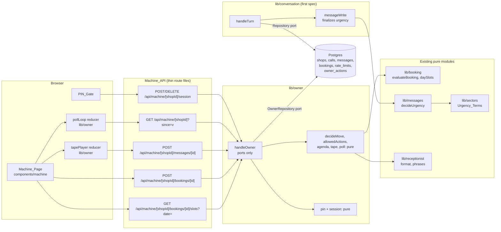
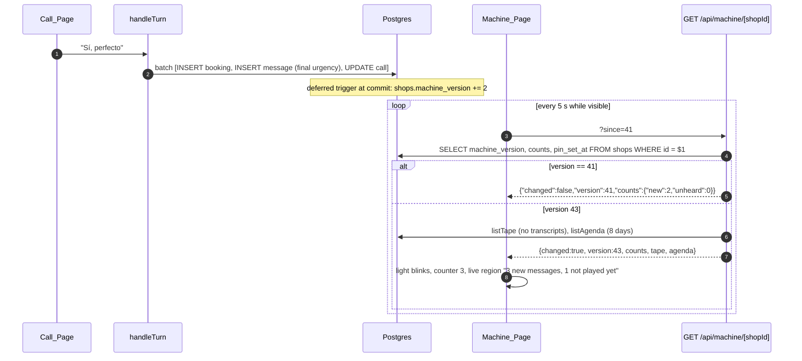
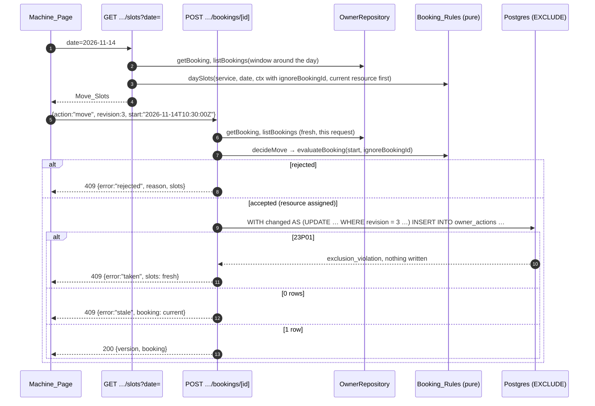

# Design Document: Owner Machine

## Overview

The owner machine is the Owner's screen at `/machine/[shopId]`: the Tape (every Message, from every Channel) and the Agenda (today and the next 7 days), on one ivory answering machine. It is built on what `core-call-loop` already stores:

- `messages`: one row per Call, written by code at every end of a Call (`messages_call_uq`), with `read_at` already in the schema.
- `calls.transcript`: the lines the server itself handled. This is the Transcript the Tape plays. There is no audio anywhere.
- `bookings`: with the `bookings_no_overlap` exclusion constraint, `status` `confirmed | cancelled`, and `rescheduled_from`.
- `rate_limits`: fixed-window counters, reused for PIN attempts.
- `lib/booking` (`evaluateBooking`, `slotCandidates`, `ignoreBookingId`), `lib/sectors` (packs, zod, registry), `lib/receptionist/format.ts` (`formatSlot`, `formatDay`, `formatTime`) and `phrases().owner` (agreed texts and suggested replies).

Five decisions shape the design:

1. **Urgency is code.** The model's per-Turn `urgency` becomes the Suggested_Urgency. A pure `decideUrgency` in `lib/messages/` computes the Rule_Urgency from the Caller's lines and the pack's Urgency_Terms, and the stored Final_Urgency is the higher of the two. The type of the `insertMessage` write only accepts an urgency produced by `decideUrgency`, so none of the five end-of-Call paths can skip it.
2. **One SQL statement per owner action.** Each action is a data-modifying CTE: the conditional `UPDATE` and the `INSERT` of its Audit_Record are one statement. Either both happen or neither does, it works the same on Neon HTTP and on PGlite, and a 23P01 from the no-overlap constraint aborts both.
3. **The database keeps the version.** A deferred constraint trigger bumps `shops.machine_version` on every write to `messages` or `bookings`, so the Poll reads one row by primary key and returns ~60 bytes when nothing changed, every 5 seconds, or every 30 seconds while the page is Idle.
4. **A stateless owner session.** A 6-digit PIN, hashed with scrypt from `node:crypto`, opens an HMAC-signed `HttpOnly` cookie, also from `node:crypto`. No session table and no new dependency.
5. **Moves reuse the caller's rules.** A move is `evaluateBooking` with `ignoreBookingId` against bookings read in the same request, then an `UPDATE` that the same exclusion constraint checks.

Out of scope, as in the requirements: WhatsApp and web chat adapters, sending replies, profile editing, staff accounts, table and order units.

### Working beside the natural-voice spec

Another session is changing `lib/receptionist`, `lib/conversation` and `lib/voice` for `.kiro/specs/natural-voice`. This design keeps out of those directories wherever it can:

- New formatting helpers live in `lib/owner/format.ts` and do not depend on `lib/receptionist/format.ts`.
- The Demo_Shop is recognised by `DEMO_SHOP_ID` in `lib/owner/demo.ts`, not by a new profile field, so `lib/conversation/shopProfile.ts` and `lib/voice/publicShop.ts` do not change. The call page passes `demo` to `CallScreen` itself.
- `visitorKeyOf` moves from `app/api/turn/handler.ts` to `app/api/visitorKey.ts`, not into `lib/conversation`.
- Demo_Retention is its own function in `lib/owner` and runs from the Machine_API and a cron route, so the `sweep` in `lib/conversation/handleTurn.ts` does not change.

One change cannot avoid them: code-decided urgency has to run on every end-of-Call path, which lives in `lib/conversation` (`ownerMessage.ts`, `types.ts`, `handleTurn.ts`, the new `messageWrite.ts`). That work is one task in `tasks.md` (task 9), and it starts only after natural-voice has landed on the main branch, on top of its code. `phrases(lang).owner` is read, never changed.

## Where current documentation changed my first choice

Checked on 2026-11-13 in the Next.js 16.4.5 docs bundled in `node_modules/next/dist/docs`, and, for the review decisions, in the installed `vitest` package. **The network was not available in this session**, so online docs (Lucide, PGlite, Neon, Vercel, jsdom) could not be read; the open questions are listed below the table and become a spike in task 1, as in the first spec.

| Area | First choice from memory | What the docs say | Decision |
|---|---|---|---|
| Session library | `jose` JWT, as in the Next.js authentication guide | The guide uses `jose` only as an example of "your preferred session management library"; the requirement is an encrypted or signed, `HttpOnly` cookie verified on the server. | HMAC-SHA256 over a small JSON payload with `node:crypto` (`createHmac`, `timingSafeEqual`). The payload holds no secret, so signing is enough; no new dependency. |
| Setting the cookie | Set it from the page after the PIN check | `cookies().set` works only in a Server Function or a Route Handler; HTTP cannot set cookies after streaming starts. | The PIN form posts to a Route Handler that sets the cookie; the client then calls `router.refresh()`, so the machine appears without a full reload (1.4). |
| Reading the session in the page | Read `cookies()` at the top of the page | With Cache Components, `cookies()` outside `<Suspense>` blocks prerendering and is flagged by the build. Plain `use cache` cannot call `cookies()`. | Same shape as the call page: static shell, and a `MachineGate` inside `<Suspense>` that awaits `params` and `cookies()`. Nothing personal is cached (14.6); only the shop name lookup reuses the cached `loadPublicShop`. |
| Caching personal data | `use cache: private` for the snapshot | `use cache: private` keeps results in the browser, but the guide warns that cache keys and tags are plain text. | No cache directive on anything that holds caller data. The Poll is a Route Handler that reads the request, so it runs at request time, and it sends `Cache-Control: no-store` (12.8). |
| Route Handler params | `{ params }: { params: { shopId: string } }` | `params` is a promise; the global `RouteContext<'/api/machine/[shopId]'>` helper types it. | Route files use `RouteContext<…>` and stay thin, as `app/api/turn/route.ts` does; the logic sits in testable handler factories. |
| GET Route Handlers | Cached unless opted out | With Cache Components, a GET handler that reads the request, cookies or a database runs at request time. | No segment config needed for the Poll. |
| Lucide icons (checked 2026-11-13, review decision 9) | Deep imports per icon file to keep the bundle small | `optimizePackageImports` in the bundled Next.js 16.4.5 docs lists `lucide-react` among the packages "optimized by default": only the modules actually used are loaded. | One named import per icon (`import { Phone } from "lucide-react"`), no `next.config` change. If the installed package also exports a per-icon entry point, the spike records it, and the components use whichever form Vitest loads faster. |
| DOM tests (checked 2026-11-13, review decision 10) | A global `environment: "jsdom"` in Vitest | The installed Vitest 4.1.12 lists `jsdom` as an optional peer with range `*`, and its own development uses jsdom `^27.4.0`. The current config runs every test in `node` and only includes `tests/**/*.test.ts`. | Keep `node` as the default. DOM test files are `*.test.tsx` and start with `// @vitest-environment jsdom`; the `include` gains `tests/**/*.test.tsx`. The property and database tests keep running in `node`. |

Findings of the task 1 spike (2026-11-15), measured on this machine (Node 20.19.6) and read from the npm registry and the installed packages. The Neon and Vercel answers were read the same day from the docs' Markdown pages, fetched with Node's `fetch` because the web fetch tool and the Context7 server failed at their permission step:

| Area | Expected in the design | What the spike found | Decision |
|---|---|---|---|
| DOM test cleanup | Testing Library cleans up after each test | `@testing-library/react` 16.3.3 (`dist/index.js`) registers its `cleanup` only when `afterEach` is a **global**. `vitest.config.mts` does not enable `globals`, so nothing is cleaned up between tests and renders pile up in `document.body`. | Every DOM test file calls `afterEach(cleanup)` itself (as `tests/components/smoke.test.tsx` does). No `globals: true`, so node tests keep explicit imports. |
| jsdom version | The newest jsdom (Vitest's own development uses `^27.4.0`) | The newest jsdom, 31.0.1 (and all of 30.x), declares `engines.node` `^22.22.2 \|\| ^24.15.0 \|\| >=26.0.0`: it does not support Node 20. 29.1.1 declares `^20.19.0 \|\| ^22.13.0 \|\| >=24.0.0`. | Pin `jsdom` `^29.1.1`, the newest line for Node 20.19. |
| Dialog focus tests | Run in jsdom if `showModal()` exists | jsdom 29.1.1 has `HTMLDialogElement`, but `HTMLDialogElement.prototype.showModal` is `undefined`. | The move and cancel dialog focus checks of 11.10 stay in the manual checklist (task 12). The smoke test asserts `showModal` is missing, so a future jsdom that adds it fails that test on purpose, and the dialog DOM tests can be added then. Components still use the native `<dialog>`; tests must not polyfill `showModal`, because that would test the polyfill instead of the browser. |
| Lucide import form | Named imports, or a per-icon entry point if one exists | `lucide-react` 1.73.0 exports `./icons/*` (`lucide-react/icons/<kebab-name>`) and has `"sideEffects": false`. | Keep one named import per icon from `"lucide-react"` (tech.md; Next.js optimizes the package by default). Task 11 may measure the per-icon entry for Vitest speed, and switches only if the gain is real. |
| Neon compute and the Idle Poll (open question 4) | The Poll is cheap: one primary-key read of ~60 bytes | The cost is not the bytes, it is keeping the compute awake. Neon Free scales to zero only after 5 minutes with no queries, and this cannot be disabled; the allowance is 100 CU-hours per project per month (400 hours at 0.25 CU). A Poll every 5 s, or every 30 s while Idle, means the compute never suspends while a Machine_Page is open and visible. One visible tab left open day and night costs 0.25 CU × 24 h = 6 CU-hours a day, so the month's allowance runs out in about 16–17 days, after which Neon suspends the compute until the next billing period and every Call and Poll fails with `53000`. A hidden tab is fine: 7.6 already stops polling. | **Open, for the owner to decide; requirements unchanged.** The design as written is correct for normal use (a counter tablet open 10 h a day is about 75 CU-hours a month at 0.25 CU), but a forgotten desktop tab on the public demo can take the whole demo down before the jury sees it. Options: (a) after a long Idle (for example 2 h) the page stops polling and shows "Paused, tap to resume", which means a forgotten tab stops blinking; (b) keep 7.1 as it is and add a usage check to the manual checklist (task 12). The daily cron adds about 5 minutes of compute a day, about 0.6 CU-hours a month at 0.25 CU. Task 12's cost note uses these numbers. |
| Daily cron precision (open question 5) | The daily job runs at its set time, so data is deleted "at most one day after it turns 7 days old" (16.6) | Vercel Hobby runs a daily job any time within its set hour ("±59 min"). Two consecutive runs can be up to 24 h 59 min apart. | **Open, for the owner to decide; requirements unchanged.** When nobody opens the machine, a Call can stay up to about 59 minutes past the "at most one day" of 16.6. Options: (a) reword 16.6 to "within about 25 hours"; (b) accept it as within the intent, since the request-time triggers run first whenever someone visits. Tasks 7, 8 and 10.4 do not depend on the choice. |

Open questions for the task 1 spike, with their answers:

1. **Answered: yes.** PGlite 0.5.16 runs `plpgsql` functions and `CREATE CONSTRAINT TRIGGER … DEFERRABLE INITIALLY DEFERRED`. A throwaway Vitest file (deleted afterwards) created a table, a counter, a `plpgsql` function and a deferred constraint trigger `AFTER INSERT OR UPDATE … FOR EACH ROW`. Inside an explicit `BEGIN`, after the `INSERT`, the counter still read 0; after `COMMIT` it read 1. The same held through `pg.transaction` (the path Drizzle's `db.transaction` uses): an `UPDATE` inside it left the counter unchanged until the transaction ended. No extension was needed. Migration 0003 uses the design's form as written; no fallback.
2. **Answered.** `lucide-react` 1.73.0 is `latest`. Peer range: `react` `^16.5.1 || ^17.0.0 || ^18.0.0 || ^19.0.0`, which covers React 19.3. No `engines` field. Per-icon entry: yes, `lucide-react/icons/*` (see the table above). Installed as a dependency.
3. **Answered.** `@testing-library/react` 16.3.3 is `latest`: `engines.node` `>=18`, peers `react` and `react-dom` `^18.0.0 || ^19.0.0` and `@testing-library/dom` `^10.0.0`. npm installed that required peer on its own (`@testing-library/dom` 10.4.2, `engines.node` `>=18`), so it is in the lockfile but not in `package.json`. jsdom: 29.1.1 (see the table above). Vitest 4.1.12 transformed `tests/components/smoke.test.tsx` with the project's `"jsx": "react-jsx"`, with **no** `@vitejs/plugin-react` and no JSX option in `vitest.config.mts`. jsdom 29.1.1 does **not** implement `HTMLDialogElement.showModal()`, so the dialog focus checks stay in the manual checklist.
4. **Answered (read 2026-11-15 from https://neon.com/docs/introduction/plans, the page's Markdown form).** Free plan: **100 CU-hours per project per month**, "enough to run a 0.25 CU compute in a project for 400 hours/month"; autoscaling up to 2 CU. **Scale to zero after 5 minutes of inactivity, and it cannot be disabled on Free.** Suspended computes accrue no CU-hours. When the CU-hours run out, the compute is suspended until the next billing period and connections fail with SQLSTATE `53000`. This changes a design assumption; see "Neon compute and the Idle Poll" in the table above.
5. **Answered (read 2026-11-15 from https://vercel.com/docs/cron-jobs/usage-and-pricing and https://vercel.com/docs/cron-jobs/manage-cron-jobs, which now redirect under `/docs/schedules/cron-jobs/`).** Hobby: **100 cron jobs per project, at most once per day**, and a more frequent expression fails the deployment. Timing precision on Hobby is per hour: a job set for `0 1 * * *` runs any time between 01:00 and 01:59. The secret: when the project has a `CRON_SECRET` environment variable, Vercel sends it as **`Authorization: Bearer <CRON_SECRET>`**, the value captured at build time of the production deployment. The design's expectation holds: one daily entry in `vercel.json`, and the route compares that header with `process.env.CRON_SECRET`, refusing when either is missing (16.8). A daily job is available, so 16.6 does not fall back to request-time triggers only. Two notes for task 10.4: the docs now call Cron Jobs "a legacy feature" that "will be migrated to Schedules", and Vercel Schedules is in public beta (https://vercel.com/docs/schedules/limits); the design stays on the generally available Cron Jobs and does not adopt a beta. And the per-hour precision affects 16.6; see "Daily cron precision" in the table above.

**Found in task 3 (2026-11-16): DOM tests cannot start on this machine right now.** `tests/components/smoke.test.tsx` (passing in task 1) now fails before any test code runs: the Vitest worker never answers ("Timeout waiting for worker to respond", 60 s), alone or with other files. Plain `node -e "import('jsdom')"` hangs for more than 3 minutes too. A require-by-require probe found the hang in `css-tree` (needed by jsdom through `@asamuzakjp/dom-selector`), and `ls -lO` shows why: `node_modules/css-tree/dist/csstree.js`, `data.js` and `version.js` are marked `compressed,dataless`. The project lives under `~/Documents`, which macOS syncs with iCloud Drive, and iCloud evicted those files to placeholders; reading one blocks until it is downloaded again. This is the machine, not the code, and it probably explains the "Failed to start forks worker" errors of the full runs as well. Fixes for the owner (not done by Kiro, because they touch the machine): exclude `node_modules` from iCloud (rename it `node_modules.nosync` with a symlink, or move the repository out of `~/Documents`), or run `brctl download node_modules` / reinstall with `npm ci`. Task 11's DOM tests need this fixed first.

## Architecture



### Sequence: opening the machine

```mermaid
sequenceDiagram
  autonumber
  participant B as Machine_Page (browser)
  participant G as MachineGate (server, in Suspense)
  participant A as POST /session
  participant R as OwnerRepository
  B->>G: GET /machine/peluqueria-lola
  G->>R: getShopAccess(shopId)
  G->>G: verifySession(cookie) → none
  G-->>B: PIN_Gate (shop name only)
  B->>A: {pin, label} (Origin checked, JSON only)
  A->>R: hitCounters([pin:v:shop:visitor 15 min, pin:s:shop 1 h only for a Real_Shop])
  alt over a limit
    A-->>B: 429 "Too many tries" (PIN not checked)
  else within limits
    A->>A: verifyPin(pin, ownerPinHash) (scrypt, timingSafeEqual)
    alt wrong
      A-->>B: 401 same message for every wrong PIN; log owner_auth
    else right
      A-->>B: 204 + Set-Cookie __Host-pl_owner (HttpOnly, Secure, SameSite=Strict, 12 h)
      Note over A: Demo_Shop only: runDemoRetention runs before the 204 is sent (16.6)
      B->>G: router.refresh()
      G->>R: snapshot (tape without transcripts, agenda)
      G-->>B: machine with initial data
    end
  end
```

### Sequence: the Poll and a finished call



### Sequence: moving a booking



## Components and Interfaces

### Module layout

```
app/
  page.tsx                                   landing page: demo links + DEMO_OWNER_PIN (Requirement 3)
  machine/[shopId]/page.tsx                  static shell + <Suspense><MachineGate/></Suspense>
  machine/[shopId]/MachineGate.tsx           server: params, cookies(), session check → PinGate | MachineScreen
  machine/[shopId]/loadMachine.ts            server-only: builds OwnerDeps, the initial snapshot
  machine/[shopId]/error.tsx                 "the machine is not available right now" (DB down)
  api/machine/[shopId]/route.ts              GET: the Poll
  api/machine/[shopId]/session/route.ts      POST: PIN login; DELETE: lock
  api/machine/[shopId]/messages/[messageId]/route.ts            POST {action: play | erase}
  api/machine/[shopId]/bookings/[bookingId]/route.ts            POST {action: confirm | move | cancel}
  api/machine/[shopId]/bookings/[bookingId]/slots/route.ts      GET ?date=YYYY-MM-DD
  api/machine/handlers.ts                    makeMachineHandlers(deps): every handler, testable with Request
  api/cron/demo-retention/route.ts           GET: daily Demo_Retention, Authorization: Bearer CRON_SECRET (16.6, 16.8)
  api/visitorKey.ts                          visitorKeyOf, moved here from api/turn/handler.ts; shared by both adapters
vercel.json                                  the one daily cron entry
components/machine/
  MachineScreen.tsx  MachineBody.tsx  TapeReels.tsx  MessageLight.tsx  MessageCounter.tsx  ViewTabs.tsx
  TapeView.tsx  TapeCard.tsx  TranscriptTape.tsx  UrgencyBadge.tsx  SampleBadge.tsx  ChannelLabel.tsx  CopyReplyButton.tsx
  AgendaView.tsx  AgendaDay.tsx  AgendaRow.tsx  MoveDialog.tsx  CancelDialog.tsx
  PinGate.tsx  LockButton.tsx  DemoNotice.tsx  LanguageSwitch.tsx (reuses components/call/LanguageSwitch if its props fit)
  useMachinePoll.ts  useTapePlayer.ts  machineCopy.ts
lib/
  messages/  PURE  index.ts (formatMessageCount moves here from lib/messages.ts) urgency.ts terms.ts tape.ts
                   currentReply.ts agreedText.ts
  owner/     PURE  types.ts api.ts (zod request/response schemas, shared with the browser) format.ts demo.ts
                   pin.ts session.ts limits.ts agenda.ts move.ts poll.ts pollLoop.ts tapePlayer.ts
             PORTS handleOwner.ts, demoRetention.ts (I/O only through injected OwnerDeps)
  booking/   PURE  + daySlots, preferResource (new rules, with properties)
  sectors/   PURE  + Urgency_Terms in each pack's vocabulary
  conversation/    + messageWrite.ts (the one place an end-of-Call Message becomes a Write); task 9, after natural-voice
  db/        I/O   + ownerRepository.ts, schema additions, seed sets the PIN
drizzle/           0002_owner_machine.sql (generated), 0003_machine_triggers.sql (custom)
tests/             mirrors lib/ (+ tests/owner, tests/messages, tests/design, tests/components/machine for jsdom tests)
```

`lib/messages.ts` becomes `lib/messages/index.ts`. The existing smoke test imports `../lib/messages`, which resolves to the directory's index, so it needs no change. `lib/owner/` is a new directory. `structure.md` lists it, `lib/messages/` and the `api/machine/…` routes, which replace the planned `api/messages/route.ts` (review decision 6).

### Changes to first-spec code

| File | Change | Why | Task |
|---|---|---|---|
| `lib/sectors/types.ts` | `vocabulary[lang]` gains `urgent: string[]` and `today: string[]`; `VocabularyKey` becomes `"booking" \| "bookingVerb" \| "service"` so `term()` still returns a string; `SectorPackDataSchema` validates the lists (1–40 terms, 1–40 characters, no duplicates after normalization). | 5.2 | 2 |
| `lib/sectors/hairSalon.ts` | Ships the terms below. | 5.12 | 2 |
| `lib/messages.ts` → `lib/messages/index.ts` | `formatMessageCount` gains `lang`. | 6.3 | 2 |
| `lib/db/schema.ts`, `lib/db/repository.ts` | Schema additions below; `cancelBooking` sets `cancelled_by = 'caller'`; `insertMessage` writes the new columns. | 4.3, 11.5 | 8 |
| `lib/db/seed.ts` | Takes the shop id from `DEMO_SHOP_ID`; sets the PIN hash from `DEMO_OWNER_PIN`. | 2.6 | 8 |
| `tests/db/pglite.ts` | `reset()` also truncates `owner_actions`. | | 8 |
| `app/api/turn/handler.ts` | Imports `visitorKeyOf` from `app/api/visitorKey.ts`; no other change. | 2.2 | 10 |
| `app/call/[shopId]/page.tsx`, `components/call/CallScreen.tsx` | The page passes `demo={isDemoShop(shop.id)}`; `CallScreen` renders `DemoNotice` above the Call button when it is set. | 3.3 | 11 |
| `lib/conversation/ownerMessage.ts` | Returns an `OwnerMessageDraft` (urgency is the suggestion, plus `requestedDate` and the booking start). | 4.1, 5.8 | 9 (after natural-voice) |
| `lib/conversation/messageWrite.ts` (new) | `messageWrite(draft, ctx)` calls `decideUrgency` and returns the `insertMessage` write. | 4.1 | 9 (after natural-voice) |
| `lib/conversation/types.ts` | `Effect.saveMessage` carries a draft; `Write.insertMessage` requires `OwnerMessage` with a branded `FinalUrgency`. | type-level guarantee for 4.1 | 9 (after natural-voice) |
| `lib/conversation/handleTurn.ts` | `writesFor`, `endWithFallback`, `giveUpAfterConflicts`, `hangup` go through `messageWrite` with the transcript they already hold. | 4.1 | 9 (after natural-voice) |
| `lib/db/repository.ts` (`closeStaleCalls`) | Goes through `messageWrite`. | 4.1 | 9 (after natural-voice) |

Not changed, so the natural-voice session keeps them: `lib/receptionist/*` (the new `formatClock` and `formatDayHeading` live in `lib/owner/format.ts`), `lib/voice/*`, `lib/conversation/shopProfile.ts`, and the `sweep` in `handleTurn.ts`. The `PhraseSet.owner` texts, `formatSlot`, the Booking_Rules evaluation order, the constraint and the Turn_API contract do not change.

## Urgency (`lib/messages`)

### Pack data

```ts
// lib/sectors/types.ts (addition)
vocabulary: Record<Lang, {
  booking: string; bookingVerb: string; service: string;
  /** Any of these in a Caller line makes the Message urgent (5.3). */
  urgent: readonly string[];
  /** A request for today (5.4, 5.5). */
  today: readonly string[];
}>;
```

Hair salon:

| | `urgent` | `today` |
|---|---|---|
| es | urgente, urgentemente, urgencia, emergencia, alergia, alérgica, alérgico, reacción, me pica, quemadura, me quema, dolor | hoy, esta mañana, esta tarde, esta noche, ahora mismo, cuanto antes, lo antes posible |
| en | urgent, urgently, emergency, allergy, allergic, reaction, itching, burn, burning, pain | today, this morning, this afternoon, tonight, right now, asap, as soon as possible |

Allergy and burn terms are there because a reaction to a dye is the hair salon's real emergency. Bare "ahora" and "now" are left out: "ahora mismo no puedo" and "I now want…" are common and would mark half the calls as same-day. The physio pack will add "dolor fuerte", "no puedo moverme" and similar terms in the sector-packs spec.

### Matching

```ts
// lib/messages/terms.ts
/** normalizeName from lib/conversation/matchCaller, then every non-letter/digit run becomes one space. */
export function normalizeForMatch(text: string): string;
/** The words of a normalized text, padded so whole-word search is a substring search: " hoy a las 5 ". */
export function wordsOf(text: string): string;
/** The first term (in list order) that occurs as whole words in any line, or null. */
export function findTerm(lines: readonly string[], terms: readonly string[]): string | null;
```

`findTerm` normalizes each term the same way and searches `" " + term + " "` inside `wordsOf(line)`. So "HOY," matches "hoy", "Lo antes   posible" matches "lo antes posible", "alérgica" matches "alergica", and "hoyo" does not match "hoy" (5.9).

### Decision

```ts
// lib/messages/urgency.ts
export type Urgency = "low" | "normal" | "urgent";            // same type as lib/conversation
declare const finalBrand: unique symbol;
export type FinalUrgency = Urgency & { readonly [finalBrand]: true };

export type UrgencyBasis =
  | { rule: "urgent_term"; term: string; lang: Lang }
  | { rule: "today_open" | "today_handled"; via: "term" | "requested_day" | "booking_day"; term?: string }
  | { rule: "model_failed" }
  | { rule: "none" };

export interface UrgencyInput {
  callerLines: readonly string[];          // the Caller side of the Transcript only (5.10)
  vocabulary: SectorPack["vocabulary"];    // every language of the pack is searched (5.3)
  timeZone: string;
  now: Temporal.Instant;
  requestedDate: Temporal.PlainDate | null; // shop-local, from CallState.fields.requested
  bookingStart: Temporal.Instant | null;    // the Booking the Call created, moved or cancelled
  outcome: Outcome;
  modelFailed: boolean;
  suggested: Urgency | null;                // null when the model never gave a valid Turn
}
export interface UrgencyDecision {
  final: FinalUrgency;
  rule: Urgency;
  basis: UrgencyBasis;
  suggested: Urgency | null;
}
export function decideUrgency(input: UrgencyInput): UrgencyDecision;
export function maxUrgency(a: Urgency, b: Urgency): Urgency;
```

Rules, in order; the first that fires sets `rule` and `basis`:

1. `urgent_term`: `findTerm(callerLines, vocabulary[l].urgent)` for each pack language `l` → `urgent` (5.3).
2. Today: `today` term in the Caller lines, or `requestedDate` equals today in `timeZone`, or `bookingStart`'s local date equals today. Then `today_open` → `urgent` when `outcome` is not `booked`, `rescheduled` or `cancelled` (5.4); `today_handled` → `normal` otherwise (5.5).
3. `model_failed` → `normal` (5.6).
4. `none` → `low` (5.7).

`final = maxUrgency(rule, suggested ?? "low")` (5.8). `suggested` is `state.note.urgency` when `state.note.reason.trim() !== ""`, because `decideTurn` writes both from every valid model Turn and `reason` has `min(1)`; the initial `"normal"` of a Call with no valid Turn is not a suggestion.

`decideUrgency` is the only function that returns a `FinalUrgency` (it casts once). `Write.insertMessage.message.urgency` has that type, so a Message cannot be written with an unchecked urgency.

Added in task 2 (2026-11-15), so task 9 does not have to re-derive them: `suggestedFrom(note)` returns `null` for a blank `reason` (the initial `"normal"`) and `note.urgency` otherwise, and `callerLinesOf(transcript)` returns `transcript.map(l => l.caller)`; M3(a) runs through it. `lib/sectors/types.ts` imports `normalizeForMatch` from `lib/messages/terms.ts` for the duplicate check, so the schema and the matcher can never disagree on what counts as the same term (no import cycle: `terms.ts` imports only `matchCaller.ts`, which imports nothing). `formatMessageCount(0, "es")` is "ningún mensaje nuevo". Because `FinalUrgency` is a branded intersection, indexing a `Record<Urgency, …>` with it needs a plain `Urgency` first (`const u: Urgency = d.final`).

### Where it runs

```ts
// lib/conversation/messageWrite.ts (pure)
export interface MessageWriteContext {
  call: Pick<StoredCall, "id" | "channel">;
  shop: ShopProfile;
  pack: SectorPack;
  transcript: readonly Line[];   // includes the current Turn's line when there is one
  now: Temporal.Instant;
  bookingId?: string;
}
export function messageWrite(draft: OwnerMessageDraft, ctx: MessageWriteContext): Extract<Write, { type: "insertMessage" }>;
```

All five end-of-Call paths call it: `writesFor` (completed Turns), `endWithFallback`, `giveUpAfterConflicts`, `hangup`, and the stale-call sweep in `closeStaleCalls`. The Caller lines are `transcript.map(l => l.caller)`; the greeting row has `caller: ""` and adds nothing.

### What the Owner sees

`urgencyBasisText(basis, lang)` in `lib/messages/tape.ts`: "Urgente · dijo «alergia»", "Urgente · pide cita para hoy y no quedó cerrada", "Normal · era para hoy, ya está apuntada", "Normal · el contestador falló". The quoted word is the pack's own term, never the caller's sentence. Rows written before this spec have `urgency_basis = NULL` and show the badge alone.

As built in task 3 (2026-11-16), the signature is `urgencyBasisText({ urgency, urgencyBasis }, lang, pack)`, for two reasons found while writing it. (1) The basis alone gives the rule's level, but the badge shows the Final_Urgency; when the model's suggestion raised a Message above the rule (rule `none`, suggestion `urgent`), a basis-only text would read "Baja · …" under an "Urgente" badge. The text now says "Urgente · lo marcó el asistente" / "Urgent · flagged by the assistant" in that case. (2) "pide cita" names the booking, which must come from the pack's vocabulary (sector-packs steering), so the pack is a parameter. The Spanish wording avoids gendered participles that would break for "encargo": "Urgente · pide cita para hoy y quedó sin cerrar", "Urgente · dijo «esta tarde» y quedó sin cerrar", "Normal · es para hoy y ya quedó resuelto", "Normal · el contestador falló", "Baja · nada urgente". `urgencyLabel(urgency, lang)` is the badge text ("Urgente" / "Urgent", 7.8). `lightAnnouncement` for zero is "No new messages" / "No hay mensajes nuevos".

## The Tape (`lib/messages/tape.ts`, `lib/owner/tapePlayer.ts`)

```ts
export interface TapeEntry {
  id: string;
  urgency: Urgency;
  heard: boolean;          // read_at IS NOT NULL
  createdAt: string;       // ISO instant
}
/** Unheard first; then urgent > normal > low; then newest first; ties by id. A permutation of the input. */
export function orderTape<T extends TapeEntry>(items: readonly T[]): T[];
export function tapeCounts(items: readonly TapeEntry[]): { new: number; unheard: number };
export type LightState = "blinking" | "steady" | "off";
export function lightState(counts: { new: number; unheard: number }): LightState;   // 6.4
/** "3 new messages, 1 not played yet" / "3 mensajes nuevos, 1 sin escuchar" / "No new messages". */
export function lightAnnouncement(counts: { new: number; unheard: number }, lang: Lang): string;
export function formatMessageCount(count: number, lang?: Lang): string;            // existing, gains `lang`
```

The Tape lists only messages with `erased_at IS NULL`, at most 200. A Real_Shop with more is asked to erase; the Demo_Shop never gets near the cap because of Demo_Retention.

### Current_Reply

```ts
// lib/messages/currentReply.ts
export interface ReplyBooking {
  serviceId: string;
  start: Temporal.Instant;
  status: "confirmed" | "cancelled";
  cancelledBy: "caller" | "owner" | null;
  ownerMovedAt: Temporal.Instant | null;   // latest 'move' Audit_Record
}
export function currentReply(
  m: { suggestedReply: string; callerName: string | null; createdAt: Temporal.Instant },
  booking: ReplyBooking | null,
  callLang: Lang, shop: ShopProfile, pack: SectorPack,
): string;
```

The stored reply, unless the Owner changed the Booking after the Message: cancelled by the owner → `phrases(callLang).owner.replyCancelled(name)`; moved by the owner after `createdAt` → `replyRescheduled(name, serviceId, start)` with the current start. The texts are the existing templates, so the Owner never copies a reply with a stale time (4.6). The reply stays in the Call's language because it is sent to the customer.

### Agreed_Text (review decision 14)

```ts
// lib/messages/agreedText.ts
export interface AgreedBooking {
  serviceId: string; resourceId: string; start: Temporal.Instant;
  status: "confirmed" | "cancelled";
}
/** "what was agreed" in `lang`, from the Booking as it is now. */
export function agreedText(outcome: Outcome, booking: AgreedBooking, lang: Lang, shop: ShopProfile, pack: SectorPack): string;
```

- A cancelled Booking → `phrases(lang).owner.agreedCancelled(serviceId, start)`.
- An active Booking with outcome `rescheduled` → `agreedRescheduled(serviceId, start, resourceId)`; any other active Booking → `agreedBooked(serviceId, start, resourceId)`. An owner move shows the new time; the Agenda row says who moved it (9.5).
- These are the templates `buildOwnerMessage` already used to write the stored text, so the Spanish rendering of an unchanged Booking equals the stored text (a unit test checks it).
- The server computes it for every language of the Shop, so the ES / EN switch needs no request: `TapeItem.agreed` is `{ byLang: Record<Lang, string> } | { stored: string }`. The page shows `byLang[labelLang]` with `lang={labelLang}`, or `stored` with the Shop's first language as `lang` (13.7).
- A Message without a Booking (answered, message, fallback, abandoned, and the Sample_Messages) shows the stored text. The reason is always the stored text (4.7).

### Tape player (browser, pure reducer)

```ts
export interface TapePlayerState {
  items: Record<string, TapeItem>;        // the latest snapshot, minus erased ids
  queue: readonly string[];               // Tape_Order frozen at PLAY (7.5)
  index: number;
  playing: string | null;
  erased: readonly string[];              // every id erased in this page's life
  version: number;                        // the newest Machine_Version applied
}
export type TapePlayerEvent =
  | { type: "SNAPSHOT"; version: number; items: readonly TapeItem[] }
  | { type: "PLAY" } | { type: "NEXT" } | { type: "STOP" }
  | { type: "ERASE"; id: string } | { type: "ERASED"; id: string; version: number }
  | { type: "TRANSCRIPT"; id: string; lines: readonly Line[] };
export type TapePlayerEffect =
  | { type: "postPlay"; id: string } | { type: "postErase"; id: string };
export function tapePlayer(s: TapePlayerState, e: TapePlayerEvent): [TapePlayerState, TapePlayerEffect[]];
```

- A `SNAPSHOT` with a `version` lower than `state.version` is ignored. A Poll computed before an ERASE committed can therefore never put the Message back (8.1).
- `erased` filters every later snapshot too, so even an out-of-order response from another code path cannot show an erased id.
- `PLAY` freezes `orderTape(items)` into `queue` and plays `queue[0]`; `NEXT` moves along the frozen queue and skips ids erased since. A new Message joins at the next `PLAY`.

As built in task 3 (2026-11-16):

- The reducer is generic, `tapePlayer<T extends TapeEntry>`, so it is written and tested before `TapeItem` exists (task 6 plugs it in), and `lib/owner/tapePlayer.ts` imports only `lib/messages/tape.ts` and the `Line` type.
- The state has two more fields than the sketch above: `transcripts` (where `TRANSCRIPT` stores the lines PLAY fetched) and `played` (ids PLAY showed on this page). A Message in `played` stays `heard` even if a snapshot of the same version, computed before the play committed, still says unheard, so the counter never goes back up. `initialTapePlayer(version, items)` builds the first state and `tapeItems(state)` lists the items in Tape_Order.
- An erased id is removed from `queue` as well, and `index` moves with it, so "never comes back in the rest of `queue`" holds for the whole queue. ERASE of the Message on screen stops on it (`playing = null`) instead of starting the next one, because starting the next one would mark it heard without the Owner asking; NEXT then plays the Message that followed it.
- A snapshot that no longer lists the Message on screen (erased on another device) also stops on it; NEXT skips ids that are no longer on the Tape.
- ERASE sends `postErase` once per id; a repeat changes nothing. `ERASED` raises `version` to the erase's version (never lowers it), which is what makes an older Poll ignorable.

### Transcript playback

`TranscriptTape` renders every line in an `<ol>` from the start. While playing, lines after the current one get a CSS class that hides them visually only (`opacity: 0`, not `display: none` or `aria-hidden`), and one more line is revealed every 900 ms, so a screen reader reads the whole Transcript at once (7.3). Under `prefers-reduced-motion` the class is never applied. The reels rotate while `playing !== null` and the reveal is unfinished.

## The Agenda (`lib/owner/agenda.ts`)

```ts
export type AgendaStatus = "booked" | "confirmed" | "cancelled";
export type OwnerBookingAction = "confirm" | "move" | "cancel";

export interface AgendaBooking {
  id: string;
  revision: number;
  resourceId: string;
  serviceId: string;
  start: Temporal.Instant;
  end: Temporal.Instant;
  status: "confirmed" | "cancelled";          // the database column
  ownerConfirmedAt: Temporal.Instant | null;
  cancelledBy: "caller" | "owner" | null;
  customerName: string;
  channel: Channel;
  lastOwnerAction: { action: OwnerBookingAction; label: string; at: Temporal.Instant } | null;
}

/** Today 00:00 to the start of today + 8 local days, in the shop's zone; the 8 local dates. */
export function agendaWindow(now: Temporal.Instant, timeZone: string): { from: Temporal.Instant; to: Temporal.Instant; days: Temporal.PlainDate[] };
export function agendaStatus(b: Pick<AgendaBooking, "status" | "ownerConfirmedAt">): AgendaStatus;
/** None for a cancelled booking or one that has started (start <= now); confirm only while unconfirmed. */
export function allowedActions(b: AgendaBooking, now: Temporal.Instant): OwnerBookingAction[];
export interface AgendaDay { date: string; items: AgendaBooking[] }   // active by start, then cancelled by start
export function groupAgenda(rows: readonly AgendaBooking[], window: ReturnType<typeof agendaWindow>, timeZone: string): AgendaDay[];
/** What was booked, in the pack's words: the Service name for an `appointment` pack. */
export function agendaWhat(b: AgendaBooking, shop: ShopProfile, pack: SectorPack, lang: Lang): string;
```

`agendaWindow` uses `PlainDate.add({ days })` and `toInstant(date, "00:00", tz)`, so the 23- and 25-hour days are handled like the rest of `lib/booking`. Days are always 8, even when empty (9.1). `agendaWhat` handles `unit: "appointment"`; the `table` and `order` branches return the Service name until the sector-packs spec stores party size and items.

Times and day headings come from `lib/owner/format.ts`: `formatClock(instant, tz, lang)` ("19:30" / "7:30 pm") and `formatDayHeading(date, lang)` ("Viernes 13" / "Friday the 13th"). They are self-contained on purpose: the natural-voice spec is turning the receptionist's `formatTime` and `formatDay` into spoken forms ("a las siete y media"), which is right for a voice and wrong for a written agenda. Both are pure and have no server imports, so the browser uses them too. If natural-voice changes the written `phrases(lang).owner` templates as well, `agreedText` follows them automatically, and the unit test "unchanged Booking renders the stored text" shows any drift.

The mapping between the database and the screen is deliberate: an active Booking is `status = 'confirmed'` in the database because the exclusion constraint filters on it, and renaming it would rebuild the constraint. The Owner's confirmation is `owner_confirmed_at`. `agendaStatus` is the only place that turns the two into the three words the Owner sees.

## Moves (`lib/booking` additions, `lib/owner/move.ts`)

```ts
// lib/booking/rules.ts
/** The same shop with `resourceId` first in allocation order (the other resources keep their order). */
export function preferResource(shop: ShopRules, resourceId: string): ShopRules;

// lib/booking/slots.ts
/** Every grid start of `date`'s sessions that evaluateBooking accepts for the request, in time order. */
export function daySlots(
  req: { serviceId: string; ignoreBookingId?: string },
  date: Temporal.PlainDate,
  ctx: RuleContext,
): Slot[];

// lib/owner/move.ts
export const MOVE_WINDOW_DAYS = 14;
export function moveDays(now: Temporal.Instant, timeZone: string): Temporal.PlainDate[];   // today … today + 13
export function moveContext(b: AgendaBooking, shop: ShopProfile, pack: SectorPack, now: Temporal.Instant,
                            existing: readonly ExistingBooking[]): RuleContext;              // preferResource(toShopRules(shop), b.resourceId)
export type MoveDecision =
  | { ok: true; verdict: AcceptedVerdict }
  | { ok: false; reason: RejectionReason | "not_movable" | "outside_move_window"; slots: Slot[] };
export function decideMove(input: {
  booking: AgendaBooking; start: Temporal.Instant; now: Temporal.Instant;
  shop: ShopProfile; pack: SectorPack; existing: readonly ExistingBooking[];
}): MoveDecision;
```

`decideMove`:

1. `not_movable` unless `allowedActions(booking, now)` includes `move` (10.1).
2. `outside_move_window` unless the start's local date is in `moveDays(now)`.
3. `evaluateBooking({ serviceId: booking.serviceId, start, ignoreBookingId: booking.id }, moveContext(...))`. Accept with its verdict, or reject with its reason (10.4, 10.9).
4. A rejection carries `daySlots` of the requested day, so the dialog refreshes in place.

`preferResource` changes only the allocation order, which `evaluateBooking` already treats as a preference ("the result does not depend on the order of `existing`, only on the order of `resources`"). So a move keeps the chair when it is free and takes another one otherwise (10.6), and every result is still an accepted verdict.

The move updates the row in place: same id, customer, Service, Channel, `call_id` and Message link; new `starts_at`, `ends_at`, `resource_id`; `owner_confirmed_at = NULL` (10.6, review decision 4). The no-overlap constraint checks `UPDATE`s like `INSERT`s, so the database guarantee is the same as for a caller (10.5).

As built in task 4 (2026-11-16):

- Only a Booking_Rules rejection carries the fresh `daySlots` of the requested day. `not_movable` and `outside_move_window` carry `slots: []`: nothing can be offered for a Booking that cannot move, and the slots route lists only days in `moveDays`. `unknown_service` and `closed_day` carry `[]` because `daySlots` finds nothing. A small `isMoveDay(date, now, tz)` helper sits next to `moveDays`.
- `daySlots` sorts and de-duplicates its starts. On a DST day two sessions of one local date can cover overlapping instants (for example 01:00–02:30 and 03:00–04:00 on 29 March in Madrid: 02:30 does not exist and becomes 03:30), so the same grid instant could otherwise appear twice. M8 checks "no duplicates" over random shops in five zones.
- `allowedActions` returns `["confirm", "move", "cancel"]` in that order (the order of the buttons), or `["move", "cancel"]` once confirmed.
- `agendaWhat` shows the Service id when the Service is no longer in the profile, so a row never renders empty.
- The generators in `tests/booking/arbitraries.ts`: `arbAgendaBookings` (an Agenda built from accepted requests, accepted 0–3 days before `now` so some bookings have started, some cancelled, some confirmed), `arbAgendaBooking` (one booking from it), `arbMoveStart`, `profileOf` (the Shop_Profile and Sector_Pack behind an `arbShop` case), and the case generators `arbMoveCase` (M7), `arbDaySlotsCase` (M8), `arbMoveSequence` (M9) and `arbAgendaCase` (M10), which P8's coverage test samples. A third of the M7 starts land on another booking's start (±1 minute). Without that, the branch "the booking's own resource is busy, so the move takes another one" was never reached in 200 runs, and M7 now asserts that every branch was reached.
- Mutation checks: skipping `ignoreBookingId` in `decideMove` (M7 and the unit test), dropping `preferResource` from `moveContext` (M7), stopping `daySlots` one grid step early (M8), reading Agenda days in UTC (M10), and checking a move against an empty agenda (M9). Each was caught. The code was restored each time. The counterexamples are in NOTAS-KIRO.md.

## Owner access (`lib/owner/pin.ts`, `session.ts`, `limits.ts`)

### PIN

```ts
export const PIN_PATTERN = /^\d{6}$/;
/** "scrypt$16384$8$1$<salt b64url>$<hash b64url>"; 16-byte random salt, 32-byte key. */
export function hashPin(pin: string): Promise<string>;
/** Recomputes with the stored parameters; compares with crypto.timingSafeEqual. False for any malformed hash. */
export function verifyPin(pin: string, stored: string): Promise<boolean>;
```

scrypt N = 16384, r = 8, p = 1 needs 16 MiB, under Node's default `maxmem` of 32 MiB, and takes tens of milliseconds. The async `crypto.scrypt` is used so a login does not block the event loop. A 6-digit PIN has 10⁶ values. For a Real_Shop, the per-Shop cap of 30 tries per hour holds even against many IP addresses, so finding a PIN takes on average 500,000 tries, about 16,700 hours (1.9 years) of continuous attack, and that attack also shows up as `owner_auth` lines in the log. The per-Visitor cap of 5 per 15 minutes stops a single device much sooner. The hash protects the PIN if the database leaks.

The hash lives in `shops.owner_pin_hash`, never in `shops.profile`, because the profile is loaded by the receptionist and `toPublicShop`. `owner_pin_set_at` records when it last changed (2.1).

### Attempt limits

```ts
export interface PinLimitConfig { perVisitorPer15Min: number /* 5 */; perShopPerHour: number /* 30 */ }
export function pinLimitsFromEnv(env: Record<string, string | undefined>): PinLimitConfig;
/** Counts include this attempt, as in checkLimits. `shop` is null for the Demo_Shop, which has no shop-wide cap. */
export function checkPinAttempts(counts: { visitor: number; shop: number | null }, cfg: PinLimitConfig):
  { blocked: false } | { blocked: true; limit: "visitor" | "shop" };
/** "pin:v:<shop>:<visitor>" 15 min for every Shop; "pin:s:<shop>" 1 h only when `demo` is false. */
export function pinCounterKeys(shopId: string, visitorKey: string, now: Temporal.Instant, demo: boolean):
  readonly { key: string; windowStart: Temporal.Instant }[];
```

Review decision 12: the Demo_Shop counts and caps only per Visitor. Its PIN is printed on the landing page, so the shop-wide cap protects nothing there and would let one script lock every judge out for an hour. A Real_Shop keeps both caps.

The Visitor key is `visitorKeyOf(x-forwarded-for, RATE_LIMIT_SALT)` from the Turn_API, moved to `app/api/visitorKey.ts` so both adapters share it. Counters use a new `OwnerRepository.hitCounters`, the same `INSERT … ON CONFLICT DO UPDATE … RETURNING` as `hitRateLimits` with caller-chosen windows. The existing prune in `sweep` already deletes rows older than a day.

### Session

```ts
export const SESSION_COOKIE = "__Host-pl_owner";
export const SESSION_HOURS = 12;
export interface SessionPayload {
  v: 1;
  shopId: string;
  sid: string;        // 16 random bytes, base64url: the Actor's session id
  label: string;      // normalizeLabel(input): 1–30 chars, no control characters, collapsed spaces
  iat: number;        // epoch seconds
  exp: number;        // iat + 12 h
  pv: number;         // owner_pin_set_at in epoch seconds
}
export function signSession(p: SessionPayload, secret: string): string;   // "v1.<b64url(json)>.<b64url(hmac)>"
export function verifySession(token: string | undefined, secret: string,
  expect: { shopId: string; now: Temporal.Instant; pinSetAt: Temporal.Instant | null }):
  { ok: true; session: SessionPayload } | { ok: false; reason: "missing" | "malformed" | "bad_signature" | "expired" | "other_shop" | "pin_changed" };
export function normalizeLabel(raw: string | undefined, lang: Lang): string;
```

- `OWNER_SESSION_SECRET` must be at least 32 characters. If it is missing, login answers `503 machine_not_configured` and every session is invalid; the log says so, without the value.
- `pv` makes a PIN change revoke every session of that Shop (1.8). The seed re-hashes only when `DEMO_OWNER_PIN` no longer verifies against the stored hash, so re-running the seed does not log the jury out.
- The `__Host-` prefix forces `Secure`, `Path=/` and no `Domain`. Chrome accepts `Secure` cookies on `http://localhost`, so local development works.
- One cookie holds one Shop. Logging in to another Shop replaces it.

Findings from task 5 (checked against Node 20.19.6, not only the docs):

- `verifyPin` passes `maxmem: 256 * N * r` explicitly. N = 16384, r = 8 fits Node's default 32 MiB, but a stored hash with N = 32768 makes Node 20 throw `ERR_CRYPTO_INVALID_SCRYPT_PARAMS` synchronously under the default, so "recompute with the stored parameters" would fail for a stronger hash. Stored parameters are bounded (N a power of two ≤ 32768, r ≤ 8, p ≤ 4) so a damaged row cannot ask for unbounded memory; anything outside returns false.
- `verifySession` compares the MAC as canonical base64url text, not decoded bytes. A 32-byte HMAC is 43 characters and the last one carries 2 spare bits that `Buffer.from(…, "base64url")` ignores, so a byte compare accepts 4 different spellings of one MAC (M12's last-character property shows it, see NOTAS-KIRO.md).
- An `OWNER_SESSION_SECRET` shorter than 32 characters makes `signSession` throw and `verifySession` answer `bad_signature`; the handler (task 10) turns the first into `503 machine_not_configured`.
- Tests compare Temporal values by their ISO text: Temporal objects have no own enumerable keys, so Vitest's `toEqual` calls any two `Instant`s equal.

### Request checks for every Machine_API handler

1. State-changing requests: `Origin` must equal the request's own origin (1.10), and `Content-Type` must be `application/json`. `SameSite=Strict` is the second layer.
2. Body and query parsed with `z.strictObject` schemas from `lib/owner/api.ts` (400 with issues, like the Turn_API).
3. `getShopAccess(shopId)`: 404 `shop_not_found`.
4. `verifySession`: 401 `locked` with an empty body otherwise (1.8). The Poll reads `owner_pin_set_at` in the same query as the version, so the check costs nothing extra.

## Machine_API

All responses are JSON with `Cache-Control: no-store`. Instants are ISO strings; the browser formats them in the Shop's zone with `lib/receptionist/format.ts`, which has no server imports.

| Method and path | Body / query | Success | Errors |
|---|---|---|---|
| `POST /api/machine/[shopId]/session` | `{ pin: string /^\d{6}$/, label?: string ≤ 30 }` | `204`, `Set-Cookie` | `401 wrong_pin`, `429 too_many_tries`, `409 no_pin`, `503 machine_not_configured` |
| `DELETE /api/machine/[shopId]/session` | none | `204`, cookie cleared | none |
| `GET /api/machine/[shopId]` | `?since=<int>` (optional) | `PollResponse` | `401 locked` |
| `POST /api/machine/[shopId]/messages/[id]` | `{ action: "play" }` | `{ version, transcript: Line[], lang }` | `404 message_not_found` |
| | `{ action: "erase" }` | `{ version }` (also when already erased) | `404 message_not_found` |
| `POST /api/machine/[shopId]/bookings/[id]` | `{ action: "confirm" \| "cancel", revision: int }` | `{ version, booking: AgendaItem }` | `404`, `409 stale` (+ current booking), `409 not_allowed` |
| | `{ action: "move", revision: int, start: ISO instant }` | `{ version, booking }` | `409 rejected` (+ reason, slots), `409 taken` (+ slots), `409 stale` |
| `GET /api/machine/[shopId]/bookings/[id]/slots` | `?date=YYYY-MM-DD` within `moveDays` | `{ slots: { start, resourceId }[] }` | `400`, `404`, `409 not_allowed` |
| `GET /api/cron/demo-retention` | `Authorization: Bearer <CRON_SECRET>` | `204`, no body | `401` with no body for a missing or wrong secret, or when `CRON_SECRET` is unset (16.8) |

```ts
// lib/owner/api.ts
export type PollResponse =
  | { changed: false; version: number; counts: { new: number; unheard: number } }
  | { changed: true; version: number; counts: { new: number; unheard: number };
      now: string; tape: TapeItem[]; agenda: AgendaDayDto[] };
export interface TapeItem {
  id: string; channel: Channel; createdAt: string; heard: boolean;
  callerName: string | null; callerPhone: string | null;
  reason: string; urgency: Urgency; urgencyBasis: UrgencyBasis | null;
  agreed: { byLang: Record<Lang, string> } | { stored: string };   // Agreed_Text (4.7)
  currentReply: string; replyLang: Lang; ownerLang: Lang;
  outcome: Outcome; modelFailed: boolean;
  sample: SampleKey | null;                                        // "Sample" badge (7.12)
}
/** Pure: the small body when `since` equals `version`, else the full one. */
export function pollResponse(since: number | null, head: PollHead, load: () => Promise<Snapshot>): Promise<PollResponse>;
```

`TapeItem` has no Transcript (14.2); PLAY fetches it. `ownerLang` and `replyLang` let the page set `lang` on each block (13.7). The unchanged body is about 60 bytes (12.2).

### `handleOwner` (ports)

```ts
export interface OwnerDeps {
  repo: OwnerRepository;
  core: Pick<Repository, "listBookings">;   // the same read the caller's path uses
  clock: Clock;
  newId: () => string;
  secret: () => string | undefined;
  pinLimits: PinLimitConfig;
  log?: (e: OwnerLogEvent) => void;
}
export function handleLogin(i: { shopId: string; pin: string; label?: string; visitorKey: string; lang: Lang }, d: OwnerDeps): Promise<LoginResult>;
export function handlePoll(i: { shopId: string; since: number | null; session: SessionPayload }, d: OwnerDeps): Promise<PollResponse>;
export function handleMessageAction(i: { shopId: string; messageId: string; action: "play" | "erase"; session: SessionPayload }, d: OwnerDeps): Promise<MessageActionResult>;
export function handleBookingAction(i: { shopId: string; bookingId: string; req: BookingActionRequest; session: SessionPayload }, d: OwnerDeps): Promise<BookingActionResult>;
export function handleSlots(i: { shopId: string; bookingId: string; date: Temporal.PlainDate; session: SessionPayload }, d: OwnerDeps): Promise<SlotsResult>;
```

`handleBookingAction` for a move reads the booking, then `listBookings(shop, start − 1 day, start + 1 day)` (enough for any service of at most 480 minutes), runs `decideMove`, and only then calls `applyOwnerCommand`. No automatic retry on `taken`: the Owner sees the fresh slots and picks again.

`handleLogin` (after a right PIN), `loadMachine` (before the first snapshot) and `handlePoll` (before reading the head) call `runDemoRetention(shopId, deps)` when `isDemoShop(shopId)`. It is throttled in the database (see "Demo_Retention"), so on most Polls it costs one conditional `UPDATE` that matches no row. For a Real_Shop it is never called.

## Data Models

### Drizzle schema additions (`lib/db/schema.ts`)

```ts
// shops
ownerPinHash: text("owner_pin_hash"),
ownerPinSetAt: tstz("owner_pin_set_at"),
machineVersion: bigint("machine_version", { mode: "number" }).notNull().default(0),
demoSweptAt: tstz("demo_swept_at"),                      // Demo_Retention throttle; only ever set for the Demo_Shop

// bookings
ownerConfirmedAt: tstz("owner_confirmed_at"),
cancelledBy: text("cancelled_by"),                       // check: NULL | caller | owner
revision: integer().notNull().default(0),                // bumped by trigger on every UPDATE
// + check("bookings_cancelled_by_ck", sql`cancelled_by IS NULL OR cancelled_by IN ('caller','owner')`)

// messages
erasedAt: tstz("erased_at"),
urgencySuggested: text("urgency_suggested"),             // check: NULL | low | normal | urgent
urgencyBasis: jsonb("urgency_basis").$type<UrgencyBasis>(),
sampleKey: text("sample_key"),                           // check: NULL | urgent | booking | question
// + uniqueIndex("messages_sample_uq").on(t.shopId, t.sampleKey).where(sql`sample_key IS NOT NULL AND erased_at IS NULL`)
// + index("messages_new_idx").on(t.shopId).where(sql`erased_at IS NULL`)
// messages_unread_idx is replaced by messages_unheard_idx ON (shop_id) WHERE erased_at IS NULL AND read_at IS NULL

export const ownerActions = pgTable("owner_actions", {
  id: uuid().primaryKey().defaultRandom(),
  shopId: text("shop_id").notNull().references(() => shops.id),
  action: text().notNull(),                              // check: play | erase | confirm | move | cancel
  bookingId: uuid("booking_id").references(() => bookings.id),
  messageId: uuid("message_id").references(() => messages.id),
  actorSession: text("actor_session").notNull(),
  actorLabel: text("actor_label").notNull(),
  before: jsonb().$type<AuditValues>().notNull(),
  after: jsonb().$type<AuditValues>().notNull(),
  createdAt: tstz("created_at").notNull().defaultNow(),
}, (t) => [
  check("owner_actions_action_ck", sql`${t.action} IN ('play','erase','confirm','move','cancel')`),
  check("owner_actions_target_ck", sql`(${t.bookingId} IS NULL) <> (${t.messageId} IS NULL)`),
  index("owner_actions_booking_idx").on(t.bookingId, t.createdAt.desc()),
  index("owner_actions_shop_idx").on(t.shopId, t.createdAt.desc()),
]);
// AuditValues: { start?, end?, resourceId?, status?, ownerConfirmed?, erased?, heard? } — never a name or phone (11.4)
```

`owner_actions` is a sixth table, approved in review decision 5; `tech.md` now lists six. The alternative, before/after columns on `bookings` and `messages`, keeps only the last change and could not answer "who moved Ana's appointment on Tuesday" after a second move.

### Migrations

- `drizzle/0002_owner_machine.sql`: generated with `drizzle-kit generate --name=owner_machine` from the schema above. Every new column is nullable or has a default, so existing rows stay valid with no backfill. `messages.urgency` keeps its values: old rows simply have no basis.
- `drizzle/0003_machine_triggers.sql`: custom (`drizzle-kit generate --custom --name=machine_triggers`):

```sql
-- Machine_Version: every write to a shop's messages or bookings bumps it, at commit time.
CREATE OR REPLACE FUNCTION bump_machine_version() RETURNS trigger LANGUAGE plpgsql AS $$
BEGIN
  UPDATE shops SET machine_version = machine_version + 1
   WHERE id = CASE WHEN TG_OP = 'DELETE' THEN OLD.shop_id ELSE NEW.shop_id END;
  RETURN NULL;
END $$;--> statement-breakpoint
CREATE CONSTRAINT TRIGGER messages_machine_version
  AFTER INSERT OR UPDATE OR DELETE ON messages
  DEFERRABLE INITIALLY DEFERRED FOR EACH ROW EXECUTE FUNCTION bump_machine_version();--> statement-breakpoint
CREATE CONSTRAINT TRIGGER bookings_machine_version
  AFTER INSERT OR UPDATE OR DELETE ON bookings
  DEFERRABLE INITIALLY DEFERRED FOR EACH ROW EXECUTE FUNCTION bump_machine_version();--> statement-breakpoint
-- Booking revision for optimistic checks: every UPDATE bumps it, whoever writes.
CREATE OR REPLACE FUNCTION bump_booking_revision() RETURNS trigger LANGUAGE plpgsql AS $$
BEGIN
  NEW.revision := OLD.revision + 1;
  RETURN NEW;
END $$;--> statement-breakpoint
CREATE TRIGGER bookings_revision BEFORE UPDATE ON bookings
  FOR EACH ROW EXECUTE FUNCTION bump_booking_revision();
```

### Machine_Version: why a deferred trigger

- **No forgotten path.** The caller's five end-of-Call paths, the reschedule batch, the sweep and every owner action all bump the version without knowing it (12.4). An `INSERT … ON CONFLICT DO NOTHING` that inserts nothing (a repeated hang-up) fires no row trigger and does not bump it.
- **No deadlock with the exclusion constraint.** With a plain `AFTER` trigger, a caller's reschedule batch (`UPDATE` old booking, then `INSERT` new) takes the shop row lock in its first statement and may then wait on another transaction's conflicting booking; that transaction's own trigger then waits for the shop row: a deadlock, which Postgres resolves with error 40P01 and the Caller hears a 503. Deferred to commit, the shop row is locked only after every statement has run, when the transaction no longer waits on anything else.
- **Why not a sequence or `max(updated_at)`.** Values taken before commit can become visible out of order: a Poll could see 11, then a transaction holding 10 commits, and the change is never noticed. The shop row update is ordered by the row lock, so a later commit always has a higher version.
- **Cost.** One extra single-row `UPDATE` per changed row at commit. Writes for one shop serialize on that row at commit; a small shop has a few writes per minute.

### OwnerRepository port

```ts
export interface ShopAccess { profile: ShopProfile; pinHash: string | null; pinSetAt: Temporal.Instant | null }
export interface PollHead { version: number; counts: { new: number; unheard: number }; pinSetAt: Temporal.Instant | null }

export interface OwnerRepository {
  getShopAccess(shopId: string): Promise<ShopAccess | null>;
  hitCounters(keys: readonly { key: string; windowStart: Temporal.Instant }[]): Promise<number[]>;
  pollHead(shopId: string): Promise<PollHead | null>;                        // one SELECT on shops + two counts
  listTape(shopId: string, limit: number): Promise<TapeRow[]>;              // erased_at IS NULL, joined to calls.language and the booking
  getTranscript(shopId: string, messageId: string): Promise<{ lines: Line[]; lang: Lang } | null>;
  listAgenda(shopId: string, from: Temporal.Instant, to: Temporal.Instant): Promise<AgendaBooking[]>;   // + latest owner action (LATERAL)
  getBooking(shopId: string, bookingId: string): Promise<AgendaBooking | null>;
  applyOwnerCommand(cmd: OwnerCommand): Promise<{ status: "applied" | "noop" | "stale" | "not_found" | "overlap"; version: number }>;
  setOwnerPin(shopId: string, hash: string, at: Temporal.Instant): Promise<void>;   // seed only
  // Demo_Retention (Requirement 16). None of these takes a shop id: they act on DEMO_SHOP_ID only.
  claimDemoRetention(now: Temporal.Instant): Promise<boolean>;
  applyDemoCutoffs(c: DemoCutoffs): Promise<DemoRetentionCounts>;
  demoTapeState(): Promise<{ newCount: number; activeSampleKeys: SampleKey[] }>;
  insertDemoSamples(samples: readonly DemoSample[]): Promise<number>;
}

export type OwnerCommand =
  | { kind: "play" | "erase"; shopId: string; messageId: string; actor: Actor; now: Temporal.Instant }
  | { kind: "confirm" | "cancel"; shopId: string; bookingId: string; revision: number; actor: Actor; now: Temporal.Instant; before: AuditValues }
  | { kind: "move"; shopId: string; bookingId: string; revision: number; actor: Actor; now: Temporal.Instant;
      before: AuditValues; to: { start: Temporal.Instant; end: Temporal.Instant; resourceId: string } };
export interface Actor { sessionId: string; label: string }
```

Every command is one statement. The move, for example:

```sql
WITH changed AS (
  UPDATE bookings
     SET starts_at = $start, ends_at = $end, resource_id = $resource, owner_confirmed_at = NULL
   WHERE id = $id AND shop_id = $shop AND status = 'confirmed'
     AND revision = $revision AND starts_at > $now
  RETURNING id, starts_at, ends_at, resource_id
)
INSERT INTO owner_actions (shop_id, action, booking_id, actor_session, actor_label, before, after)
SELECT $shop, 'move', id, $sid, $label, $before::jsonb,
       jsonb_build_object('start', starts_at, 'end', ends_at, 'resourceId', resource_id, 'ownerConfirmed', false)
  FROM changed
RETURNING id;
```

- One row returned: `applied`. Zero rows: a follow-up `SELECT` tells `not_found` from `stale` (10.7). SQLSTATE 23P01 (`isOverlapViolation`, already in the repository): `overlap`, and nothing was written (10.5, 11.3).
- `confirm` adds `AND owner_confirmed_at IS NULL`; zero rows on an already confirmed, unchanged booking is `noop` (10.2).
- `cancel` sets `status = 'cancelled', cancelled_at = $now, cancelled_by = 'owner'` (10.8).
- `erase` sets `erased_at = $now, read_at = COALESCE(read_at, $now) WHERE erased_at IS NULL`; zero rows on an existing, erased message is `noop` with no Audit_Record (8.2). There is no statement that sets `erased_at` back to `NULL` (8.3).
- `play` sets `read_at = $now WHERE read_at IS NULL`; only the first play is recorded.
- `$now` comes from `OwnerDeps.clock`, so tests control "has started".
- Drizzle runs these with `db.execute(sql\`…\`)`, on Neon HTTP as one autocommit statement and on PGlite the same way.

As built in task 8 (2026-11-16):

- **Migration numbers.** natural-voice landed `drizzle/0002_voice_cache.sql` first, so this spec's migrations are `drizzle/0003_owner_machine.sql` (generated, `drizzle-kit generate --name=owner_machine`) and `drizzle/0004_machine_triggers.sql` (custom). Every name "0002" / "0003" above means 0003 / 0004. Every new column in 0003 is nullable or has a default. The manual checklist (task 12) applies 0003 and 0004 to Neon.
- **Erase is permanent in Postgres too (8.3).** 0004 adds a fourth trigger, `messages_erase_permanent` (`BEFORE UPDATE OF erased_at`), which refuses any update that clears or moves a set `erased_at` (`check_violation`). The design relied on "no statement does it"; now no code path can, and the 8.6 test runs the raw `UPDATE … SET erased_at = NULL` and sees it refused. `DELETE` (Demo_Retention, 16.3) is still allowed.
- **Before and after values come from the row, not from the caller.** `OwnerCommand` has no `before` field. Each command is `UPDATE … FROM <table> o WHERE o.id = b.id …`: in `RETURNING`, `o` is the row before the update and `b` the row after it, so the Audit_Record's `before` and `after` are read by the same statement that writes it (M16 compares both with the row). Booking records hold `start`, `end`, `resourceId`, `status`, `ownerConfirmed`; Message records hold `heard`, `erased`. Instants inside the jsonb are written `YYYY-MM-DDTHH:MM:SS.mmmZ`.
- **The Audit_Record's time is the command's `now`** (from `OwnerDeps.clock`), not the database's `now()`, so "has started", the Agenda's "moved by Lola at 10:02" and the tests share one clock.
- **`not_found` without a cast error.** URL ids are untrusted text; a non-UUID id answers `not_found` before any `::uuid` cast, which would otherwise fail with 22P02. Another shop's id is `not_found` too (14.3).
- **Zero rows.** `confirm` on a confirmed, unchanged, not-started Booking is `noop`; every other zero-row Booking command is `stale` (including a Booking that started since the page loaded at the same revision, which the handler's `allowedActions` check refuses first). `play` on a heard or erased Message and `erase` on an erased one are `noop`. The result's `version` is read after the statement commits.
- **`DbHandle.atomic` returns each query's result** (`db.batch` already returns them on Neon; the PGlite handle collects them), so `applyDemoCutoffs` reports its counts from the same transaction. Existing callers ignore the value.
- **`insertMessage` writes `urgency_suggested` and `urgency_basis` when the write carries them** (`urgencyColumns` in `lib/db/repository.ts`); `Write` gains the typed fields in task 9. Until then every caller Message stores both as `NULL`.
- **Drizzle leaves a column unqualified inside `sql\`…\`` when the query has one table.** `pollHead`'s count subqueries first used `${shops.id}`, which rendered as `"id"` and resolved to `messages.id` inside the subquery (`text = uuid`, 42883). The subqueries name `"shops"."id"` by hand, and `listTape`'s moved-at subquery names `"messages"."booking_id"` the same way, although its joined query already qualified it.
- **`runDemoRetention` returns whether it held the claim** (`false` when another run holds it, or when the claim itself failed), so the trigger tests of task 10.7 can tell "ran" from "throttled". It still never throws (16.7). Its log line also counts `deletedAuditRecords`.
- **The seed and `DEMO_OWNER_PIN`.** `seedOwnerPin(db, shopId, pin, print, now)` sets no PIN when the variable is missing or not exactly 6 digits, and says so. It also leaves a PIN set by an earlier seed unchanged in that case, because clearing a working PIN over a missing local variable would lock the jury out. It re-hashes only when the PIN no longer verifies, so `owner_pin_set_at` (and every session) survives a re-seed. Nothing printed contains the PIN or the hash. `scripts/seed.ts` calls it after `seedShop`.
- **PGlite cannot show a deadlock.** The design's mutation "use a plain `AFTER` trigger, the concurrency test should then show 40P01" does not hold on PGlite: it is one backend and runs the 20 transactions one after another, so the concurrency tests still pass with a non-deferred trigger. The mutation is caught instead by the trigger test (`tgdeferrable`) and by the test that reads the version inside an open transaction. A real 40P01 needs a Postgres server and is not tested here.
- Mutation checks: dropping the `shop_id` filter from the 24-hour erase (M21 shrank to an empty Demo_Shop and one Real_Shop Message 24 hours 1 minute old, on 20 March, which was erased; the unit test of 16.1 failed too); a non-deferred machine-version trigger (two unit tests, not the concurrency tests, see above); dropping the revision check from owner booking commands. The last one first passed every test: no test sent an old revision for a Booking that was still active. A unit test for it was added ("another device moved it"), and M16 now also asserts that a command sent with a revision other than the row's is never applied. With the check removed, M16 shrank to a confirm followed by a cancel sent with the pre-confirm revision, which was applied. The code was restored each time.

As built in task 9 (2026-11-16), after natural-voice landed:

- **What 9.1 found.** natural-voice changed `phrases()` to `phrases(lang, pack, shop, seed?, now?)` and added the Variant_Seed to the Turn's templates; `buildOwnerMessage`, the `Write` / `Effect` types, the four end-of-Call paths in `handleTurn.ts` and `phrases(lang).owner` were as this design assumed. Nothing needed a question.
- **The draft.** `OwnerMessageDraft` is the texts plus `suggested` (`suggestedFrom(state.note)`, so `null` before any valid Turn), `requestedDate` (a `Temporal.PlainDate` from `fields.requested.date`) and `bookingStart` (the start of the `MessageBooking` passed in). It has no `urgency` key at all, so spreading a draft into `insertMessage` fails `tsc`; `tests/conversation/messageWrite.test.ts` pins that with two `@ts-expect-error` lines. `Effect.saveMessage` keeps its key `message`, now typed as a draft.
- **`OwnerMessage`** has `urgency: FinalUrgency`, `urgencySuggested: Urgency | null` and `urgencyBasis: UrgencyBasis | null`. The basis stays nullable in the type because the column is (rows from before this spec), and the database fixtures in `tests/db/helpers.ts` write `NULL`, which the task-8 test of 4.3 checks. Every production write gets a basis, because `messageWrite` is the only producer of a `FinalUrgency`. `urgencyColumns` is gone.
- **`closeStaleCalls(shopId, idleBefore, now?)`.** The sweep had no clock to pass, and "today" (5.4) needs one. The `sweep` passes its own `deps.clock()`; the parameter is optional and defaults to `Temporal.Now.instant()`, so the existing repository tests that call it with two arguments are unchanged. This is the only change to `sweep`.
- **The current Turn's line counts.** `endWithFallback` and `giveUpAfterConflicts` pass the transcript with the current utterance, so "es urgente" said on the very Turn the model fails still raises the Message (a 9.4 test covers it).
- Mutation checks: reading the Receptionist's lines as the Caller's made both "hoy" tests fail (the API one stored `urgent` / `today_open`); giving the stale sweep an empty transcript made the stale-sweep test fail. The code was restored each time.

## Demo_Retention (review decision 11, Requirement 16)

Judging runs from mid December to late January, so a judge may open the demo weeks after it was recorded, and the demo PIN is public. For the Demo_Shop only, the machine forgets old calls and never looks empty. Real_Shops keep everything; no code path below can reach them.

### Pure parts (`lib/owner/demo.ts`)

```ts
export const DEMO_SHOP_ID = "peluqueria-lola";            // the seed imports it
export function isDemoShop(shopId: string): boolean;
export const DEMO_ERASE_AFTER_HOURS = 24;
export const DEMO_DELETE_AFTER_DAYS = 7;
export const DEMO_MIN_TAPE = 3;
export const DEMO_RETENTION_EVERY_MIN = 10;

export interface DemoCutoffs { now: Temporal.Instant; eraseBefore: Temporal.Instant; deleteBefore: Temporal.Instant }
export function demoCutoffs(now: Temporal.Instant): DemoCutoffs;            // now − 24 h, now − 7 days (exact hours)

export type SampleKey = "urgent" | "booking" | "question";
/** Every key not on the Tape when the Tape holds fewer than 3 New_Messages; otherwise none (16.4). */
export function samplesToRestore(s: { newCount: number; activeSampleKeys: readonly SampleKey[] }): SampleKey[];

export interface DemoSample {
  key: SampleKey;
  call: { id: string; language: Lang; transcript: Line[]; startedAt: Temporal.Instant };
  message: OwnerMessage & { sampleKey: SampleKey };   // urgency from decideUrgency (16.5)
}
export function demoSamples(keys: readonly SampleKey[], ctx: {
  now: Temporal.Instant; shop: ShopProfile; pack: SectorPack; newId: () => string;
}): DemoSample[];

/** "Demo: do not leave real personal data" / "Demo: no dejes datos personales reales". */
export function demoNotice(lang: Lang): string;
```

The three samples, in the Demo_Shop's first language (Spanish for Lola), with English texts in the same fixture for a future English demo shop:

| Key | Caller (marked as an example) | Transcript (Caller side) | Outcome | Urgency, from `decideUrgency` |
|---|---|---|---|---|
| `urgent` | "Marta (ejemplo)" | "Me teñí ayer y hoy tengo una reacción, me pica mucho el cuero cabelludo." | `message` | `urgent`, basis `urgent_term` («reacción») |
| `booking` | "Ana (ejemplo)" | "Quería un corte…", the time, "Sí, perfecto." | `booked`, no Booking row | `normal` (rule `low`, suggestion `normal`); the day is the next open day after `now`, at its first session start + 1 hour, written with `phrases(lang).owner.agreedBooked` |
| `question` | "Luis (ejemplo)" | "¿Abrís el sábado por la tarde?" | `answered` | `low` |

Phones are `+34 000 000 001` to `003`, which cannot be dialled. The samples create no Booking, so they never take a chair or appear in the Agenda (16.5). Their `agreed` is stored text because they have no Booking (4.7). The card shows `SampleBadge` (7.12).

As built in task 7 (2026-11-16):

- `DemoSample` has three things the sketch above did not: `message.urgencyBasis` and `message.urgencySuggested` (the `decideUrgency` result, so task 8 can write `urgency_basis` and `urgency_suggested` like any other Message), `call.channel: "voice"`, and, for the booking sample only, `agreedSlot` (`serviceId`, `start`, `resourceId`). `agreedSlot` is the slot the Agreed_Text names, there so M20 can check it against the Booking_Rules. `insertDemoSamples` must never write it as a Booking row (16.5).
- Phones are stored as `+34000000001` to `+34000000003`: the "+34 000 000 001" of the table in E.164, like every phone `CallFields` stores.
- The booking sample's start is the first open day after today, at its first session start + 1 hour, if `evaluateBooking` accepts it on an empty agenda. Otherwise it is that day's first `daySlots` start, and otherwise the next open day, for up to 14 days. For Lola the first rule always holds (11:00, haircut, Sillón 1). A shop with no room in 14 days gets no booking sample rather than an invented one. The service is the shop's first one (`haircut` for Lola), named with its `spokenName`.
- The question sample's answer is built from the shop's own Saturday hours (sessions opening at 14:00 or later), never from a fixed text: "Sí, el sábado por la tarde abrimos de 17:00 a 20:00." With no Saturday afternoon session it says the shop is closed then.
- The Receptionist lines of the transcripts come from `phrases(lang, pack, shop, undefined, now)` (greeting, `dontKnow` + `askName`, `askPhone`, `timeAcceptedAskName`, `readBack`, `booked`, `goodbye`), so they read like a real Call and say days the receptionist's way ("mañana a las once"). The Caller's lines are fixed text with no urgent or today term, except the urgent sample's. That line also contains "hoy", but the urgent rule comes first, so the basis is `urgent_term` «reacción» (English: «reaction»).
- The names are Marta, Ana and Luis in both languages, with " (ejemplo)" or " (example)". The suggested replies use the plain first name.
- Mutation checks: restoring every sample whatever is active (M20 shrank to an empty Tape with only `question` active, and `question` was restored a second time, plus a unit test); letting the booking sample land on today (M20 shrank to 00:00 Madrid time on Saturday 28 March, a DST weekend, which booked 11:00 that same day, plus two unit tests). Code restored both times.

### Running it (`lib/owner/demoRetention.ts`, ports only)

```ts
export async function runDemoRetention(deps: Pick<OwnerDeps, "repo" | "clock" | "newId" | "log">): Promise<void>;
```

1. `claimDemoRetention(now)`: `UPDATE shops SET demo_swept_at = $now WHERE id = $DEMO AND (demo_swept_at IS NULL OR demo_swept_at <= $now − 10 min) RETURNING id`. No row: another request ran it in the last 10 minutes, so stop (16.6). The row lock makes concurrent claims return one row in total.
2. `applyDemoCutoffs(demoCutoffs(now))`, one transaction (`db.batch` on Neon HTTP, a transaction on PGlite), in foreign-key order. "Old Calls" are the Demo_Shop's Calls with `started_at < deleteBefore`, open or ended (a Call open for 7 days was abandoned long ago; the stale-call sweep only runs on the Turn path); "old Bookings" are its Bookings with `ends_at < deleteBefore`:
   1. Erase: `UPDATE messages SET erased_at = $now, read_at = COALESCE(read_at, $now) WHERE shop_id = $DEMO AND erased_at IS NULL AND created_at < eraseBefore` (16.2). No Audit_Record.
   2. `DELETE FROM owner_actions` whose Message belongs to an old Call or whose Booking is old.
   3. `UPDATE messages SET booking_id = NULL` where the Booking is old and the Message stays (cannot happen with today's flows, kept so the delete never fails).
   4. `DELETE FROM messages` of old Calls; `DELETE FROM bookings` that are old; `UPDATE bookings SET call_id = NULL` where the Call is old and the Booking stays; `DELETE FROM calls` that are old (16.3).
3. `demoTapeState()`, then `samplesToRestore`, then `insertDemoSamples(demoSamples(keys, …))`: one transaction inserting each sample's Call and Message. The partial unique index `messages_sample_uq` is the backstop: a duplicate sample makes the whole insert fail, which is logged and changes nothing.
4. Every step is caught. A failure logs one `demo_retention` line (`step`, counts, `summarizeError`) and the triggering request answers as if retention had not run (16.7).

The machine-version trigger fires on every erased, deleted or inserted row, so an open machine sees the change on its next Poll.

### When it runs (16.6)

| Trigger | Why |
|---|---|
| `handleLogin`, after a right PIN for the Demo_Shop, before the `204` | A judge's first view is already clean. |
| `loadMachine`, for a valid Demo_Shop session, before the snapshot | A judge who comes back with a 12-hour cookie. |
| `handlePoll` for the Demo_Shop | A machine left open. The claim makes it run at most every 10 minutes. |
| `GET /api/cron/demo-retention`, once a day from `vercel.json` | Deletion after 7 days must not depend on someone opening the machine. The route checks `Authorization: Bearer ${CRON_SECRET}` with `timingSafeEqual`; no secret set means every request is `401` (16.8). Whether Hobby runs it daily is a spike question. |

It never runs from the PIN_Gate without a right PIN, so a stranger cannot make the server write by loading the page.

## The Machine_Page

- `page.tsx` renders the static shell and `<Suspense fallback={…}>` around `MachineGate`, exactly like `app/call/[shopId]/page.tsx`.
- `MachineGate` awaits `params`, decodes the id with the same `safeDecode`, reads `getShopAccess`, then `(await cookies()).get(SESSION_COOKIE)`, then `verifySession`. Unknown shop → the call page's not-found block (1.6). No PIN set → "This machine is not set up yet" (1.7). No valid session → `<PinGate shopName demo={isDemoShop(id)}>` (1.1, 1.2, 3.3). Valid → for the Demo_Shop runs `runDemoRetention` (16.6), then loads the snapshot and renders `<MachineScreen initial={…} shop={machineShop} session={{ label }}>`.
- `machineShop` is the public part the browser needs to format: name, owner name, time zone, languages, Service and Resource names, pack id and unit, and `demo` (whether to show the Demo_Notice). Hours and prices are not sent.
- `useMachinePoll` drives the pure `pollLoop` reducer:

```ts
export type PollPhase = "running" | "hidden" | "backoff" | "locked";
export interface PollState {
  phase: PollPhase; version: number; delayMs: number; failures: number;
  lastActivityAt: number;     // ms; the last input or new Message (12.9)
  idle: boolean;
  seenIds: readonly string[]; // Message ids seen on the Tape, to spot a new one
}
export type PollEvent =
  | { type: "TICK"; at: number } | { type: "VISIBLE"; at: number } | { type: "HIDDEN" }
  | { type: "INPUT"; at: number }
  | { type: "OK"; res: PollResponse; at: number } | { type: "FAILED" } | { type: "UNAUTHORIZED" };
export type PollEffect =
  | { type: "fetch"; since: number } | { type: "schedule"; ms: number } | { type: "cancel" }
  | { type: "apply"; res: Extract<PollResponse, { changed: true }> } | { type: "counts"; counts: PollCounts }
  | { type: "showOffline"; on: boolean } | { type: "toGate" };
export const POLL_MS = 5000;
export const IDLE_POLL_MS = 30000;
export const IDLE_AFTER_MS = 15 * 60 * 1000;
export const MAX_BACKOFF_MS = 60000;
export function pollLoop(s: PollState, e: PollEvent): [PollState, PollEffect[]];
```

  Backoff after failures: 5, 10, 20, 40, 60, 60 … seconds (12.7). `HIDDEN` cancels the timer; `VISIBLE` fetches at once (12.6). Each fetch has `AbortSignal.timeout(4000)`, so polls never pile up. `UNAUTHORIZED` → `toGate`, which calls `router.refresh()` (12.7).

  **Idle slowdown (review decision 8, 12.9).** The reducer gets time only through the events' `at`, so it stays pure. On every `TICK`, `idle` becomes `at − lastActivityAt >= IDLE_AFTER_MS`. The next `schedule` is the backoff delay while `failures > 0`, otherwise `IDLE_POLL_MS` when idle and `POLL_MS` when not. `INPUT` sets `lastActivityAt`; when it arrives while idle, it emits a `fetch` at once and the following `schedule` is `POLL_MS`. An `OK` whose `tape` holds an id outside `seenIds` counts as activity too. `useMachinePoll` listens to `pointerdown`, `keydown` and `touchstart` on `document` (passive) and sends at most one `INPUT` per second. A machine left on a desk then costs 120 Polls an hour instead of 720.

  As built in task 6 (2026-11-16):

  - `lib/owner/api.ts` holds the request schemas, the response types and `SAMPLE_KEYS` / `SampleKey`. `SampleKey` lives here instead of `demo.ts` so `TapeItem` stays importable in the browser before task 7 exists; `demo.ts` imports it. The PIN regex is repeated in `api.ts` because `pin.ts` imports `node:crypto`; a unit test checks that both accept the same PINs. `?since` is 1–15 digits, so a version always fits a safe integer. The move's `start` uses `z.iso.datetime({ offset: true })`: checked by running zod 4.6.7, it accepts `Z` and `+01:00`, and rejects a local time with no offset (ambiguous on a DST day) and an impossible date such as 30 February. `z.iso.date()` rejects `2026-02-30` too. The error bodies are one `MachineErrorBody` union.
  - `lib/owner/poll.ts` defines `PollHead` (used by the repository port in task 8) and `Snapshot`, and builds every `TapeItem` field by field (`toTapeItem`). So a repository row that carries a joined Transcript or a visitor key still cannot put it in the Poll (14.2); M14 generates such rows. `toAgendaItem` / `toAgendaDays` turn `AgendaBooking`s into the page's `AgendaItem`s with `allowedActions` at the snapshot's `now`. Version and counts always come from the head.
  - `pollLoop`: `schedule` means "replace the one timer", and `startPollLoop` gives the first state and a 5-second schedule (the server already rendered fresh data). The loop does not track fetches in flight. Two answers can overlap (a TICK's fetch and an INPUT's fetch), and that is harmless: a full body older than the applied version is not applied, an unchanged body for another version is ignored, and the second `schedule` replaces the first timer. An answer that arrives while hidden still updates the data but schedules nothing, and an input while hidden does not fetch (12.6). Becoming visible is not counted as input, because 12.9 names pointer, touch and key input only. `seenIds` is replaced by the latest Tape rather than growing, because an erased id never returns. `backoffMs` and `isIdle` are exported for the hook and the tests. `FAILED` and `UNAUTHORIZED` carry no `at`, as in the sketch: backoff does not depend on idleness.
  - Mutation checks: returning the small body for any non-null `since` (M14 shrank to version 0 and `since` 1, answered "unchanged"); passing repository rows through without copying the fields (M14 found a `visitorKey` in the body); fetching on a TICK while hidden (M18 shrank to a hidden page whose first TICK fetched); keeping 5 s while Idle (M19 shrank to a page made visible and polled exactly 900,000 ms later, still at 5 s); not fetching on input while Idle (M19 shrank to TICK at 899,998 ms then INPUT 2 ms later). Each was caught, and the code was restored each time.

- **Look.** `MachineBody` uses `bg-section`, `rounded-[28px]`, a 1 px `--gold-dot` trim and `box-shadow: 0 18px 40px rgb(36 29 20 / 0.14)`. The grain is a CSS `background-image` of an inline SVG `feTurbulence` at `opacity: 0.04` in a `::after` with `pointer-events: none` (≤ 0.05, design.md). `TapeReels` are two espresso circles with `--gold-dot` hubs, `aria-hidden`. `MessageCounter` is `<h1>` in Newsreader: "Tienes <span class="text-gold">3 mensajes nuevos</span>", with the big number styled inside the gold phrase. The Caveat note "they called while you were busy…" with a hand-drawn SVG arrow sits beside the counter when `new > 0`.
- **Light.** `MessageLight` is a 28 px terracotta circle, `aria-hidden`, next to a visually hidden `role="status" aria-live="polite"` element holding `lightAnnouncement(counts)`; the text changes only when the counts change, so screen readers hear it once per change (13.2). Blinking is a 2.4 s opacity cycle (lit 1.2 s, dim 1.2 s), and the flicker is a second animation with a 9.7 s period containing one 120 ms dip, so the two drift against each other and the flicker looks irregular. At most 2 opacity changes fall in any one second (13.5).
- **Tabs.** `ViewTabs` follows the ARIA tabs pattern (`role="tablist"`, arrow keys, `aria-controls`), labelled "Cinta" / "Tape" and "Agenda", stored in `sessionStorage` (6.6).
- **Dialogs.** `MoveDialog` and `CancelDialog` use the native `<dialog>` with `showModal()`, which traps focus, closes on Escape and returns focus to the opener (13.6). The move dialog has a day `<select>` (the 14 `moveDays`, formatted with `formatDayHeading`) and the slots as a radio group of times; "Mover" stays disabled until one is chosen.
- **COPY REPLY.** `navigator.clipboard.writeText` (secure contexts: HTTPS and localhost). If it throws, the reply text is selected in a read-only `<textarea>` with the hint "Press Ctrl+C". The result goes to the same live region (7.7).
- **Icons.** Lucide `Phone`, `MessageCircle` (WhatsApp) and `MessagesSquare` (web chat) with text labels; `Play`, `SkipForward`, `Eraser`, `Copy`, `Lock` on buttons whose visible text is the accessible name. The icons are `aria-hidden` (7.9).
- **Reduced motion.** The existing global rule in `globals.css` already stops every animation and transition; `TranscriptTape` and the reels also read `matchMedia("(prefers-reduced-motion: reduce)")` so no hidden lines or timers exist at all (13.4). `MessageLight` renders `data-light="blinking" | "steady" | "off"` and adds the blink and flicker classes only when the state is `blinking` and motion is allowed; `TapeReels` adds the spin class only while playing and motion is allowed. These attributes and classes are what the DOM tests check, because jsdom runs no CSS animations.
- **Focus ring.** One utility class, `focus-ring` in `globals.css` (`:focus-visible` outline 2 px `var(--gold)` with a 2 px offset), is applied to every focusable control. A DOM test checks that every focusable element of the PIN_Gate and the machine has it, and a CSS test checks that the rule exists and uses `--gold` (13.1).
- **Keyboard order.** DOM order is the tab order; no `tabindex` above 0. PIN_Gate: PIN → name → "Open the machine". Machine: language switch → Lock → the tab list (one tab stop, arrow keys move between "Cinta" and "Agenda") → PLAY → NEXT → ERASE → COPY REPLY → the tape cards in Tape_Order, or, in the Agenda view, each day's rows with their actions in time order.
- **Demo_Notice.** `DemoNotice` is a one-line `--card` strip with `--text` on it, under the Shop name, on the PIN_Gate, the machine and the Call_Page of the Demo_Shop only (3.3). It is plain text, not a dialog, so it never blocks a control.

As built in task 11 (2026-11-16):

- **Where the docs or the running code changed the plan.**
  - `lucide-react` 1.73.0 already renders every icon with `aria-hidden="true"` (checked by rendering `<Play/>` with `react-dom/server`). The components still pass `aria-hidden` explicitly, so the contract does not depend on a library default.
  - The bundled Next.js 16.4.5 `error.md` names the recovery prop `retry`, not `reset`; `app/machine/[shopId]/error.tsx` uses `retry`, like the Call_Page's.
  - A Server Component that imports from a `"use client"` file gets client references for its exports, so plain constants do not belong there (this is from the React Server Components model, not tested here). The button class strings and `sessionUrl` therefore live in `components/machine/controlButton.ts` (no directive), which the landing page, the PIN_Gate and the dialogs all import.
  - `tests/design/contrast.test.ts` found that ink on the darkest stop of the gold gradient (`#9E731F`) is 4.4:1, under 4.5:1 for normal text, although design.md asks for ink text on that gradient. The primary button's label is 19 px bold, which is large text (3:1); ink passes on all three stops. A test pins the 4.4:1 so a lighter gradient shows up.
  - jsdom has no `scrollIntoView`; the Call_Page's `Transcript` calls it on mount, so the Demo_Notice DOM test stubs it. No production code changed for it.
- **Server side.** The decision of `/machine/[shopId]` is `lib/owner/machineView.ts` (`loadMachineView`, I/O only through `OwnerDeps`), tested on PGlite; `loadMachine.ts` only adds the production deps. The first snapshot goes through `handlePoll` with no `since`, so the page and every later Poll share one code path, and the Demo_Shop's retention runs before it (16.6). A failure is logged once as `owner_error` with `summarizeError` and rethrown as a plain error, so Next's own error log never prints Drizzle's query parameters. `MachineShop` (`lib/owner/machineShop.ts`) is the public part: name, languages, zone, unit, the pack's vocabulary (for "cita" and `urgencyBasisText`), Service and Resource names, `demo`. A shop with no PIN shows "not set up" with no form.
- **Unknown shop.** The Call_Page's not-found block moved to `components/call/ShopNotFound.tsx`, so both pages say exactly the same thing (1.6).
- **Files beyond the module layout.** `useReducedMotion.ts` (`useSyncExternalStore` over `matchMedia`), `useStoredView.ts` (the last tab in `sessionStorage`, 6.6, read after hydration), `bookingApi.ts` (the two Agenda requests), `openDialog.ts` (`showModal()` when it exists) and `controlButton.ts`. `LanguageSwitch` is the Call_Page's, which now carries `focus-ring`; no separate machine copy.
- **Live region.** One polite `role="status"` next to the light. It holds `lightAnnouncement(counts)`; a COPY REPLY result replaces it only until the counts change (7.7, 13.2). Counts come from the tape player's items, so a local ERASE lowers the Counter at once.
- **Light.** Blink on the outer element, flicker on an inner one (two animations on one element would override each other on `opacity`). The test reads both keyframes and durations from `globals.css` and counts opacity changes over 10 minutes: at most 3 in any second.
- **Tabs.** Both panels stay mounted and the inactive one is `hidden`, so `aria-controls` always points at an element and a playing Transcript keeps its place when the Owner looks at the Agenda.
- **Tape.** NEXT, ERASE and COPY REPLY are disabled until a Message plays, so the keyboard order before PLAY is language switch → Lock → tab → PLAY → cards. PLAY on a Message erased elsewhere (404) removes it and plays the next one. Each card is an `<article tabindex="0">` with `focus-ring`; the Message on screen is a separate expanded card with the phone and the Transcript, not a tab stop.
- **Agenda.** Every Owner_Action answer replaces its row through `withAgendaItem` (`lib/owner/poll.ts`, unit-tested): a moved row joins the day of its new local start. Dialogs report their outcome, then close themselves, so focus returns to the opener before the dialog unmounts.
- **Mutation checks.** Each was caught, and the code restored: blinking under reduced motion, hiding Transcript lines under reduced motion (both by 11.9), removing `focus-ring` from the tape cards (11.7), making both tabs tabbable (11.6, 11.7), keeping the initial counts (11.8), and showing the call page's Demo_Notice only after the Call starts (11.10).

### Landing page

`app/page.tsx` stays static. It reads `process.env.DEMO_OWNER_PIN` at build time (no request data, so it prerenders) and the demo id from `DEMO_SHOP_ID` in `lib/owner/demo.ts` (`"peluqueria-lola"`). It adds two links, "Llamar a Peluquería Lola →" (gold pill) and "Abrir el contestador" (ink outline pill, to `/machine/peluqueria-lola`), the PIN in Newsreader digits, and the Demo_Notice (3.1, 3.2). A PIN change needs a redeploy, which is fine for a demo. With no PIN set, the PIN line is omitted (3.4).

As built in task 11: the landing page is in English like its existing heading (`<html lang="en">`), so the links read "Call Peluquería Lola →" and "Open the answering machine", and the Demo_Notice is the English one. The PIN line appears only for exactly 6 digits, the same rule as the seed (2.6), so a malformed value never shows digits that would not open the machine.

## Error Handling

| Failure | What the Owner sees | Server side |
|---|---|---|
| Unknown shop on `/machine/…` | The call page's "Este número no existe" block, no PIN form. | Nothing logged. |
| Shop has no PIN | "This machine is not set up yet." No form. | Login answers `409 no_pin`. |
| `OWNER_SESSION_SECRET` missing or short | PIN_Gate: "The machine can't open right now." | `owner_auth` log `misconfigured`; login `503`. |
| Wrong PIN | "That PIN doesn't open this machine." Name kept, PIN cleared. | `owner_auth` log `wrong_pin` with window counts. |
| Too many PIN tries | "Too many tries, wait a few minutes." | `429`, PIN not checked, attempt counted, logged. |
| Session expired, PIN changed, cookie for another shop | Back to the PIN_Gate on the next Poll. | `401 locked`, no body. |
| Request from another origin | Nothing (a forged request). | `403 bad_origin`. |
| Poll fails (network, 5xx, timeout) | Last data stays; small "Offline, retrying" note; backoff to 60 s. | 5xx logged as `owner_error` with the error summary. |
| Database down when the page loads | `error.tsx`: "The machine is not available right now. Try again in a few minutes." | Logged with `summarizeError`. |
| PLAY on a message erased elsewhere | The card disappears; the player moves to the next one. | `404 message_not_found` or `noop`. |
| ERASE twice (double tap, two devices) | Same result as once. | `noop`, no second Audit_Record. |
| Confirm on an already confirmed booking | Nothing changes. | `noop`. |
| Move to a slot the rules reject | "That time isn't possible: <reason>." Fresh slots for the day. | `409 rejected`, nothing written. |
| Move to a slot taken between listing and saving | "That time was just taken." Fresh slots. | `409 taken` from 23P01, nothing written. |
| Booking changed since the screen loaded | "This booking changed, here is the current one." The row is replaced. | `409 stale`. |
| Action on a booking that has started or is cancelled | The action is not offered; a forged request is refused. | `409 not_allowed`. |
| Clipboard not available | The reply is selected in a text box: "Press Ctrl+C". | Nothing. |
| A Message with no transcript lines (rate-limited `start` never makes one) | "No transcript for this call." | Nothing. |
| Demo_Retention fails at any step | Nothing; the machine shows what the database holds. | One `demo_retention` line; the request answers normally (16.7). |
| Cron request without the right secret | Nothing. | `401`, no body, nothing run (16.8). |

### Logging

One JSON line per event on stderr, in the style of `turn_fallback`:

| Event | Fields | Never |
|---|---|---|
| `owner_auth` | `outcome` (`wrong_pin`, `rate_limited`, `no_pin`, `misconfigured`), `shopId`, `limit`, `counts: { visitor, shop }` | PIN, hash, token, Visitor key, IP, label |
| `owner_error` | `route`, `shopId`, `error` (`summarizeError`, which already drops Drizzle query parameters) | caller name, phone, reason, transcript, token |
| `demo_retention` | `step` (`claim`, `cutoffs`, `samples`), `outcome` (`ok`, `failed`), counts (`erased`, `deletedCalls`, `deletedMessages`, `deletedBookings`, `samplesAdded`), `error` when failed | caller name, phone, reason, transcript, sample texts |

`demo_retention` is logged once per run that claimed the throttle, also on success, so the deletions after 7 days leave a trace with counts only.

Successful logins and actions are not logged; the Audit_Record is their record.

## Correctness Properties

Each property is one fast-check test with `numRuns: 200` unless noted. Shared generators extend `tests/booking/arbitraries.ts` (`arbShop`, `arbNow` between 2026-03-20 and 2026-11-05, covering both Madrid transitions, `arbExisting`). New generators in `tests/messages/arbitraries.ts`: `arbCallerLines` (0–20 lines of random words from a pool that includes near-misses such as "hoyo", "alergólogo" and "painting"), `arbTermVariant(term)` (random case per letter, accents added or removed, spaces doubled, punctuation such as `,.!¿?` around it), `arbOutcome`, `arbSuggested` (`low | normal | urgent | null`).

**M1. The Final_Urgency is never below the rules or the suggestion.** *For all* packs, Caller lines, outcomes, requested dates, booking starts, model-failed flags, suggestions and `now`: `final >= rule`, `final >= suggested`, and `rule` equals an independent oracle written from Requirement 5.3–5.7 as a table. Validates 15.1, 5.3–5.8.

**M2. An urgent term is always found.** *For all* packs, languages `l`, terms `t` in `vocabulary[l].urgent`, Caller lines and positions: inserting `arbTermVariant(t)` as a separate word into any line makes `final === "urgent"` with basis `urgent_term`. Validates 15.2, 5.3, 5.9.

**M3. Only whole words in the Caller's lines count.** *For all* packs and transcripts: (a) moving every term occurrence from Caller lines to Receptionist lines gives `rule` as if they were absent; (b) a term glued to letters on either side ("hoyo", "xurgente") does not match; (c) `normalizeForMatch` is idempotent. Validates 5.9, 5.10. (The test suite also lists the known accepted false positive "no es urgente" as a unit test, 5.11.)

**M4. Erase is permanent in the database.** *For all* sequences of 1–30 operations over 1–5 Calls (finish the Call with a Message, play, erase, erase again, repeat the end-of-Call write as a late hang-up or the sweep would, poll): after each step, `pollHead.counts.new` equals the number of Messages never erased, and no erased id is in `listTape`. Runs against PGlite with `numRuns: 50`. Validates 15.3, 8.1, 8.2.

**M5. Erase is permanent on the page.** *For all* event sequences of `tapePlayer` (snapshots with random versions in random order, possibly containing ids erased before, PLAY, NEXT, ERASE, ERASED): no id that received `ERASE` appears in `items`, in the rest of `queue`, or as `playing` afterwards, and `version` never decreases. Validates 8.1, 7.5, 7.6.

**M6. Tape order, counts and light.** *For all* lists of `TapeEntry`: `orderTape` is a permutation; every unheard entry precedes every heard one; within each group urgency is non-increasing and, within equal urgency, `createdAt` non-increasing; `tapeCounts` matches a direct count; `lightState` is `blinking` iff `unheard > 0`, `steady` iff `new > 0 && unheard === 0`, `off` iff `new === 0`. Validates 7.1, 6.3, 6.4.

**M7. A move is accepted only where the Booking_Rules accept it.** *For all* shops, `now`, existing bookings (built by accepting requests, as in P9), a booking among them and a requested start at minute granularity within −2 to +16 days: `decideMove` returns `ok: true` iff `allowedActions` allows `move`, the start is in `moveDays`, and `evaluateBooking({ serviceId, start, ignoreBookingId: booking.id }, ctx)` accepts (acceptance does not depend on the resource order); when it accepts, the verdict's `[start, end)` is free on its resource in `existing` minus the booking, and the resource is the booking's own whenever that one is free. Validates 15.4, 10.4, 10.6, 10.9.

**M8. Move_Slots are exactly the accepted grid slots of the day.** *For all* shops, `now`, existing bookings, bookings and days in `moveDays`: every slot of `daySlots` is accepted by `evaluateBooking` with the same context, and every grid start of that day's sessions (from `slotCandidates` over the whole local day) that `evaluateBooking` accepts is in `daySlots`; the list is in time order with no duplicates. Validates 10.3, 15.4. Both M7 and M8 cover the new rules `daySlots` and `preferResource` in `lib/booking`, as `structure.md` requires.

**M9. Owner moves never double-book.** *For all* shops, `now` and sequences of 1–40 operations mixing new caller requests (`checkBooking`) and owner moves (`decideMove`) applied in order to an in-memory agenda: no two active bookings share a resource and overlap. The database half: an integration test runs 20 concurrent owner moves and caller bookings for the same chair and time on PGlite and gets exactly one active row there, every loser getting `overlap` or a caller-side conflict. Validates 15.5, 10.5.

**M10. The Agenda groups every booking once, on its local day.** *For all* shops (all `arbShop` zones), `now` and bookings: `groupAgenda` returns exactly 8 consecutive local days starting at `localDateOf(now)`; every booking whose start is in `[from, to)` appears in exactly one day, the one equal to `localDateOf(start, tz)`; none outside the window appears; active items precede cancelled ones and each part is sorted by start. Validates 9.1, 9.4.

**M11. Allowed actions.** *For all* bookings and `now`: a cancelled booking or one with `start <= now` has no actions; otherwise `move` and `cancel` are present and `confirm` is present iff `ownerConfirmedAt` is null. Validates 10.1, 10.2.

**M12. Session tokens.** *For all* payloads, secrets and `now`: `verifySession(signSession(p, s), s, expect)` is ok iff `p.shopId === expect.shopId`, `now < p.exp`, and `p.pv === pinSetAt` in seconds; changing any one character of a valid token, or verifying with another secret, gives `ok: false`. Validates 1.8.

**M13. PIN attempt limits.** *For all* counts, configs and both kinds of Shop: `checkPinAttempts` blocks exactly when `visitor > perVisitorPer15Min`, or, for a Real_Shop, `shop > perShopPerHour`, the visitor limit reported first; for the Demo_Shop (`shop: null`) any shop count is ignored, and `pinCounterKeys(…, demo: true)` returns only the visitor key. Validates 2.2, 2.3.

**M14. The Poll body.** *For all* heads, `since` values and snapshots: when `since === version`, the response has exactly the keys `changed`, `version`, `counts` and its JSON is under 200 bytes; otherwise it has `tape` and `agenda`; no `TapeItem` ever has a transcript key. Validates 12.2, 12.3, 14.2.

**M15. Every write changes the Machine_Version, and only its own shop's.** *For all* sequences of writes over two shops through the real repository on PGlite (caller commit batches, owner commands, the sweep, a duplicate `insertMessage`): after each committed write that changed at least one `messages` or `bookings` row of shop A, A's version is strictly higher and B's is unchanged; a write that changed no row (duplicate message, `noop`, `stale`, `overlap`) changes no version. `numRuns: 50`. Validates 12.4.

**M16. Audit records match applied actions.** *For all* sequences of owner commands on PGlite, including stale revisions, overlaps and repeats: the number of `owner_actions` rows equals the number of results with status `applied`, each row's `after` equals the row's state right after the command, and no row's JSON contains any `customer_name`, `customer_phone`, `caller_name` or `caller_phone` value of the seeded data. `numRuns: 50`. Validates 11.1–11.4.

**M17. Nothing personal without a session.** *For all* Machine_API requests (any route, method, body and query from the schemas, plus random junk) sent without a cookie or with a malformed, expired, other-shop or wrong-signature cookie, to handlers backed by PGlite seeded with generated names and phones: no response body contains any of those names, phones, reasons, transcript lines or booking times. `numRuns: 100`. Validates 14.1, 1.2, 1.8.

**M18. The Poll loop.** *For all* event sequences with non-decreasing `at` values: no `fetch` effect is emitted while `phase === "hidden"`; every `schedule` is between 5,000 and 60,000 ms; after `UNAUTHORIZED` no further `fetch` is emitted; a `VISIBLE` after `HIDDEN` emits a `fetch` at once. Validates 12.1, 12.6, 12.7.

**M19. Idle slowdown.** *For all* event sequences with non-decreasing `at` values (ticks, inputs, `OK` responses with and without new ids, failures, visibility changes): every `schedule` with `failures > 0` is the backoff delay; otherwise it is 30,000 ms exactly when the last input or new Message is at least 15 minutes before the event, and 5,000 ms otherwise; an `INPUT` while idle emits a `fetch` at once and the next `schedule` is 5,000 ms; an `OK` with a new id makes the next `schedule` 5,000 ms. The oracle recomputes idleness from the sequence itself. Validates 15.8, 12.9.

**M20. Samples restore the Tape and never repeat.** *For all* `newCount` from 0 to 10, subsets of active sample keys and `now` values (both DST weekends in Madrid included), with the Demo_Shop's seeded profile: `samplesToRestore` returns no key when `newCount >= 3`, otherwise exactly the keys not active, so the active keys after inserting are all three and none twice; `demoSamples` gives the `urgent` sample a Final_Urgency of `urgent` with basis `urgent_term`, the `booking` sample a day after today in the Shop's zone and inside Opening_Hours by `evaluateBooking` against an empty agenda, and every sample a test name and a non-dialable phone. Validates 16.4, 16.5.

**M21. Demo_Retention in the database.** *For all* generated Demo_Shop and Real_Shop data on PGlite (Calls started from 10 days before to now, open and ended; Messages heard, unheard, erased and samples; Bookings past and future, some moved or cancelled by the owner with Audit_Records) and `now`: after `runDemoRetention` with a fresh claim, the Demo_Shop has no New_Message created before `now − 24 h`, no Call or Message older than 7 days, no Booking that ended more than 7 days ago, no orphan Audit_Record, at least 3 New_Messages, and each sample key active at most once; every row of the Real_Shop is byte-for-byte unchanged; a second run at the same `now` is refused by the claim, and a forced second run changes nothing. `numRuns: 50`. Validates 15.7, 16.1–16.4, 16.6.

## Testing Strategy

**Property-based tests (fast-check, Vitest):** M1–M3 in `tests/messages/urgency.property.test.ts`, run over `allSectorPacks()` so a new pack is covered automatically; M5 `tests/owner/tapePlayer.property.test.ts`; M6 `tests/messages/tape.property.test.ts`; M7–M9 `tests/booking/daySlots.property.test.ts` and `tests/owner/move.property.test.ts`; M10–M11 `tests/owner/agenda.property.test.ts`; M12–M13 `tests/owner/session.property.test.ts`; M14 `tests/owner/poll.property.test.ts`; M18–M19 `tests/owner/pollLoop.property.test.ts`; M20 `tests/owner/demo.property.test.ts`; M4, M15, M16, M17, M21 in `tests/db/` and `tests/api/` on PGlite with fewer runs. P8's coverage meta-test is extended to M7–M10 (≥ 100 cases, both DST weekends hit).

**Mutation checks (as in the first spec):** before calling the properties done, break the code on purpose and record which property catches it: drop the Caller-only filter (M3a), compare without accents (M2), return the small body whenever `since` is not null, whatever the version (M14), skip `ignoreBookingId` in `decideMove` (M7), apply snapshots without the version check (M5), use a plain `AFTER` trigger (the concurrency test should then show 40P01), keep polling at 5 s while idle (M19), restore samples without checking which keys are active (M20), and drop the `shop_id` filter from one Demo_Retention statement (M21 must show a changed Real_Shop row).

**Unit tests:** hair-salon terms in both languages; "no es urgente" raises (5.11); the today rule on 29 March and 25 October in Madrid; `urgencyBasisText`; `currentReply` after an owner move and an owner cancel; `agreedText` for booked, rescheduled, moved and cancelled Bookings in ES and EN, and the Spanish rendering of an unchanged Booking equal to the stored text; `demoNotice` in both languages; `agendaStatus` for the three states; `formatClock` and `formatDayHeading` on DST days; `hashPin` / `verifyPin` round trip, wrong PIN, malformed hash; `normalizeLabel`; `pinCounterKeys` windows; the seed keeps the hash when the PIN is unchanged; every pack still passes `SectorPackDataSchema`.

**Integration tests (PGlite, no network):**

- Migrations 0000–0003 apply; the triggers exist; `revision` increments on a caller cancel.
- Every `OwnerCommand` statement: applied, `noop`, `stale`, `not_found`, `overlap`, each with or without its Audit_Record as required.
- **The demo acceptance, scripted:** a full Spanish booking call through `makeTurnHandler` (scripted model, as in `tests/api/turn.test.ts`), then the Poll handler with the previous version returns `changed: true`, the Message first in the Tape with `heard: false` (light `blinking`), and the Booking in the Agenda on its day. The real 5-second timing is checked by hand.
- The scripted call with "es urgente" in a Caller line and a model that says `low` stores `urgent` with basis `urgent_term`; the same through hang-up, fallback and sweep paths.
- Login: right PIN sets a cookie with the four attributes; the sixth try in 15 minutes is `429` even with the right PIN; a wrong `Origin` is `403`; the 31st try in an hour from 31 Visitors is `429` for a Real_Shop and not for the Demo_Shop.
- Demo_Retention: a demo login with 10-day-old data runs it before the `204`; a Poll 1 minute later does not run it again; a Real_Shop login never calls it; the cron route answers `401` without the secret and `204` with it.

**Accessibility checks:**

- `tests/design/contrast.test.ts` parses the `:root` tokens in `app/globals.css` and checks every text/background pair the machine uses, listed in the test with its size class: normal text ≥ 4.5:1, large text ≥ 3:1 (13.3). A pair that fails blocks the build before any screen exists. The same file checks that the `focus-ring` rule exists and uses `--gold`.
- **DOM tests (review decision 10, 13.9)** in `tests/components/machine/*.test.tsx`, each starting with `// @vitest-environment jsdom`, rendering with `@testing-library/react`. `next/navigation` is mocked; `fetch` is a fake returning scripted Poll bodies; `window.matchMedia` is a stub that each test sets. They check:
  - **Keyboard order:** the tabbable elements (buttons, links, inputs, selects, `tabindex="0"`, not disabled or hidden) of the PIN_Gate and of the machine in both views are in the order of "Keyboard order" above; no element has `tabindex` above 0; only the selected tab is tabbable, and ArrowRight / ArrowLeft move selection and focus between the two tabs.
  - **Focus ring:** every tabbable element has the `focus-ring` class.
  - **Live region:** one `role="status"` with `aria-live="polite"`; after a scripted Poll with one more unheard Message, its text becomes `lightAnnouncement` of the new counts ("3 mensajes nuevos, 1 sin escuchar"); after a Poll with the same counts, its text node is unchanged (no repeated announcement).
  - **Reduced motion:** with `(prefers-reduced-motion: reduce)` matching, the light has `data-light="steady"` or `"blinking"` without the blink or flicker classes, the reels never get the spin class while a Message plays, and every Transcript line is visible from the start (no hidden-line class); with motion allowed, the same render has those classes, so the test proves the switch and not only the absence.
  - Limits, stated rather than hidden: jsdom does not move focus on Tab, does not compute `:focus-visible` styles and runs no animations. The tests check the DOM contract (order, classes, attributes, live text); the real Tab pass, the visible ring and the motion are checked in the manual checklist. If the spike finds that jsdom lacks `HTMLDialogElement.showModal()`, the dialog focus-trap checks also stay manual.
- Manual checklist (`manual-checklist.md`, written in the tasks): Chrome desktop, an Android phone, a keyboard-only pass, VoiceOver reading the counter and a played Transcript, 360 px, reduced motion, the Demo_Notice, and **Lighthouse accessibility ≥ 95** in Chrome DevTools, mobile, on `/machine/peluqueria-lola`, both on the PIN_Gate and on the machine after login (uncheck "Clear storage" so the session cookie is kept) (13.8).

## Dependencies and configuration

- New runtime dependency: `lucide-react`, with one named import per icon, which Next.js 16.4.5 optimizes by default (review decision 9).
- New dev dependencies: `jsdom` and `@testing-library/react`, for the DOM tests only (review decision 10). Versions chosen in the task 1 spike for Node 20.19 and React 19.3. No `@testing-library/user-event` and no `@vitejs/plugin-react` unless the spike shows Vitest cannot transform `.tsx` without it, in which case the spike stops and asks.
- Hashing, signing and the clipboard use `node:crypto` and the browser.
- `vercel.json`: one cron entry, daily, `GET /api/cron/demo-retention`.
- `.env.example` gains, names only: `OWNER_SESSION_SECRET`, `DEMO_OWNER_PIN`, `PIN_LIMIT_PER_VISITOR_PER_15MIN`, `PIN_LIMIT_PER_SHOP_PER_HOUR`, `CRON_SECRET`.
- Steering, updated with this review: `tech.md` lists six tables (adds `owner_actions`), the icon library and the DOM test libraries; `structure.md` lists `lib/owner/`, `lib/messages/` as a directory, the `components/machine/` files, the `api/machine/…` and cron routes instead of `api/messages/route.ts`, and the jsdom tests; `sector-packs.md` adds urgent and today terms to the vocabulary; `product.md` says the public demo forgets and real shops keep everything.

## Review decisions (2026-11-13)

The owner approved requirements and design with these answers to the 14 review points. Each is applied above.

| # | Point | Decision | Where it changed the spec |
|---|---|---|---|
| 1 | Machine URL | (a) Keep `/machine/peluqueria-lola`; fix the criterion. | Requirement 3.1, 13.8; manual checklist |
| 2 | Extra Gemini call for the Message | No extra call. | Requirement 4.5 unchanged |
| 3 | May the model raise urgency | The higher of rule and suggestion. | Requirement 5.8 unchanged |
| 4 | Move drops confirmation, updates in place | Both OK. | Requirement 10.6 unchanged |
| 5 | Sixth table `owner_actions` | Approved, with the `tech.md` edit. | `tech.md` |
| 6 | Routes under `/api/machine/[shopId]/…` | OK; update `structure.md`. | `structure.md` |
| 7 | New vs unheard | As designed: the light blinks for unheard, the counter counts not erased, like a real machine. | Unchanged |
| 8 | Polling cost | Slow down to 30 s after 15 minutes idle; any input or a new Message returns to 5 s. | Glossary (Idle, Poll), Requirement 12.1, 12.5, 12.9, 15.8; `pollLoop`; M19 |
| 9 | `lucide-react` | Approved, per-icon imports. | Dependencies; docs table |
| 10 | DOM tests | Add `jsdom` and `@testing-library/react` as dev dependencies; test keyboard order, focus ring, the aria-live announcement and reduced motion in the DOM. | Requirement 13.9; Testing Strategy; `vitest.config.mts` include |
| 11 | Retention and the public demo | Demo_Shop only: Messages older than 24 h leave the Tape, Calls and Messages are deleted after 7 days, fewer than 3 Messages restores 3 fixed samples, and a Demo_Notice on the demo machine and call page. Real shops keep everything. | Intro rule 6; glossary; Requirement 3.2, 3.3, 7.12, 15.7, 16; "Demo_Retention"; M20, M21 |
| 12 | Shop-wide PIN cap | Per-Visitor cap only for the Demo_Shop; both caps for Real_Shops. | Requirement 2.2; `checkPinAttempts`, `pinCounterKeys`; M13 |
| 13 | Actor is a typed name | Enough for this spec. | Unchanged |
| 14 | Mixed languages on the machine | Render "what was agreed" from the Booking at read time in the selected language; the reason stays as stored. | Glossary (Agreed_Text); Requirement 4.7, 6.8; `agreedText`; `TapeItem.agreed` |

### Choices made while applying them

These follow from the decisions but were not spelled out in them; say if any should change.

- **Bookings in the 7-day deletion.** Deleting a demo Call has to do something with the Booking that points at it, and a Booking holds a name and phone. Demo Bookings that ended more than 7 days ago are deleted too; a future Booking stays and only loses its Call link (16.3).
- **Samples are marked "Sample" / "Ejemplo"** and use names marked as examples and phones that cannot be dialled, so a judge does not take them for real callers and `design.md`'s "no invented numbers in the demo" still holds (7.12, 16.5). They create no Booking, so they never take a chair a judge wants to book.
- **When retention runs.** The sweep in `handleTurn` belongs to the natural-voice session's files, and a judge may open only the machine. So Demo_Retention runs on demo login, on page load, on a Poll at most every 10 minutes, and from a daily Vercel Cron job, so the 7-day deletion does not wait for a visitor. The cron job adds `vercel.json`, one route and `CRON_SECRET`.
- **The Demo_Shop is recognised by its id** (`DEMO_SHOP_ID`), not by a new profile field, so no file of the natural-voice session changes for it.

